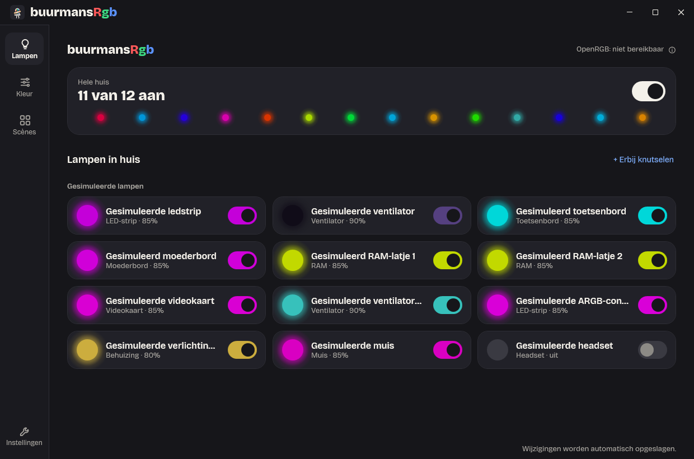
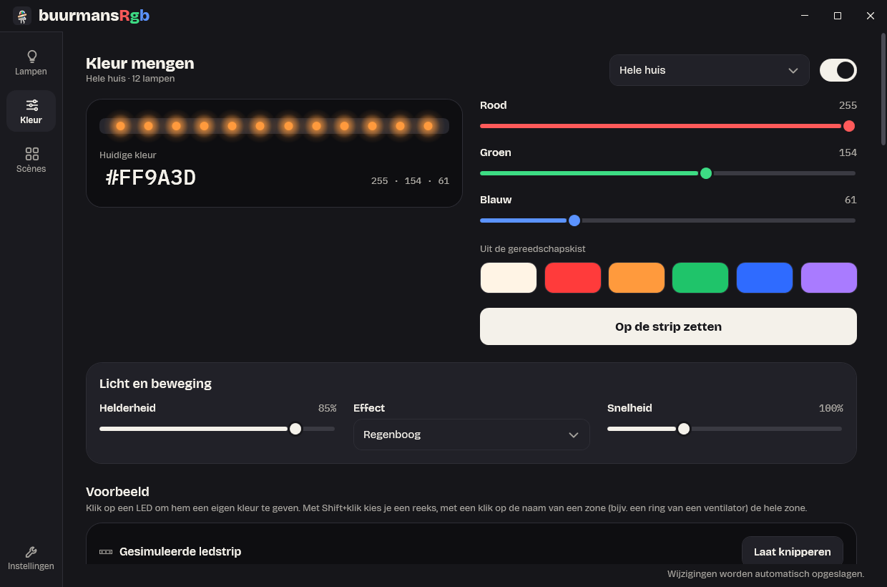
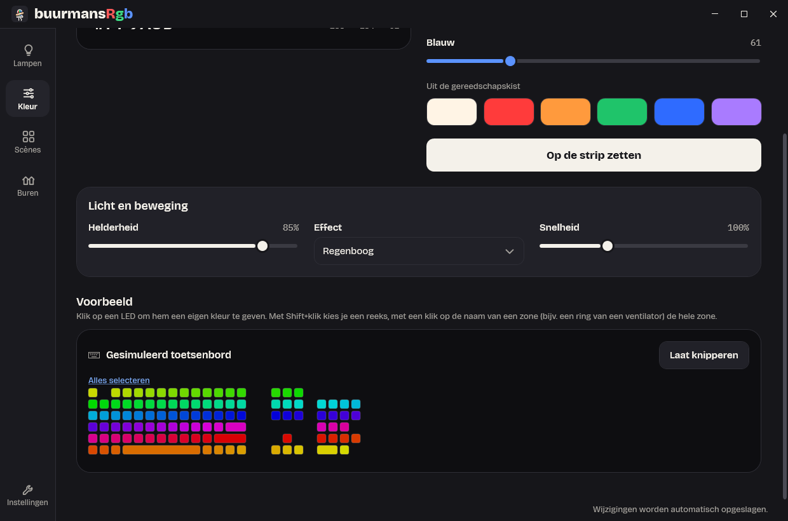
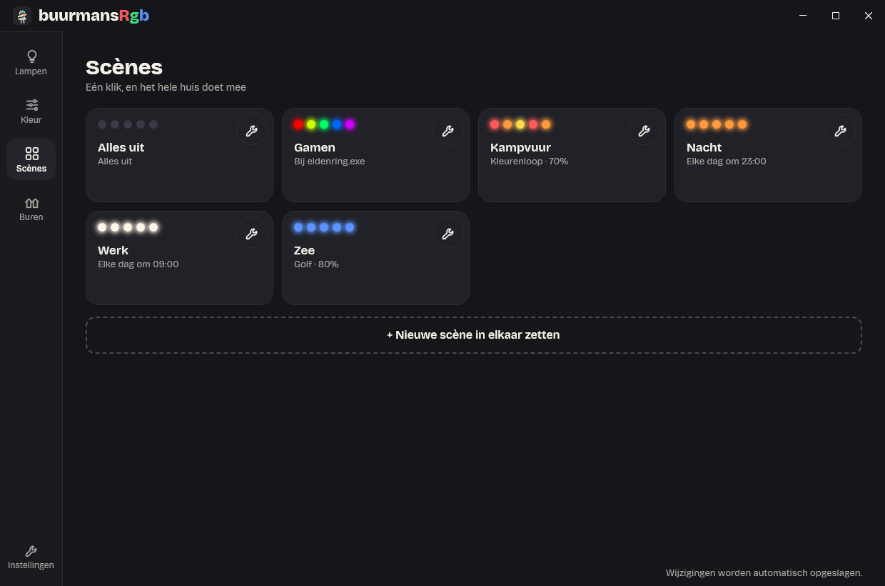

<p align="center">
  
</p>

<h1 align="center">BuurmansRgb</h1>

<p align="center">
  Alle RGB in je pc vanuit één rustige app: fans, strips, moederbord, RAM, videokaart,
  toetsenbord, muis en headset.
</p>



## Wat het doet

- **Eén plek voor alles.** BuurmansRgb stuurt je hardware via [OpenRGB](https://openrgb.org),
  dus geen aparte app per merk.
- **Licht op de achtergrond.** Een kleine engine met een tray-icoon houdt de lampen aan
  (minder dan 0,5 % van één CPU-kern, ~25 MB geheugen). De instellingen-app open je alleen als je iets wilt veranderen.
- **Kleur mengen en effecten:** statisch, ademen, regenboog, golf, een eigen kleurenloop, of
  per LED een eigen kleur. Helderheid en snelheid werken op elk effect.
- **Scènes** zoals "Gamen" of "Nacht": met één klik, uit het tray-menu, elke dag op een tijd of
  zolang een spel draait.
- **Slim met je pc:** pauzeert bij vergrendelen, slaapstand en scherm uit en zet de kleuren na
  het ontwaken terug.
- **Werkt zonder hardware:** zonder OpenRGB staan er twaalf gesimuleerde lampen klaar om mee te
  spelen.

| Kleur mengen | Voorbeeld per LED | Scènes |
| --- | --- | --- |
|  |  |  |

## Installeren

1. Download `BuurmansRgb-setup.exe` bij de
   [nieuwste release](https://github.com/FiekBuurman/BuurmansRgb/releases/latest).
2. Sluit fabrikantsoftware af (iCUE, Armoury Crate, Mystic Light, ...) en draai de setup.

De installer zet BuurmansRgb, OpenRGB (als service) en de driver PawnIO in één keer neer, met
één UAC-vraag; een losse .NET is niet nodig. Zelf bouwen kan ook, zie
[docs/installatie.md](docs/installatie.md).

## Zelf bouwen

```bash
dotnet build BuurmansRgb.slnx -warnaserror
dotnet test --solution BuurmansRgb.slnx
dotnet run --project src/BuurmansRgb.Engine
```

De engine verschijnt als tray-icoon; dubbelklik erop voor de instellingen-app. Alle tests
draaien zonder hardware. Meer in [docs/ontwikkelaars.md](docs/ontwikkelaars.md).

## Status

Taak 0 t/m 9 uit het [bouwplan](docs/bouwplan.md) zijn gebouwd, plus een reeks uitbreidingen.
Alles is getest met gesimuleerde lampen en de installer op een echte pc; het testen per
apparaattype op echte hardware staat nog open.

## Meer lezen

| Document | Waarover |
| --- | --- |
| [Handleiding](docs/handleiding.md) | De instellingen-app, het tray-icoon, pauzeren, de instellingenbestanden en per apparaattype |
| [Installatie](docs/installatie.md) | Installeren, bijwerken en verwijderen |
| [Voor ontwikkelaars](docs/ontwikkelaars.md) | Bouwen, testen, de installer, hoe de engine werkt en metingen |
| [Bouwplan](docs/bouwplan.md) | Architectuur, taken en de stand per taak |
| [Ideeën](docs/ideas.md) | Wat er nog kan komen |
| [Ontwerp](design/DESIGN.md) | Het ontwerp "Werkplaats bij nacht" |
