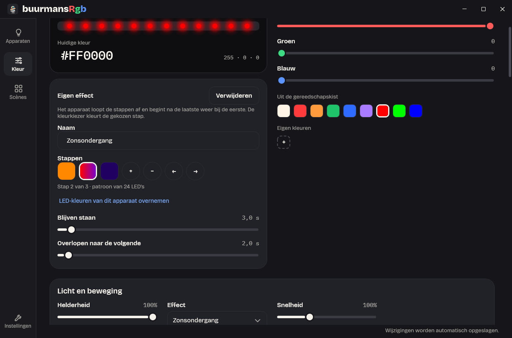

# Handleiding

Alles over het gebruik van BuurmansRgb: de instellingen-app, het tray-icoon, pauzeren, de
instellingenbestanden en hoe OpenRGB en de verschillende apparaten werken. Installeren staat in
[installatie.md](installatie.md); bouwen, testen en hoe het van binnen werkt in
[ontwikkelaars.md](ontwikkelaars.md).

## De instellingen-app

De app volgt het ontwerp "Werkplaats bij nacht" uit [design/DESIGN.md](../design/DESIGN.md):
altijd donker, zodat de kleuren van de apparaten gloeien, met een eigen titelbalk en links een
navigatiebalk met **Apparaten**, **Kleur**, **Scènes** en onderaan **Instellingen**.

- **Venster:** donkere titelbalk met het kleine icoon en het woordmerk. Slepen, dubbelklikken
  om te maximaliseren, Aero Snap en Alt+Spatie werken zoals altijd. Minimaal 960 × 640.
- **Toetsenbord:** met Tab kom je in de navigatiebalk, met de pijltjes kies je een pagina. Elke
  knop, kaart en schuif krijgt bij toetsenbordfocus een ring van 2 px, en in het voorbeeld de
  actieve LED (zie "Per-LED-editor").
- **Onderaan** staat wat er net gebeurde (bijv. "Scène 'Nacht' staat aan.") en rechts
  "Opgeslagen ✓" met de tijd zodra de engine je wijziging heeft weggeschreven, een seconde na
  de laatste wijziging. "Opslaan mislukt" betekent: de verlichting werkt, maar na een herstart is
  de wijziging weg. "De engine kon de wijziging niet verwerken." verdwijnt bij de volgende
  wijziging die wel lukt. Bestaat een scène die je aanzet, verwijdert of een tijd geeft niet
  meer (bijv. verwijderd in een tweede venster), dan staat er "Scène '…' bestaat niet meer." en
  toont de lijst de scènes zoals ze nu zijn.
- **Engine weg:** draait de engine niet, dan meldt het venster dat, met "Opnieuw proberen".
  Stopt de engine terwijl het venster open is, dan staat er dat de verbinding is verbroken.

### Apparaten


- Bovenaan het woordmerk en de OpenRGB-status in één regel, met een tip achter de ⓘ (bij
  aanwijzen of met Tab). Een schermlezer leest een nieuwe status voor.
- De kaart **Hele huis** zegt hoeveel apparaten aan zijn ("11 van 12 aan"), heeft een grote
  schakelaar voor alles en een strip van 14 bolletjes die laat zien wat de apparaten nu echt doen:
  elk bolletje is een LED uit alle apparaten achter elkaar, dus bij een regenboog loopt hij mee.
- **Apparaten in huis:** elk apparaat als kaart, de echte onder "Echte apparaten
  (OpenRGB)" en de gesimuleerde onder "Gesimuleerde apparaten", twee of drie naast elkaar. Op de
  kaart: een bolletje in de kleur van zijn felste LED, de naam, het type met de helderheid of
  "uit", zo nodig de plek (bijv. "Adres 0x52", zie "Welk apparaat is wat?") en
  "⚠ Volgt de kleur misschien niet", en een schakelaar in de kleur van het apparaat. Bij een heel
  donkere kleur is het spoor van de schakelaar lichter (zwart wordt grijs), zodat je de knop
  blijft zien.
- Een klik op een kaart opent het apparaat bij Kleur en laat het op de hardware knipperen.
  "+ Erbij knutselen" gaat naar Instellingen.
- **Verversen** (naast "+ Erbij knutselen") laat OpenRGB opnieuw naar apparaten zoeken. Gebruik
  het als een apparaat niet terugkomt, bijvoorbeeld een koptelefoon die je uit en weer aan zette.
  Zolang er gezocht wordt, staat er "Zoeken…"; nog een klik doet dan niets. Een apparaat dat
  terugkomt, krijgt zijn eigen kleur en effect weer. De lijst kan zich in stappen vullen: OpenRGB
  meldt elk apparaat dat het vindt. Is OpenRGB niet bereikbaar, dan zegt een melding onder de kop
  dat er niet gezocht is; die melding verdwijnt zodra OpenRGB weer verbonden is. Duurt het zoeken
  langer dan 15 seconden, dan zegt de melding dat apparaten die OpenRGB nog vindt vanzelf
  verschijnen. Kent OpenRGB de vraag om opnieuw te zoeken
  niet (versies voor 1.0) of antwoordt het niet binnen 5 seconden, dan verbindt BuurmansRgb
  opnieuw met OpenRGB en haalt het de apparatenlijst opnieuw op. De knop is met Tab te bereiken
  en een schermlezer leest de melding voor.

### Kleur


Bovenaan kies je een apparaat of "Hele huis" (een schermlezer noemt de keuze "Welk apparaat?"), met de
schakelaar ernaast.

- **Kleur mengen:** links een groot voorbeeld met een strip in de gemengde kleur, de hex-code
  (je kunt er ook een typen) en de R · G · B-waarden; rechts de schuiven Rood, Groen en Blauw
  (0–255, ook met de pijltjes), "Uit de gereedschapskist" met negen vaste kleuren (Klus-wit,
  Rood, Oranje, Groen, Blauw, Paars, en Echt rood, Echt groen en Echt blauw) met daaronder je
  eigen kleuren (zie "Eigen kleuren"), en de knop **Op de strip zetten**. Schuiven, hex-code en
  vaste kleuren laten de kleur meteen in het voorbeeld zien ("Nog niet op het apparaat"); pas de
  knop zet hem op het apparaat. Dat geldt voor de kleur van het hele apparaat. Heb je een kleur van de
  kleurenloop, een kleur van Fonkelen, Komeet, Scanner of Vuur, een stap van een eigen effect of
  LED's in het voorbeeld gekozen, dan is er geen knop: die kleur of LED's veranderen meteen mee
  terwijl je schuift, typt of een vaste kleur kiest (zie "Kleurenloop", "Kleuren van een effect",
  "Eigen effecten" en "Per-LED-editor"). Wat de kiezer kleurt, gaat in deze volgorde: gekozen
  LED's, dan de kleur van de loop of van het effect, dan de gekozen stap van een eigen effect, en
  anders het apparaat.
- **Een apparaat dat uit staat, gaat aan** als je er met de knop een kleur op zet, zoals bij de
  meeste lamp-apps: het komt meteen in de nieuwe kleur aan en de schakelaar (hier en op Apparaten)
  gaat mee. Dat geldt ook voor een kleur van de kleurenloop, van een effect of van een stap van
  een eigen effect en voor de per-LED-editor: daar gaat het apparaat aan bij de eerste kleur die
  je mengt, één keer. Alleen mengen voor het hele apparaat (zonder de knop), of + en − bij de
  kleuren, laat het uit. Bij "Hele huis"
  gaan alle apparaten aan als er één uit staat, want de kleur gaat naar allemaal. Kies je één
  apparaat, dan blijven de andere apparaten zoals ze zijn.
- **Licht en beweging:** de helderheid (0–100 %), het effect, de snelheid en bij Regenboog, Golf
  en een verspreide Kleurenloop de richting. De helderheid werkt op elk effect.
- **Hele huis of één apparaat:** een wijziging bij "Hele huis" geldt voor alle apparaten, maar
  alleen voor wat je wijzigt: zet je de helderheid, dan houdt een apparaat met een eigen kleur die
  kleur. Een wijziging bij één apparaat geldt alleen voor dat apparaat. Is een apparaat weer
  gelijk aan "Hele huis", dan volgt het "Hele huis" weer.
- **Eigen kleuren:** onder de vaste kleuren van de gereedschapskist. Het vakje **+** zet de
  huidige kleur van de kiezer erbij, achteraan de rij; hooguit 12, en elke kleur één keer (staat
  de kleur er al, of zijn het er 12, dan is + grijs). Een klik op een eigen kleur mengt hem, net
  als een vaste kleur. Weghalen doe je met rechts klikken en **Weghalen**, of met de toets
  **Delete** op het vakje dat de focus heeft; de focus gaat dan naar het vakje dat ervoor in de
  plaats komt, of naar +. De eigen kleuren gelden voor alle apparaten en blijven bewaard, ook
  als je de app sluit: de engine bewaart ze als `customColors` in `settings.json`. Een andere
  instellingen-app die tegelijk open is, ziet ze meteen. Ze zijn iets anders dan de kleuren van
  een effect (zie "Kleuren van een effect"): die horen bij een effect op een apparaat.
- **Loopt mee:** verandert de verlichting buiten de pagina (een scène uit het tray-menu, een
  scène die op tijd of bij een programma aangaat), dan tonen de schuiven,
  het effect, de snelheid, de richting, de kleurenloop en de kleuren van het effect meteen de
  nieuwe verlichting. Een kleur die je aan het mengen bent en nog niet op het apparaat hebt gezet,
  blijft staan, en een schuif die je net verschoof, springt niet terug. Komt er zo de kleurenloop,
  Fonkelen, Komeet, Scanner of Vuur op, dan toont het mengpaneel de gekozen kleur daarvan: die
  verandert meteen mee, dus de kleur die je voor het apparaat mengde vervalt.
  De gemengde kleur blijft ook staan als de apparaten opnieuw binnenkomen (een zone met een nieuwe
  lengte, apparaten die OpenRGB opnieuw meldt, de schakelaar **Zones gelijk**), zolang hetzelfde
  apparaat gekozen blijft. Verdwijnt het gekozen apparaat, dan toont de pagina "Hele huis" met
  zijn kleur.
- Zijn de effecten gepauzeerd, dan staat bovenaan een melding met de reden, bij de pauze uit het
  tray-menu met "Hervatten" (zie "Pauzeren").

#### Effecten

| Effect | In `settings.json` | Wat het doet |
| --- | --- | --- |
| Statisch | `static` | Eén kleur op alle LED's |
| Ademen | `breathing` | De kleur fadet in 4 seconden in en uit |
| Regenboog | `rainbow` | Alle tinten verdeeld over de LED's, schuift met 0,2 rondes per seconde |
| Golf | `wave` | Een band van de kleur die over de LED's loopt, 0,5 golf per seconde |
| Kleurenloop | `color-loop` | Je eigen 2–12 kleuren die in elkaar overlopen, 0,2 loop per seconde; over de LED's verdeeld of alle LED's tegelijk |
| Fonkelen | `twinkle` | LED's lichten willekeurig op en doven langzaam uit, elke fonkeling in een willekeurige kleur uit de kleuren van het effect (zonder eigen kleuren: de kleur van het apparaat). Elke LED krijgt ongeveer elke 1,7 seconde een kans, en op een lange strip grijpt een vijfde die, zodat losse LED's fonkelen (op een toetsenbord gloeit zo'n 13 % tegelijk); bij een apparaat van een paar LED's lichten er per keer toch ongeveer twee op, bij een muis van één of twee LED's elke LED elke keer. Elk apparaat fonkelt op zijn eigen manier, ook twee even lange |
| Komeet | `comet` | Een punt met een staart die achter hem uitdooft, 0,5 ronde per seconde naar de laatste LED en weer rond, zoals op een fan-ring; elke ronde in de volgende kleur van het effect (zonder eigen kleuren: de kleur van het apparaat), en de staart van de vorige ronde dooft uit in zijn eigen kleur; de staart is 30 % van de lengte. Bij een apparaat van minder dan vier LED's (een muis) staan de LED's verdeeld over een ring van vier: één LED pulseert, fel als de kop voorbijkomt en dan uitdovend, twee LED's om de beurt |
| Scanner | `scanner` | Een punt dat naar de laatste LED en terug gaat, zoals bij Knight Rider, 0,5 keer heen en terug per seconde, elke keer heen of terug in de volgende kleur van het effect (zonder eigen kleuren: de kleur van het apparaat); de kleur wisselt aan het eind, waar het punt omkeert; het remt af bij de uiteinden en trekt een staart die met zijn vaart meegroeit (tot een kwart van de lengte). Eén LED (een muis) licht op telkens als het punt voorbijkomt |
| Vuur | `fire` | Vuur dat onrustig flakkert, met vlammen van een paar LED's breed: een rustige laag die twee keer per seconde verandert en een snelle die er overheen flakkert. De hitte loopt van de eerste kleur van het effect (de gloed) via de andere naar de laatste (de felste vlam); zonder eigen kleuren is dat donkerrood, rood, oranje en geel. De kleur van het apparaat doet niet mee (zoals bij Regenboog). Elk apparaat brandt op zijn eigen manier; één LED (een muis) flakkert als een kaars |
| Per LED | `per-led` | Een eigen kleur per LED (zie "Per-LED-editor") |
| Een eigen effect, onder zijn eigen naam | `custom:` met een code, bijv. `custom:1a2b3c4d` | Je eigen stappen, elk met één kleur of een patroon over de LED's, die in elkaar overlopen (zie "Eigen effecten") |

- **Snelheid** (10–300 %, standaard 100 %) werkt alleen bij een bewegend effect; bij Statisch
  en Per LED staat de schuif grijs. Bij een eigen effect gaan alle tijden van de stappen mee: op
  200 % duurt een stap van 2 seconden er 1. Een nieuwe snelheid gaat verder waar de animatie
  was, en apparaten die samen een nieuwe snelheid krijgen, blijven gelijk lopen.
- **Richting** (0–359°) staat naast de snelheid, alleen bij Regenboog, Golf en een Kleurenloop
  die over de LED's verdeeld is. Zonder richting ("Volgorde" naast de schuif) lopen die effecten
  over de LED's in hun volgorde, zoals altijd. Verschuif je de schuif, dan lopen ze over de plek
  van de LED's: 0° naar rechts, 90° naar beneden, 180° naar links en 270° naar boven, met een
  pijltje naast de graden. Precies 0° kies je met Home op de schuif of een klik op het schuifje
  zelf. Op een toetsenbord loopt de regenboog zo bijv. schuin over de toetsen
  (45°: van linksboven naar rechtsonder), op een fan-ring van links naar rechts of van boven naar
  beneden. Een **strip** (of een andere zone zonder vorm) kan alleen vooruit of achteruit: tussen
  271° en 89° loopt hij zoals zonder richting, tussen 91° en 269° andersom, en op precies 90° of
  270° krijgen al zijn LED's dezelfde kleur. **Volgorde van de LED's** onder de schuif zet de
  richting weer uit. De richting geldt per apparaat, of bij "Hele huis" voor alle apparaten, elk
  over zijn eigen LED's: een effect loopt niet van het ene apparaat naar het andere. Heeft een
  apparaat meer zones, dan houdt elke zone zijn deel van het effect, zoals in de volgorde, en
  loopt het binnen elke zone in de richting; met **Zones gelijk** loopt het over de langste zone
  en krijgen de andere dat beeld. De plekken zijn die van het voorbeeld: de toetsen uit de
  matrix-map van OpenRGB (een brede toets als de spatiebalk in het midden van zijn vakjes), een
  fan-ring als cirkel met LED 1 bovenaan en met de klok mee, en verder een rij. OpenRGB weet niet
  waar LED 1 van een echte fan zit en welke kant hij op telt; loopt de kleur op de fan zelf een
  andere kant op dan in het voorbeeld, draai dan de hoek bij. Een apparaat onthoudt zijn richting
  ook bij een ander effect, en een scène neemt hem mee.
- **Kleurenloop:** kies het effect, dan verschijnen onder het kleurvoorbeeld de kleuren van de
  loop. Klik op een kleur (hij krijgt een dikke witte rand) en meng een nieuwe, met de hex-code
  erboven of met de schuiven en vaste kleuren rechts: het vakje
  en het apparaat veranderen meteen mee, en de loop wordt bewaard. Klik je daarna een andere kleur,
  dan houdt de vorige wat je mengde. + voegt een kleur toe na de gekozen, − haalt de gekozen
  weg. Een loop heeft 2 tot 12 kleuren; de vakjes staan in rijen van hooguit zes, met + en −
  rechts naast de eerste rij (in een smal venster eronder). Zonder vinkje bij "Kleuren over de
  LED's verdelen" krijgen alle LED's tegelijk dezelfde kleur. Een apparaat onthoudt zijn loop, ook als je
  tussendoor een ander effect kiest. Standaard: geel, groen, blauw.
- **Kleuren van een effect:** bij Fonkelen, Komeet, Scanner en Vuur verschijnen onder het
  kleurvoorbeeld "Kleuren van het effect", met dezelfde vakjes, + en − als bij de kleurenloop,
  en een regel die zegt wat de kleuren doen. Klik op een vakje en meng een nieuwe kleur: het
  vakje en het apparaat veranderen meteen mee. Een effect heeft 1 tot 12 kleuren. Wat ze doen:
  - **Komeet:** elke ronde de volgende kleur, en na de laatste weer de eerste.
  - **Scanner:** elke keer heen of terug de volgende kleur.
  - **Fonkelen:** elke fonkeling een willekeurige kleur uit de lijst; een fonkeling houdt zijn
    kleur tot hij uit is.
  - **Vuur:** de vlammen lopen van de eerste kleur (de gloed, het koudst) via de andere naar de
    laatste (de felste vlam). Zet ze dus van donker naar licht, bijv. donkerblauw, blauw,
    lichtblauw en wit voor blauw vuur, of donkergroen, groen en geelgroen voor "gif". Met één
    kleur flakkert die tussen een donkere versie van zichzelf en zichzelf.

  Elk effect heeft zijn eigen kleuren per apparaat: kies je Komeet en daarna Vuur, dan houdt de
  komeet zijn kleuren voor als je hem weer kiest. Ze gaan mee in een scène. Zolang je de kleuren
  van Komeet, Scanner of Fonkelen niet aanpast, is dat één kleur: de kleur van het apparaat (de
  kleur van Statisch, Ademen en Golf). Een bestaand apparaat of een bestaande scène met zo'n
  effect ziet er dus hetzelfde uit als vóór er kleuren per effect waren, en Vuur zonder eigen
  kleuren brandt warm, zoals altijd: donkerrood, rood, oranje en geel. Pas je de kleuren aan, dan
  doet de kleur van het apparaat bij dat effect niet meer mee; hij blijft bewaard voor de
  effecten met één kleur. "Op de strip zetten" is er bij deze effecten niet, want de schuiven
  kleuren het gekozen vakje. Golf en Ademen hebben nog één kleur.

  **Standaardkleuren** onder de vakjes haalt de eigen kleuren van het gekozen effect weg: Komeet,
  Scanner en Fonkelen volgen weer de kleur van het apparaat (ook als je die later verandert), Vuur
  brandt weer in zijn vier warme kleuren. De andere effecten houden hun kleuren. Met "Hele huis"
  gekozen geldt dat voor alle apparaten, ook voor een apparaat met eigen kleuren. De knop is alleen te
  gebruiken als het effect eigen kleuren heeft; bij "Hele huis" telt daarvoor wat "Hele huis"
  zelf heeft.

#### Eigen effecten



Een eigen effect maak je van **stappen**. Elke stap is één kleur voor het hele apparaat, of een
patroon over de LED's, en heeft twee tijden: hoe lang hij **blijft staan** en hoe lang hij
**overloopt** naar de volgende stap. Na de laatste stap begint het weer bij de eerste. Zo maak je
bijv. een zwaailicht (rood en blauw, elk 0,3 s, zonder overlopen) of een zonsondergang (oranje,
een verloop van rood naar paars, donkerblauw, met een paar seconden overlopen).

- **Maken:** kies bij "Licht en beweging" **+ Eigen effect maken** onder het effect. Er komt een
  effect "Eigen effect 1" (of 2, 3, …) met twee stappen, de kleur van het apparaat en zwart, elk
  1 seconde met 1 seconde overlopen, en het apparaat (of bij "Hele huis" alles) toont het meteen.
  Je kunt tot 32 eigen effecten maken; daarna is de link grijs.
- **Kiezen:** de eigen effecten staan in de effectkeuze onder hun naam, na de gewone effecten en
  op alfabet. Ze gelden voor alle apparaten: hetzelfde effect kan op meer apparaten tegelijk
  staan, elk met zijn eigen helderheid en snelheid.
- **Aanpassen:** met een eigen effect gekozen staat onder het kleurvoorbeeld het paneel **Eigen
  effect**. Elke wijziging gaat meteen naar de engine, die hem in `effects.json` bewaart, en de
  apparaten met dit effect (en het voorbeeld onderaan) laten hem meteen zien; een tweede
  instellingen-app die open is, ook:
  - **Naam:** typ een nieuwe naam en druk Enter of Tab. Een naam is 1 tot 40 tekens, en twee
    eigen effecten kunnen niet dezelfde naam hebben (hoofdletters tellen niet); dan staat er
    een melding onder het vak en blijft de oude naam.
  - **Stappen:** de vakjes, in rijen van hooguit zes; een patroon staat als verloop in het vakje.
    Klik op een stap (hij krijgt een dikke witte rand) en meng een kleur met de schuiven, de
    hex-code of de gereedschapskist: de stap verandert meteen mee. Een patroon wordt dan één
    kleur. **+** voegt een stap toe na de gekozen, als kopie ervan; **−** haalt de gekozen weg
    (een effect houdt minstens één stap, en heeft er hooguit 32); **←** en **→** zetten de stap
    een plek naar voren of naar achteren. Met de toets **Delete** op een stap haal je hem ook
    weg; de focus gaat naar de stap die ervoor in de plaats komt.
  - **LED-kleuren van dit apparaat overnemen:** maakt van de gekozen stap een patroon met de
    kleuren die je bij **Per LED** aan de LED's van het gekozen apparaat gaf (zie
    "Per-LED-editor"; een LED zonder eigen kleur telt met de kleur van het apparaat). Werkwijze:
    kies het apparaat, kies Per LED en kleur de LED's, kies dan je eigen effect, kies de stap en
    neem de kleuren over. Bij "Hele huis" is de link grijs: kies eerst een apparaat.
  - **Blijven staan** en **Overlopen naar de volgende:** de tijden van de gekozen stap, van 0 tot
    60 seconden in stappen van 0,1 s (de pijltjes 0,1 s, Page Up en Page Down 1 s). Een stap
    met 0 en 0 slaat het effect over. Overlopen gaat per LED van zijn kleur in deze stap naar
    zijn kleur in de volgende.
  - **Verwijderen** haalt het effect weg, zonder te vragen. Apparaten die het tonen, krijgen
    Statisch in hun eigen kleur, en de focus gaat naar de effectkeuze.
- **Patroon op een ander apparaat:** een patroon wordt over de LED's van het apparaat **uitgerekt**
  (of samengedrukt), net als bij "Zones gelijk": elke LED krijgt de kleur op dezelfde plek in
  het patroon. Een patroon van een toetsenbord loopt op een fan dus ook van begin tot eind, en
  een patroon van 24 LED's op een strip van 48 geeft elke kleur twee LED's. Het patroon volgt de
  volgorde van de LED's, niet de richting (die schuif is er bij een eigen effect niet).
- **Scènes:** een scène neemt het gekozen eigen effect mee, maar als verwijzing: pas je het effect
  later aan, dan ziet de scène er ook anders uit. Verwijder je het effect, dan toont een scène met
  dit effect Statisch in de kleur van het apparaat. De scènekaart zegt bij een eigen effect
  "Eigen effect", niet zijn naam, met bolletjes in de kleur van het apparaat.
- Een eigen effect met één stap staat stil, net als Statisch: er draait dan geen animatie.

#### Voorbeeld


Onder "Licht en beweging" staat per apparaat een kaart met het icoon van zijn type, de naam en
**Laat knipperen**, en per zone een bolletje per LED. Het toont wat de engine echt rendert,
ook als de effecten gepauzeerd zijn, met hooguit 20 beelden per seconde. Op een pagina zonder
voorbeeld (Scènes, Instellingen) of met het venster geminimaliseerd stuurt de engine
geen beelden; terug op Apparaten of Kleur staat meteen het nieuwste beeld er.

- **Zones** staan er met naam en aantal LED's zoals OpenRGB ze geeft; een apparaat met één zone
  toont geen zonenaam. Naast de naam van een zone met LED's staat **Knipperen** (zie "Welk
  apparaat is wat?"), behalve bij "Overige LED's": de LED's die OpenRGB bij geen zone indeelt.
- **Zones gelijk:** een apparaat met twee of meer zones met LED's heeft onder zijn naam de
  schakelaar **Zones gelijk**, met in één regel wat hij doet (meer in de tooltip). Aan rendert
  het effect één keer, over de langste zone, en krijgt elke andere zone hetzelfde beeld,
  uitgerekt over zijn eigen lengte. Zo hebben bijv. de twee
  zones van één LED van een Logitech-muis ("Primary Zone" en "Logo Zone") in een regenboog
  dezelfde kleur, en lopen de binnen- en buitenring van een fan gelijk op. "Overige LED's" doen
  mee als een zone. Het voorbeeld laat zien wat de apparaten dan krijgen. Bij Statisch, Ademen en
  de kleurenloop met alle LED's tegelijk maakt het geen verschil; bij Per LED houdt elke LED
  zijn eigen kleur, ook met de schakelaar aan. De keuze geldt per apparaat, blijft bewaard (zie
  `zonesAlike` bij "settings.json") en hoort niet bij een scène: een scène laat hem zoals hij
  is. Knipperen werkt zoals altijd: een zone knippert alleen. Een kleur die je aan het mengen
  bent, blijft staan als je de schakelaar omzet (zie "Loopt mee").
- **Fans** (in OpenRGB het type "cooler", dus ook een AIO-pomp) tekent het voorbeeld per zone
  als ring, met LED 1 bovenaan en dan met de klok mee. OpenRGB zegt niet waar LED 1 echt zit;
  de wijzerplaat is dus een keuze. Een zone waarvan je de lengte instelt, of een zone van meer
  dan 48 LED's, blijft een rij: dat is meestal een kanaal van een hub met een strip of meer
  fans erop.
- **Toetsenborden** met een matrix-map van OpenRGB tonen elke LED als toets op zijn plek, en
  maken de toetsen kleiner in een smal venster. LED's buiten de map (bijv. een logo) staan in
  een rij eronder. Met toetsnamen tekent het voorbeeld Tab, Caps Lock, Shift, Ctrl, Backspace,
  Enter, de spatiebalk en de 0 van het numerieke blok breder over de lege vakjes ernaast.
- **Namen:** wijs een LED aan voor zijn naam en nummer, bijv. "Escape (LED 1)", of "LED 5"
  zonder naam. Een schermlezer noemt de LED's zo ook, en kan ze selecteren zoals een klik; de
  apparaten en zones in het voorbeeld noemt hij bij hun naam.
- **Lengte van een zone:** bij een zone die OpenRGB in lengte laat instellen (een ARGB-header
  of -kanaal) staat "Aantal LED's (0–120):" met het bereik, en −, +, een schuif, een vak en
  "Toepassen". − en + doen één LED per klik en blijven herhalen zolang je ze ingedrukt houdt.
  Met −, + en de schuif groeit het voorbeeld meteen; de zone zelf krijgt de lengte
  pas als je 0,6 seconde niets verandert of de schuif loslaat, want OpenRGB laadt bij elke
  nieuwe lengte zijn apparaten opnieuw. Typen en "Toepassen" (of Enter) gaat meteen. Een zone
  met 0 LED's zegt "Nog geen LED's ingesteld", met uitleg. De lengte wordt bewaard (zie
  `zoneLengths` bij "settings.json").
- **LED's tellen:** weet je niet hoeveel LED's de fan of strip op een header heeft, kies dan
  **Tellen**, naast "Knipperen" (bij een apparaat met één zone staat het rechts boven de LED's).
  De zone gaat even naar zijn grootste aantal LED's en er gaat elke seconde één LED meer aan: de
  nieuwste groen, die ervoor wit, de rest van de zone uit; de rest van het apparaat houdt zijn
  effect. In het voorbeeld staat, op de plek van de lengte, een grote teller ("LED 37") met:
  - **Pauze** en **Doorgaan**: zet het tellen stil op de LED die de teller dan zegt;
  - **−** en **+**: één LED terug of verder (dat pauzeert het tellen ook);
  - **LED's per seconde** 1, 2 of 5;
  - **Dit is de laatste**: de zone krijgt zoveel LED's als de teller zegt, net als met
    "Toepassen", en het tellen stopt;
  - **Stoppen**: het tellen stopt en de zone krijgt zijn eigen aantal LED's terug.

  Zo werkt het: kijk naar de fan of strip; gaat de groene LED niet meer aan, kies dan Pauze, ga
  met − terug tot de laatste LED groen is en kies "Dit is de laatste". Na de laatste LED die de
  zone kan hebben, stopt het tellen vanzelf; Doorgaan begint dan weer bij LED 1. Nog eens
  Tellen begint ook opnieuw bij LED 1. Er telt steeds één zone. Het tellen stopt ook, en de zone
  krijgt zijn eigen aantal LED's terug, als je een andere zone laat tellen, een ander apparaat
  kiest, van Kleur weggaat, de app sluit, op Verversen klikt, of als de effecten pauzeren (via
  het tray-menu, of omdat Windows vergrendelt, slaapt, het scherm uitgaat of de
  schermbeveiliging start); bij een pauze is Tellen grijs. Verdwijnt het apparaat, of krijgt de
  zone ergens anders een ander aantal LED's (bijv. in de app van OpenRGB), dan stopt het tellen
  zonder iets terug te zetten. Een telling die je in een tweede venster van de app startte, telt
  daar door als je hier een ander apparaat kiest of van Kleur weggaat; hier zie je hem ook, en
  Stoppen werkt in beide. Tellen verandert de verlichting niet, en de grootste lengte wordt
  nooit bewaard; "Dit is de laatste" bewaart de lengte die je koos. Had de zone nog geen
  bewaarde lengte, dan bewaart Tellen wel zijn eigen aantal LED's (niet 0) in `zoneLengths`,
  zodat de zone dat terugkrijgt als de engine halverwege het tellen stopt. Een schermlezer noemt
  de teller bijv. "Teller van Moederbord – ARGB 1: LED 37 van 60" en leest de regel eronder voor
  als het tellen pauzeert, doorgaat of een ander tempo krijgt, niet bij elke LED. Met Tab bereik
  je alle knoppen; de tempo's zijn keuzerondjes.

#### Per-LED-editor

Klik in het voorbeeld op een LED om hem te kiezen; Shift+klik kiest een reeks vanaf de vorige
klik, en een klik op de naam van een zone kiest die hele zone (bijv. één ring van een fan).
Een apparaat met maar één zone heeft daar "Alles selecteren", dat al zijn LED's kiest. Zolang er
LED's gekozen zijn, staat boven het mengpaneel welke dat zijn en gaat de kleur alleen naar die
LED's, meteen terwijl je schuift, een hex-code typt of een vaste kleur kiest;
de knop "Op de strip zetten" is dan weg. Staat het apparaat uit, dan gaat het aan bij de eerste
kleur, ook bij "Verloop vullen". Kies je een andere LED, dan toont het mengpaneel diens kleur;
de LED's ervoor houden wat je mengde.

- **Met het toetsenbord:** ga met Tab naar de LED's van een apparaat; de actieve LED krijgt een
  witte ring van 2 px en zijn naam als tooltip, die terugkomt als de muis van de LED's af gaat.
  Tab stopt één keer per apparaat, bij de zone met de actieve LED; die begint bij LED 1 en is
  daarna de laatste die je koos of aanklikte. Krijgt een zone een andere lengte, dan blijft hij
  op zijn plek in zijn zone, of op de laatste LED die die zone nog heeft. Staat de focus al in
  de LED's en klik je bij "Hele huis" op een LED van een ander apparaat, dan gaat de focus mee
  naar die LED; werk je alleen met de muis, dan blijft de focus waar hij was.

  | Toets | Wat het doet |
  | --- | --- |
  | ← en → | Naar de vorige of volgende LED, ook door naar de zone ervoor of erna |
  | ↑ en ↓ | Naar de LED in de rij erboven of eronder (op een toetsenbord de toets erboven of eronder); vanaf de bovenste of onderste rij naar de laatste LED van de zone erboven of de eerste van de zone eronder. Een ring heeft geen rijen: daar gaan ↑ en ↓ meteen naar de zone ervoor of erna |
  | Home en End | Naar de eerste of laatste LED van het apparaat |
  | Spatie of Enter | Kiest de actieve LED, zoals een klik |
  | Shift+pijltje, Shift+Home of Shift+End | Breidt de reeks uit tot de LED waar je heen gaat, zoals Shift+klik; zonder keuze begint de reeks bij de LED waar je vandaan kwam |
  | Ctrl+A | Kiest alle LED's van het apparaat, zoals "Alles selecteren" |
  | Escape | Heft de selectie op, zoals "Selectie opheffen" |

  Daarna ga je met Shift+Tab terug naar boven, naar de schuiven en de vaste kleuren: elke
  stap kleurt de gekozen LED's meteen.
  Een schermlezer noemt de actieve LED bij zijn naam en zegt of hij gekozen is.
- **Verloop vullen** vult de reeks met een verloop van de kleur van de eerste naar die van de
  laatste LED (geef die dus eerst een kleur).
- **Selectie opheffen**, een ander apparaat kiezen of een ander effect dan Per LED kiezen, geeft
  het mengpaneel weer aan het apparaat (bij Kleurenloop aan de kleur van de loop); een kleur zet
  het apparaat dan niet terug op Per LED.
- Het apparaat krijgt bij de eerste wijziging het effect "Per LED". LED's die je niet kleurt,
  volgen de kleur van het apparaat. De kleuren blijven bewaard, ook als je tussendoor een ander
  effect kiest of een zone van lengte verandert.

### Scènes


Een scène bewaart de verlichting van alle apparaten onder een naam (in de code en in
`profiles.json` heet dat een profiel). De scènes staan als kaarten, drie of vier naast elkaar:
vijf bolletjes met de kleuren van de scène (bij Komeet, Scanner en Fonkelen de kleuren van het
effect om de beurt; bij Vuur zijn kleuren heen en terug, met drie of meer kleuren zonder de
eerste, de gloed: zonder eigen kleuren rood, oranje, geel, oranje en rood; van meer dan vijf
kleuren zie je de eerste vijf), de naam en wanneer
hij vanzelf aangaat ("Elke dag om 23:00", "Bij eldenring.exe"), of anders wat hij laat zien
("Regenboog · 80%", "Alles uit").

- **Een klik op een kaart** zet de scène aan: kleur, helderheid, aan/uit, effect, snelheid,
  richting, kleurenloop, kleuren van de effecten en per-LED-kleuren van alle apparaten worden die
  van de scène, en ook de opgeslagen verlichting.
- **"+ Nieuwe scène in elkaar zetten"** vraagt een naam en bewaart de verlichting zoals die nu
  is.
- **De moersleutel** op een kaart kiest de scène (lichtere rand) en toont eronder "Aanzetten",
  "Overschrijven met wat nu brandt", "Verwijderen" (vraagt eerst of het zeker is) en
  "Vanzelf aanzetten".
- **Vanzelf aanzetten:** vul bij "Aanzetten om" een tijd in (`23:00` of `23.00`) en/of bij
  "Aanzetten als dit programma start" de naam van een .exe (`eldenring.exe`; `eldenring` of een
  heel pad mag ook), en kies "Toepassen". Leeg en "Toepassen" zet het uit. Achter elke tijd
  staan zijn dagen, ma t/m zo; standaard alle zeven. Klik een dag aan of uit, bijv. alleen
  ma t/m vr voor "Werk"; zonder tijd zijn ze grijs. De kaart zegt dan "Werkdagen om 09:00",
  "In het weekend om 10:00" of "ma, wo, vr om 19:00".
  Een snelkoppeling of script (`.lnk`, `.url`, `.bat`, `.cmd`) weigert de app: vul het doel
  in (Eigenschappen van de snelkoppeling). Weet je de naam niet, kies dan onder het veld bij
  "Kies uit wat nu draait" een programma dat nu een venster heeft (start het spel eerst), of
  kies "Bladeren…" en zoek het .exe-bestand op; alleen de naam komt in het veld. Met een vinkje
  bij "Alleen als het op de voorgrond staat" (daaronder, grijs zonder programma) telt het
  programma alleen zolang je het voor je hebt, zie "Alleen op de voorgrond" hieronder.
- **Meer tijden:** "+ Nog een tijd" zet onder de tijden een lege rij erbij, met eigen dagen;
  zo gaat "Ochtend" om 07:00 op werkdagen en om 09:00 in het weekend aan. Een scène kan tot acht
  tijden hebben. "−" achter een rij haalt die tijd weg (de enige tijd wordt leeg), en een lege
  rij telt niet mee. Klopt een tijd niet, dan zegt de melding welke ("Tijd 2: kies minstens één
  dag."). Na "Toepassen" staan de tijden van vroeg naar laat, en wordt twee keer dezelfde tijd
  één tijd op de dagen van allebei; het veld waarin je typte houdt de focus. De kaart noemt de
  eerste tijd en hoeveel er nog zijn: "Werkdagen om 07:00 en nog 1". Een andere geopende
  instellingen-app ziet de nieuwe tijden meteen op de kaart.
- **De scène die aan staat** heeft een witte rand van 2 px, zoals in het ontwerp, en in het
  tray-menu een vinkje; een schermlezer zegt "Staat aan". Dat is de scène die het laatst aanging
  (met een klik, uit het tray-menu, op tijd of bij een programma) of die je net opsloeg of
  overschreef. Verandert de verlichting daarna op een andere manier (een kleur, de helderheid,
  een apparaat uit), dan staat er geen scène meer aan. Stopt een spel met een eigen scène, dan staat
  de scène van daarvoor weer aan. Ook na een herstart van de engine (of de pc) staat dezelfde
  scène nog aan, zolang hij nog bestaat.
- Zonelengtes en "Zones gelijk" horen niet bij een scène.

Hoe het vanzelf aanzetten werkt:

- **Op tijd:** elke dag om die tijd zet de engine de scène aan, net alsof je op de kaart klikte.
  Het is de klok van Windows: bij zomer- en wintertijd blijft 23:00 gewoon 23:00; een tijd in
  het uur dat wegvalt komt na dat uur, een tijd in het dubbele uur alleen de eerste keer.
  Slaapt de pc, staat hij uit of zet je de klok erover heen, dan slaat de engine die keer over
  (ook als de timer meer dan een minuut te laat afgaat): na een nacht slaapstand komt "Nacht"
  's ochtends niet alsnog, tenzij "Gemiste tijden inhalen" aan staat (hieronder). Hebben twee
  scènes dezelfde tijd, dan wint de eerste op alfabet. Met meer tijden gaat de scène op elk van
  die tijden aan, elke tijd op zijn eigen dagen.
- **Gemiste tijden inhalen** (bij Instellingen, standaard uit): dan gaat na het ontwaken en bij
  het starten de scène aan van de tijd die het laatst voorbij is, op de gekozen dagen en
  hooguit een week terug. Bij scènes met meer tijden telt elke tijd mee: met "Ochtend" om 07:00
  en 13:00 en "Middag" om 10:00 geeft starten om 14:00 "Ochtend".
  - *Na het ontwaken* alleen als er in de slaap een tijd voorbij kwam, en pas als de apparaten terug
    zijn (na zo'n 2 seconden, zie "Na slaapstand" onder "Per apparaattype"). Kwam er geen tijd
    voorbij, dan blijft de verlichting zoals hij was, ook als je na de laatste tijd zelf iets
    koos. Voorbeeld met "Avond" om 20:00 en "Nacht" om 23:00: slaap van 21:00 tot 08:00 geeft
    "Nacht"; slaap van 20:30 tot 22:00 laat alles zoals het was. Ook een tijd vlak voor het
    ontwaken telt: wakker om 23:00:30 geeft "Nacht".
  - *Bij het starten* van de engine (of de pc) wint de tijd altijd, ook van de scène die voor de
    herstart aan stond: wat er gebeurde terwijl de engine niet draaide, weet hij niet. Is de
    scène van de tijd al de scène die aan staat, dan gebeurt er niets. Dat geldt bij elke
    herstart: kies je om 21:00 zelf "Gamen", sluit je de engine af ("Afsluiten") en start je hem
    weer, dan staat "Avond" weer aan.
  - Draait er een programma met een eigen scène, dan komt de scène van de tijd pas als het
    programma stopt, zoals bij "Tijd tijdens een spel". Ook bij het starten gaat dan alleen de
    scène van het programma naar de apparaten.
  - De klok verzetten haalt niets in; dat doet alleen ontwaken of starten, en na het ontwaken
    alleen een tijd die in de slaap viel. Aanzetten zet nog niets aan: het geldt vanaf het
    volgende ontwaken of de volgende start.
- **Bij een programma:** start het programma, dan staat de scène binnen 2 seconden aan. Stopt
  het, dan komt de verlichting van daarvoor terug, tenzij je die intussen veranderde. Bij twee
  programma's met een scène toont het laatst gestarte de zijne; stopt dat, dan komt die van
  het eerste terug. Een programma dat al draait als je het instelt, telt pas bij zijn volgende
  start; draait het al als de engine start, dan gaat de scène meteen aan. Sluit je de engine
  af terwijl het programma draait, dan zet hij eerst de verlichting van daarvoor terug en
  bewaart die. Zolang Windows vergrendeld is of slaapt, kijkt de engine niet naar programma's,
  ook als "Pauzeren bij vergrendelen, slaapstand en scherm uit" uit staat; de scène van een spel
  blijft dan staan. Gaat alleen het scherm uit of loopt de schermbeveiliging, dan kijkt hij wel.
  Meteen na het ontgrendelen of ontwaken kijkt hij één keer: een programma dat intussen
  startte, zet dan zijn scène aan, en een dat intussen stopte, zet de verlichting van daarvoor
  terug. Alleen een tijd die intussen komt, laat hem één keer eerder kijken (zie hieronder).
- **Alleen op de voorgrond** (standaard uit): met het vinkje gaat de scène aan zodra een venster
  van het programma op de voorgrond komt (je klikt erop of wisselt er met Alt+Tab naartoe),
  meteen en niet pas binnen 2 seconden, en komt de verlichting van daarvoor terug zodra je naar
  iets anders wisselt of het programma stopt. Draait het alleen op de achtergrond, dan telt het
  niet. De kaart zegt dan "Bij vlc.exe op de voorgrond". Handig voor bijv. een filmspeler of een
  tekenprogramma dat je de hele dag open laat staan.
  - *Twee van zulke programma's:* wissel je van het ene naar het andere, dan gaat de ene scène
    rechtstreeks over in de andere, zonder de verlichting van daarvoor ertussen. Wissel je daarna
    naar een derde programma, dan komt de verlichting van vóór het eerste terug.
  - *Wat niet als wegwisselen telt:* de taakbalk en het pijltje met de verborgen icoontjes naast
    de klok, het venster van Alt+Tab en Win+Tab, het startmenu en zoeken, meldingen en snelle
    instellingen, het vergrendelscherm, de schermbeveiliging en het tray-menu van BuurmansRgb
    zelf. Dan blijft het zoals het was. Het bureaublad, Verkenner en de
    instellingen-app van BuurmansRgb tellen wel als een ander programma: open je de app om de
    scène bij te stellen, dan brandt daar de verlichting van daarvoor.
  - *Samen met "zolang het draait":* de scène die het laatst aanging wint, zoals bij twee
    spellen. Start er een spel met een eigen scène terwijl de filmspeler vooraan staat, dan toont
    het spel de zijne, ook als je daarna van de film wegwisselt; stopt het spel, dan komt de
    verlichting van daarvoor terug. Wissel je tijdens een spel naar de filmspeler en weer terug,
    dan komt de scène van het spel terug.
  - *Zelf iets veranderd* terwijl het programma vooraan stond: dat blijft bij het wegwisselen.
    Elke keer dat het programma weer op de voorgrond komt, telt als een nieuwe start.
  - *Tijden* wachten zoals bij een spel (hieronder): komt een tijd terwijl het programma vooraan
    staat, dan komt de scène van die tijd zodra je wegwisselt.
  - *Vergrendeld of slaapstand:* dan telt de voorgrond niet en blijft de scène staan; meteen na
    het ontgrendelen of ontwaken telt wat dan vooraan staat.
  - *Apps uit de Microsoft Store* met een eigen Store-venster (zoals Films en tv of Foto's)
    herkent hij nog niet op de voorgrond: Windows geeft hun venster aan `ApplicationFrameHost.exe`
    in plaats van aan de app zelf. Gewone programma's, ook als je ze uit de Store haalde, tellen
    wel.
  - Zet je het vinkje aan of uit terwijl het programma draait, dan blijft de verlichting zoals
    hij is; het programma telt weer vanaf de volgende keer dat het op de voorgrond komt (of
    start). Sluit het programma zonder dat er een ander venster vooraan komt, dan ziet de engine
    dat binnen 2 seconden: zolang zo'n scène aan staat, kijkt hij ook in de proceslijst.
- **Tijd tijdens een spel:** komt een tijd terwijl een programma zijn scène toont, dan blijft
  die staan en komt de scène van de tijd zodra het programma stopt; heb je tijdens het spel
  zelf iets veranderd, dan komt hij meteen. Komt de tijd terwijl Windows vergrendeld is of
  slaapt, dan kijkt de engine eerst één keer of het programma nog draait: stopte het intussen,
  dan komt de scène van de tijd meteen, en niet pas na het ontgrendelen.

### Instellingen

- **OpenRGB:** de status met de tip uitgeschreven.

  | Wat je ziet | Wat er aan de hand is |
  | --- | --- |
  | OpenRGB: verbinden… | De engine is net gestart, of de verbinding viel weg en de volgende poging komt zo |
  | OpenRGB: verbonden, 5 apparaten | Verbonden; OpenRGB gaf zoveel apparaten |
  | OpenRGB: verbonden, geen apparaten gevonden | Verbonden, maar OpenRGB gaf geen apparaten |
  | OpenRGB: niet bereikbaar | Niets nam de verbinding aan op `127.0.0.1:6742`: OpenRGB draait niet of de SDK-server staat uit. Tip: herstart de pc of draai de installer opnieuw |
  | OpenRGB: geen goed antwoord | Er antwoordde wel iets, maar verbinden of de apparaten ophalen mislukte |

- **Gesimuleerde apparaten:** bij "Gesimuleerde apparaten tonen"
  kies je "Automatisch" (standaard: alleen zolang OpenRGB geen echte apparaten levert), "Altijd"
  of "Nooit". De engine wisselt meteen en bewaart de keuze. Bij "Automatisch" wacht de engine
  bij het starten op de eerste verbindpoging met OpenRGB, zodat de gesimuleerde apparaten op een
  pc met echte apparaten niet even verschijnen; zonder OpenRGB komen ze er na die poging bij.
  Gesimuleerd zijn er een strip
  (30 LED's), een fan (12), een toetsenbord (104, met de plek en naam van elke toets), een
  moederbord (7, in drie zones, met een lege ARGB-header), twee RAM-sticks (8), een videokaart
  (13, in twee zones), een fan met twee ringen (20), een ARGB-controller (20, in twee
  kanalen), verlichting in de behuizing (10), een muis (12, in vier zones) en een headset (2,
  in twee zones). Ze heten "Gesimuleerde ledstrip", "Gesimuleerde ventilator" enzovoort; de
  namen van hun zones en toetsen zijn Engels, zoals OpenRGB ze bij echte apparaten geeft.
- **Effecten:** bij "Vloeiendheid" kies je hoe vaak per seconde een bewegend effect de apparaten
  bijwerkt: "Zuinig" (15), "Normaal" (30, standaard) of "Vloeiend" (60). Het effect loopt even
  snel, alleen minder of meer vloeiend; zuinig kost de minste CPU. Staat er in `settings.json`
  een ander getal, dan staat dat er als vierde keuze bij. Met "Pauzeren bij vergrendelen,
  slaapstand en scherm uit" zet je het pauzeren van "Pauzeren" aan of uit (ook bij de
  schermbeveiliging), en bij "Apparaten tijdens deze pauze" kies je of de apparaten dan het laatste
  beeld houden, dimmen of uitgaan (grijs zolang het pauzeren uit staat). Alle drie gelden
  meteen, zonder herstart, de engine bewaart ze, en een tweede instellingen-app toont de
  wijziging meteen.
- **Scènes op tijd:** "Gemiste tijden inhalen" (standaard uit), zie "Gemiste tijden inhalen" bij
  Scènes. Het geldt zonder herstart, de engine bewaart het, en een tweede instellingen-app toont
  de wijziging meteen.
- **Sneltoetsen:** "Sneltoetsen voor alles aan en uit" zet de sneltoetsen van "Alles aan" en
  "Alles uit" aan of uit (standaard aan); zie "Sneltoetsen" bij het tray-icoon. Uit geeft de
  engine de toetsen meteen terug aan Windows, zodat een andere app ze kan gebruiken. Het geldt
  zonder herstart, de engine bewaart het, en een tweede instellingen-app toont de wijziging
  meteen.
- **Opslaan:** wijzigingen worden automatisch opgeslagen; hier staat of dat gelukt is.

### Aan en uit

Elk apparaat, en met "Hele huis" alles tegelijk, kan aan en uit (de schakelaars op Apparaten
en naast de apparaatkeuze bij Kleur). Een apparaat dat uit is, wordt zwart en houdt zijn kleur,
effect en helderheid voor als het weer aan gaat. De grote schakelaar staat aan zolang er
minstens één apparaat aan is. Met alles uit loopt er geen timer in de engine, ook niet als het
effect een regenboog is. "Laat knipperen" werkt ook bij een apparaat dat uit is; daarna is het weer zwart.
Een kleur op een apparaat zetten bij Kleur zet het ook aan (zie "Kleur").

### Ontwerp en bewuste afwijkingen

De app volgt `design/DESIGN.md`. Bewust anders, of (nog) niet gebouwd:

- **Apparaten in plaats van Lampen:** het ontwerp zegt "Lampen" (de pagina, "Lampen in huis",
  de lampenlijst en de keuze van de lamp bij Kleur); de app zegt "Apparaten", "Apparaten in huis" en
  "Welk apparaat?", omdat er ook een toetsenbord, muis, headset of moederbord tussen staat. In de
  code heten ze nog zo (`LampsPage`, `LampItem`), en de schermafbeelding `lampen.png` ook.
- **Hele huis:** de strip toont de echte kleuren van de apparaten, niet de vaste regenboog van het
  ontwerp; zo zegt hij iets over het huis.
- **Knoppen** hebben ronde hoeken (12 px) in plaats van pilvormen.
- **Scènes = profielen:** wat in de app een scène heet, is in de code en in `profiles.json`
  een profiel. Elke kaart heeft een moersleutel om hem aan te passen; de gekozen kaart krijgt
  dan een lichtere rand, en de witte rand van het ontwerp blijft voor de scène die aan staat.
- **Buren** zit er niet in: de pagina (§ 5.4), de buren-kaart op Apparaten en "Samen aan de slag"
  op Scènes zijn weggelaten, omdat samen met de buren je apparaten kleuren geen doel van de app is.
  Daarmee vervallen ook de `buren-*`-kleuren.
- **Kleur** heeft, zoals het ontwerp, de schuiven R, G en B en zet de kleur pas met "Op de
  strip zetten" op het apparaat. Extra ten opzichte van het ontwerp: "Licht en beweging"
  (helderheid, effect, snelheid, richting) en het LED-voorbeeld met de per-LED-editor. Een kleur
  van de kleurenloop of van een effect (Fonkelen, Komeet, Scanner, Vuur), een stap van een eigen
  effect en gekozen LED's veranderen wel meteen mee met de schuiven, zonder knop: het vakje of de LED laat de kleur al zien,
  dus een knop voegde daar niets toe.
- **Gereedschapskist:** de vakjes zijn 32 px in plaats van de 44 px van het ontwerp (§ 4,
  "Preset tile"), zodat de negen vaste kleuren op één rij passen en de eigen kleuren eronder
  ruimte hebben. Ze zijn met de Tab-toets te bereiken, krijgen de focusring en hebben hun naam
  voor een schermlezer. Naast de zes kleuren van het ontwerp staan Echt rood, Echt groen en Echt
  blauw (255,0,0 · 0,255,0 · 0,0,255): de rood, groen en blauw van het ontwerp zijn getint. De
  vakjes van de kleurenloop en de kleuren van een effect blijven 44 px.
- **LED's tellen** staat niet in het ontwerp: "Tellen" naast "Knipperen" en de teller op de plek
  van de lengte van een zone gebruiken dezelfde knoppen en kaarten; de tempo's zijn ronde knopjes
  zoals de dagen bij een scène, en de teller staat in het monolettertype.
- **Richting** staat niet in het ontwerp: een vierde schuif in "Licht en beweging", naast en in
  de stijl van de snelheid, met de graden in het monolettertype en een pijltje dat de kant op
  wijst. "Volgorde van de LED's" eronder is een link, zoals Verversen. Bij een effect zonder
  richting blijft de plek van de schuif leeg, zodat de andere drie niet verspringen.
- **Eigen effect** staat niet in het ontwerp: het paneel onder het kleurvoorbeeld gebruikt de
  kaart, de vakjes (44 px) met + en − van de kleurenloop, met ← en → in dezelfde ronde knopjes,
  en de schuiven en het monolettertype van "Licht en beweging". "+ Eigen effect maken" onder de
  effectkeuze is een link, zoals Verversen. Een eigen pagina met een lijst van alle eigen effecten
  is er niet: je kiest ze in de effectkeuze, en het paneel past het gekozen effect aan.
- **Apparaatkaarten** tonen het type met de helderheid in plaats van "Ruimte · helderheid": een
  ruimte kent BuurmansRgb niet.
- **Kop van Apparaten:** rechts staat de OpenRGB-status in plaats van de ronde instellingenknop
  (§ 5.1); Instellingen staat onderaan in de navigatiebalk. Bij "Apparaten in huis" staat naast
  "+ Erbij knutselen" de knop **Verversen**, die het ontwerp niet heeft, in dezelfde linkstijl.
  Hij blijft tijdens het zoeken bruikbaar (er staat "Zoeken…") in plaats van grijs te worden,
  zodat de toetsenbordfocus erop blijft.
- **Schakelaars** van een apparaat met een heel donkere kleur krijgen een lichter spoor (zwart wordt
  grijs), zodat je de knop blijft zien.
- **Instellingen** en de pauzemelding staan niet in het ontwerp; ze gebruiken dezelfde kaarten,
  kleuren en lettertypes. Scènes zegt "Eén klik" in plaats van "Eén tik".
- WPF kent geen letterafstand, dus de −0,02em van de koppen ontbreekt; de navigatiebalk is
  niet uitklapbaar.

## Tray-icoon

De engine draait zonder venster, met een tray-icoon rechtsonder bij de klok.

- **Menu:** "Instellingen openen", "Scène aanzetten", "Alles aan", "Alles uit", "Effecten
  pauzeren", "Starten met Windows", "Logbestand openen", "Herstarten" en "Afsluiten". Dubbelklik
  op het icoon opent ook de instellingen.
- **Alles aan** en **Alles uit** doen hetzelfde als de grote schakelaar bij "Hele huis" op Apparaten.
  Alleen wat iets verandert, is te klikken: staat alles al aan, dan is "Alles aan" grijs. Elk
  apparaat houdt zijn eigen verlichting voor als het weer aangaat.
- **Sneltoetsen:** **Ctrl+Alt+Shift+A** doet hetzelfde als "Alles aan" en **Ctrl+Alt+Shift+U**
  hetzelfde als "Alles uit" (A van aan, U van uit). Ze werken overal in Windows, ook als de
  instellingen-app dicht is of een andere app de focus heeft, vanaf het moment dat de engine de
  opgeslagen verlichting heeft gezet. In het menu staan ze naast de twee items. De toetsen zijn
  vast; uitzetten kan bij Instellingen ("Sneltoetsen") of met `"hotkeys": false` in
  `settings.json`. Gebruikt een andere app een van de toetsen al, dan meldt het icoon dat
  ("De sneltoets Ctrl+Alt+Shift+A werkt niet: een andere app gebruikt hem al."), staat die toets
  niet in het menu en noemt het logbestand hem; de andere toets werkt gewoon. Zijn ze allebei
  bezet, dan staat er "De sneltoetsen Ctrl+Alt+Shift+A en Ctrl+Alt+Shift+U werken niet: een
  andere app gebruikt ze al.". Zet de sneltoetsen
  uit en weer aan om het opnieuw te proberen nadat die app dicht is. Typ je met het toetsenbord
  "Verenigde Staten (internationaal)" een Á of Ú met AltGr+Shift, zet de sneltoetsen dan uit:
  AltGr telt in Windows als Ctrl+Alt.
- **Logbestand openen** opent `engine.log` (zie "Logbestanden") in Kladblok of het programma dat
  bij `.log` hoort.
- **Herstarten** helpt als een apparaat of de verbinding met OpenRGB hapert: het herstart
  buurmansRgb zelf en de services OpenRGB en PawnIO (de driver voor moederbord, RAM en
  videokaart). Services herstarten mag alleen met adminrechten, dus Windows vraagt één keer om
  toestemming (UAC). Daarna gaat het zo:
  - OpenRGB stopt, PawnIO stopt, PawnIO start weer en OpenRGB start weer. Dat duurt meestal een
    paar seconden, hooguit zo'n anderhalve minuut; zolang staat er in de tooltip
    "buurmansRgb – herstarten…".
  - PawnIO gaat alleen mee als het kan. Gebruikt een ander programma de driver (bijv. FanControl
    of LibreHardwareMonitor) of is hij niet te stoppen, dan blijft hij zoals hij was; staat
    PawnIO niet op de pc, dan wordt hij overgeslagen. OpenRGB start altijd weer.
  - Daarna sluit buurmansRgb af zoals bij "Afsluiten" en start meteen opnieuw. Was de
    instellingen-app open, dan gaat die dicht en weer open.
  - Een melding bij het icoon zegt wat er herstart is, bijv. "buurmansRgb is herstart.",
    "OpenRGB is herstart." en "PawnIO is overgeslagen: de driver stopte niet, misschien gebruikt
    een ander programma hem.".
  - Geef je geen toestemming, dan herstart alleen buurmansRgb ("buurmansRgb is herstart, OpenRGB
    en PawnIO niet: je gaf geen toestemming."). Staan OpenRGB en PawnIO niet als service op de
    pc (bijv. als je OpenRGB zelf start), dan komt er geen UAC-vraag en herstart ook alleen
    buurmansRgb.
  - Lukt het starten van de nieuwe engine niet, dan blijft de oude gewoon draaien en meldt het
    icoon dat.
- **Scène aanzetten** toont de opgeslagen scènes, met een vinkje bij de scène die aan staat;
  klik er een aan. Zonder scènes staat er
  "Nog geen scènes – zet ze in elkaar in de instellingen". De lijst is altijd actueel. Kan
  `profiles.json` niet gelezen worden, dan is het grijs en meldt het icoon dat; ook de eerste
  seconden na het starten is het grijs, tot de engine de opgeslagen verlichting heeft gezet.
- **Tooltip:** "buurmansRgb" (of "buurmansRgb – effecten gepauzeerd", of tijdens Herstarten
  "buurmansRgb – herstarten…") en daaronder de OpenRGB-status, bijv. "OpenRGB: verbonden, 5
  apparaten".
- **Starten met Windows** zet `BuurmansRgb` in
  `HKCU\Software\Microsoft\Windows\CurrentVersion\Run`; nogmaals klikken haalt hem weg. Staat
  de engine die daar stond er niet meer (verplaatst of ergens anders geïnstalleerd), dan zet de
  engine bij het starten zijn eigen pad erin; een andere engine die er nog wel staat, houdt hem.
- **Eén instantie:** start je de engine nog een keer, dan stopt die meteen en vraagt de
  draaiende engine om de instellingen-app (`BuurmansRgb.UI.exe` naast de engine) te openen.
  Lukt dat niet (bijv. geblokkeerd door SmartScreen), dan meldt het icoon dat. Elke ingelogde
  Windows-gebruiker heeft zijn eigen engine.
- **Afsluiten vanaf de commandline:** `BuurmansRgb.Engine.exe --exit` sluit de draaiende engine
  af zoals "Afsluiten" in het menu, dus met het bewaren van de laatste wijziging en zonder een
  icoon dat in de tray blijft hangen. Draait er geen engine, dan doet het niets.
  `--restart-services`, `--restarted` en `--open-settings` gebruikt Herstarten zelf; start ze
  niet met de hand.
- **Eén venster:** is de instellingen-app al open, dan komt dat venster naar voren (ook als het
  geminimaliseerd was) in plaats van een tweede, bij "Instellingen openen", een dubbelklik op het
  icoon of een tweede start van `BuurmansRgb.UI.exe`.

### Pauzeren

De engine pauzeert de bewegende effecten om vijf redenen, die elk op zichzelf aflopen:

| Reden | Begint | Eindigt | Wat de apparaten doen |
| --- | --- | --- | --- |
| Tray-menu | "Effecten pauzeren" aanvinken | Uitvinken, of "Hervatten" in de instellingen-app | Blijven zoals ze zijn; de engine stuurt niets tot hervatten |
| Vergrendeld | Windows vergrendelen (Windows-toets+L), van gebruiker wisselen, of een verbroken extern bureaublad | Ontgrendelen, of de sessie is weer op een scherm | Het laatste frame blijft staan, of gedimd of uit (zie "Apparaten tijdens deze pauze") |
| Slaapstand | De pc gaat slapen of in sluimerstand | Wakker worden (of ontgrendelen) | Als bij vergrendeld; "Uit" gaat naar de apparaten vóórdat de pc slaapt |
| Scherm uit | Het scherm gaat uit, ook zonder dat Windows vergrendelt (bijv. na de tijd bij "Scherm uitschakelen na" van Windows) | Het scherm gaat weer aan (of ontgrendelen) | Als bij vergrendeld |
| Schermbeveiliging | De schermbeveiliging van Windows begint na de wachttijd die je daar instelde, ook zonder dat Windows vergrendelt | Je beweegt de muis of drukt een toets in en de schermbeveiliging verdwijnt (of ontgrendelen) | Als bij vergrendeld |

- Bij elke reden stopt de animatie en kost hij geen CPU meer; standaard gaan de apparaten niet uit.
  Scènes op tijd en het verbinden met OpenRGB lopen gewoon door. Naar programma's kijkt de
  engine tijdens vergrendelen en slaapstand niet (zie "Bij een programma" bij Scènes); als
  alleen het scherm uit is of de schermbeveiliging loopt wel, want misschien zit je er nog, bijv.
  met muziek aan.
- Een gedimd scherm telt niet als uit. Het gaat om de schermen die Windows zelf uitzet; een
  scherm dat je met zijn eigen aan/uit-knop uitzet, ziet Windows niet als uit, en dan lopen de
  effecten door.
- De schermbeveiliging telt alleen als Windows hem zelf start, na de wachttijd. "Voorbeeld" in
  de instellingen van de schermbeveiliging pauzeert niet, en het kleine voorbeeld in dat venster
  ook niet; in het logboek staat dan dat er een schermbeveiliging vooraan kwam die Windows niet
  startte. Zegt Windows het pas iets later, dan pauzeren de effecten een seconde na het begin
  van de schermbeveiliging. Staat bij de schermbeveiliging het vinkje om bij hervatten het
  aanmeldingsscherm te tonen, dan vergrendelt Windows erbij: verdwijnt de schermbeveiliging, dan
  blijven de effecten gepauzeerd tot je ontgrendelt, en gedimde of uitgezette apparaten worden
  tussendoor niet even fel. Een schermbeveiliging van een ander programma telt mee als het een
  gewoon `.scr`-bestand is dat Windows start.
- De redenen staan los van elkaar: ontgrendelen heft een pauze uit het tray-menu niet op, en
  gaat het scherm aan op het vergrendelscherm, dan lopen de effecten pas na het ontgrendelen.
  Eindigt een reden, dan stuurt de engine alle kleuren nog een keer.
- Tijdens vergrendelen, slaapstand, scherm uit en de schermbeveiliging gaat een wijziging wel
  naar de apparaten, bijv. een scène op tijd of het herstellen na het ontwaken. Alleen de pauze uit
  het tray-menu houdt alles tegen. Knipperen gebeurt bij geen enkele pauze.
- In de instellingen-app staat bovenaan Apparaten en Kleur een melding met de reden, bij de pauze
  uit het tray-menu met de knop "Hervatten". Eindigt de pauze, dan staat er 5 seconden
  "Effecten lopen weer.". Het vinkje in het tray-menu hoort alleen bij de pauze uit het menu.
- Uitzetten: de schakelaar "Pauzeren bij vergrendelen, slaapstand en scherm uit" bij
  Instellingen (of `"pauseOnLockAndSleep": false` in `settings.json`); die geldt ook voor de
  schermbeveiliging. Uitzetten tijdens zo'n pauze laat de effecten meteen weer lopen.
- **Apparaten tijdens deze pauze:** daaronder bij Instellingen (of `pausedLights` in
  `settings.json`) kies je wat de apparaten doen bij vergrendelen, slaapstand, scherm uit en de
  schermbeveiliging:
  "Laatste beeld laten staan" (standaard), "Dimmen (20 %)" (het laatste beeld op een vijfde van
  zijn helderheid) of "Uit" (zwart); bij de slaapstand al vóór de pc slaapt. Eindigt de laatste
  van die redenen, dan komen de echte kleuren en effecten terug; is de pc wakker maar nog
  vergrendeld, dan blijven de apparaten gedimd of uit tot het ontgrendelen. Een scène op tijd
  tijdens de pauze gaat ook gedimd of uit naar de apparaten; na het ontgrendelen zie je hem echt.
  De pauze uit het tray-menu doet hier niet aan mee: dan blijven de apparaten zoals ze zijn, ook als
  je daarna vergrendelt. Het voorbeeld in de instellingen-app toont de echte kleuren. Wijzigen
  tijdens zo'n pauze geldt meteen.
- **Van gebruiker wisselen met "Dimmen" of "Uit":** de engine van de eerste gebruiker dimt of
  zet de apparaten uit op het moment van wisselen; de engine van de tweede gebruiker stuurt daarna
  zijn eigen kleuren.

## Instellingenbestanden

De bestanden staan in `%AppData%\BuurmansRgb\`. Bij de eerste start schrijft de engine de
standaardwaarden in `settings.json`; `profiles.json` komt er bij de eerste scène en
`effects.json` bij het eerste eigen effect. Wijzigingen uit de app, ook aan eigen effecten, slaat
de engine een seconde na de laatste wijziging op, en bij afsluiten; scènes meteen. Met de hand
aanpassen kan ook: `settings.json` terwijl de engine draait (zie hieronder), `profiles.json` en
`effects.json` terwijl hij niet draait.

### settings.json

Pas je `settings.json` met de hand aan terwijl de engine draait, dan neemt hij het binnen een
seconde na het opslaan over, zonder herstart: de opties, de verlichting (algemeen, per apparaat
en per LED), de zonelengtes en "Zones gelijk". Een open instellingen-app laat het meteen zien. Het
bestand blijft zoals jij het schreef, met je eigen opmaak en een naam die de engine niet kent
(bijv. een tikfout als `"colour"`); je editor meldt dus niet dat het bestand veranderde. Een
waarde buiten het bereik past de engine aan (bijv. `framesPerSecond` 500 wordt 60); in het
bestand staat die pas verbeterd als de engine zelf iets opslaat, bijvoorbeeld omdat je in de app
iets wijzigt.
Verander je alleen een optie, dan blijft de scène die aan staat aan; een andere verlichting zet
hem uit, zoals elke wijziging. `activeScene` neemt hij niet over: een scène aanzetten doe je in
de app of het tray-menu. Staat er in `activeScene` daardoor iets anders dan de scène die aan
staat, dan schrijft de engine het bestand een seconde later wel weg, in zijn eigen opmaak.

```json
{
  "color": "#FF8800",
  "brightness": 0.8,
  "effect": "rainbow",
  "speed": 1.5,
  "colorLoop": { "colors": ["#FF0000", "#FF00FF", "#0000FF"], "spread": true },
  "effectColors": { "fire": ["#000040", "#0000FF", "#40C0FF", "#FFFFFF"], "comet": ["#FF0000", "#00FF00"] },
  "on": true,
  "devices": {
    "simulated-fan": { "color": "#0000FF", "brightness": 0.5, "effect": "per-led", "speed": 1 },
    "simulated-headset": { "color": "#FF8800", "brightness": 0.8, "effect": "static", "on": false }
  },
  "ledColors": {
    "simulated-fan": ["#FF0000", null, "#0000FF"]
  },
  "ledColorZoneLengths": {
    "simulated-fan": [12]
  },
  "simulatedDevices": "automatic",
  "framesPerSecond": 30,
  "pauseOnLockAndSleep": true,
  "pausedLights": "keep",
  "catchUpSceneTimes": false,
  "hotkeys": true,
  "zoneLengths": {
    "simulated-argb": { "ARGB 2": 15 }
  },
  "zonesAlike": ["simulated-headset", "simulated-mouse"],
  "customColors": ["#FF0000", "#40C0FF"]
}
```

| Veld | Betekenis |
| --- | --- |
| `color` | `#RRGGBB`, standaard `#FFFFFF` (wit) |
| `brightness` | 0 tot 1, standaard 1 |
| `effect` | Een van de effecten uit de tabel bij "Effecten", standaard `static`; onbekend wordt `static` |
| `speed` | Snelheid van een bewegend effect: 1 is normaal, van 0,1 tot 3 |
| `direction` | De richting van `rainbow`, `wave` en een verspreide `color-loop` in hele graden, 0–359 (0 naar rechts, 90 naar beneden); zonder (of `null`) lopen ze over de LED's in hun volgorde. Buiten één slag telt dezelfde kant (`-90` is `270`), een breuk wordt afgerond, en iets anders dan een getal laat de engine weg. Een oudere versie leest het veld niet: hij laat de effecten over de volgorde lopen en laat het weg als hij het bestand opnieuw schrijft (`settings.json` bij de eerstvolgende wijziging, een scène als je hem opnieuw bewaart), dus daarna is de richting ook voor een nieuwe versie weg |
| `colorLoop` | De 2–12 kleuren van de Kleurenloop; `spread` op `false` voor alle LED's tegelijk. Zonder (of met te weinig of te veel kleuren): geel, groen, blauw |
| `effectColors` | Per effect de 1–12 eigen kleuren van `twinkle`, `comet`, `scanner` en `fire`, in volgorde (bij `fire` van koud naar heet). Een effect zonder lijst (of met een lege of te lange lijst) heeft zijn standaard: de kleur van het apparaat, bij `fire` donkerrood, rood, oranje en geel. Een lijst voor een ander effect slaat de engine over |
| `on` | `false` als het apparaat (of alles) uit staat; zonder is het aan |
| `devices` | Per apparaat de velden hierboven, alleen voor apparaten die afwijken van de algemene waarden |
| `ledColors` | Per apparaat een kleur per LED voor het effect `per-led`; `null`, of een LED voorbij het eind van de lijst, volgt de kleur van het apparaat |
| `ledColorZoneLengths` | Per apparaat de lengte van elke zone (in volgorde) waarvoor die kleuren gekozen zijn, zodat ze een zone met een andere lengte volgen |
| `simulatedDevices` | `"automatic"` (standaard), `"always"` of `"never"`. Iets anders leest als `"automatic"`; oud `true` is `"automatic"`, oud `false` is `"never"` |
| `framesPerSecond` | 1–60, standaard 30: de framerate van bewegende effecten ("Vloeiendheid" bij Instellingen) |
| `pauseOnLockAndSleep` | Standaard `true`; `false` laat de effecten doorlopen bij vergrendelen, slaapstand, scherm uit en de schermbeveiliging (ook bij Instellingen) |
| `pausedLights` | `"keep"` (standaard), `"dim"` of `"off"`: wat de apparaten doen tijdens die pauze ("Apparaten tijdens deze pauze" bij Instellingen). Iets anders leest als `"keep"` |
| `catchUpSceneTimes` | Standaard `false`; `true` zet na het ontwaken en bij het starten de scène van de laatste tijd aan ("Gemiste tijden inhalen" bij Instellingen) |
| `hotkeys` | Standaard `true`; `false` zet de sneltoetsen Ctrl+Alt+Shift+A en Ctrl+Alt+Shift+U van "Alles aan" en "Alles uit" uit (ook bij Instellingen) |
| `zoneLengths` | Per apparaat de lengte die je een instelbare zone gaf, op de naam van de zone |
| `zonesAlike` | De apparaten (op id) met "Zones gelijk" aan: elke zone krijgt het beeld van de langste. Zonder staat het bij elk apparaat uit. Een id die geen tekst is, slaat de engine over |
| `activeScene` | De naam van de scène die aan staat; zonder staat er geen aan. De engine houdt dit zelf bij |
| `customColors` | De eigen kleuren van de gereedschapskist op Kleur, in volgorde; zonder zijn er geen. Een kleur die twee keer staat, telt één keer, en van meer dan 12 tellen de eerste 12 |

- Een apparaat van OpenRGB heet bijvoorbeeld `openrgb-corsair-vengeance-pro-rgb-1a2b3c4d`: de naam
  plus een code uit de locatie en het serienummer, zodat die na een herstart dezelfde blijft.
- Een waarde in `zoneLengths` of `ledColorZoneLengths` die geen getal is, slaat de engine over
  (bij `ledColorZoneLengths` de hele lijst van dat apparaat); de rest blijft gelden.
- Een kleur die niet te lezen is (bijv. `"purple"` of een getal), slaat de engine ook over: bij
  `color` wordt het wit, in `ledColors` volgt die LED de kleur van het apparaat, in `effectColors`
  gaat het effect zonder die kleur (zonder kleuren over: zijn standaard), en in `colorLoop`
  loopt de loop zonder die kleur (met minder dan twee kleuren: geel, groen, blauw); in
  `customColors` valt die eigen kleur weg. De rest
  blijft gelden, ook in `profiles.json`. Bij de volgende wijziging schrijft de engine het bestand
  zonder die kleur weg.
- Een versie van vóór 12 kleuren nam er hooguit 8. Ga je terug naar zo'n versie, dan leest die
  een `colorLoop` van 9–12 kleuren als geel, groen, blauw (het vinkje `spread` blijft), en een
  lijst van 9–12 in `effectColors` als de standaard van dat effect; de andere lijsten blijven.
  Dat geldt ook voor de scènes in `profiles.json`. Bij de volgende wijziging schrijft die versie
  het bestand zo weg, en zijn de lange lijsten weg.
- Een versie van vóór de eigen kleuren kent `customColors` niet: die laat het veld liggen en
  schrijft het bij de volgende wijziging niet mee weg, dus dan zijn je eigen kleuren weg.
- Een waarde van het verkeerde soort (bijv. `"brightness": "hoog"`, `"on": "ja"` of een getal
  waar een lijst hoort), slaat de engine ook over: die waarde krijgt de standaardwaarde, alsof
  hij niet in het bestand stond, en de rest blijft gelden, ook in `profiles.json`. In een lijst
  wordt alleen dat ene onderdeel overgeslagen, zoals een scène die geen `{ … }` is. Het
  logbestand noemt elke overgeslagen waarde.
- Is het bestand geen geldige JSON (bijv. een komma te veel), geen `{ … }`, of staat een naam
  twee keer in hetzelfde `{ … }` terwijl er ook een waarde niet klopt, dan zet de engine
  het opzij als `settings.json.broken` en draait hij op de standaardwaarden. Verbeter de fout en
  zet het terug als `settings.json`. Dat kan ook terwijl de engine draait: die neemt het dan
  meteen over, net als een andere wijziging met de hand. Kan de engine het bestand niet lezen
  (bijv. omdat een ander programma het open heeft), dan laat hij het ongemoeid.
- Sla je terwijl de engine draait een bestand op dat zo niet te lezen is (of nog half
  geschreven), dan verandert er niets: de engine houdt wat hij had, noemt het in het
  logbestand en leest het bij de volgende keer opslaan opnieuw. Verbeter de fout en sla weer op.
  Slaat de engine intussen zelf iets op (omdat je in de app iets wijzigt), dan zet hij jouw
  bestand eerst opzij als `settings.json.broken`. Heeft een ander programma het bestand even
  open, dan probeert de engine het binnen een paar seconden zelf nog eens.
- Wijzig je in de app iets op hetzelfde moment dat je het bestand opslaat, dan gaat jouw
  bestand voor: de engine schrijft er niet overheen, neemt het over en de app laat zien wat
  erin staat. De wijziging in de app vervalt dan; doe die nog eens.

### profiles.json

De scènes, met per scène een naam, de lichtvelden van `settings.json` (`color` t/m
`ledColorZoneLengths`) en, als hij vanzelf aangaat, zijn tijden en/of `program`. Eén tijd staat
als `loadAt` (`"HH:mm"`) met eventueel `loadOn`, zoals vóór er meer tijden waren; meer tijden
staan in `loadTimes`, elk met `at` en eventueel `on`. `"foregroundOnly": true` naast `program`
laat het programma alleen tellen zolang het op de voorgrond staat:

```json
{
  "profiles": [
    { "name": "Film", "color": "#8000FF", "brightness": 0.3, "program": "vlc.exe", "foregroundOnly": true },
    { "name": "Gamen", "color": "#FF0000", "effect": "rainbow", "program": "eldenring.exe" },
    { "name": "Nacht", "color": "#FF8800", "brightness": 0.1, "loadAt": "23:00" },
    { "name": "Ochtend", "color": "#FFFFFF", "loadTimes": [
      { "at": "07:00", "on": "mon,tue,wed,thu,fri" },
      { "at": "09:00", "on": "sat,sun" }
    ] },
    { "name": "Werk", "color": "#FFFFFF", "loadAt": "09:00", "loadOn": "mon,tue,wed,thu,fri" }
  ]
}
```

Zonder tijd en `program` gaat een scène nooit vanzelf aan. Zonder `loadOn` of `on` geldt die
tijd elke dag; de dagen staan als `mon` t/m `sun` (met de hand mag ook `ma` t/m `zo`). Een
bestaand bestand met `loadAt` en `loadOn` blijft gewoon werken, en een scène met één tijd
schrijft de engine nog zo, zodat een oudere versie hem ook leest. Staan `loadAt` en `loadTimes`
er met de hand allebei, dan tellen ze allebei; dezelfde tijd twee keer telt één keer, en na acht
tijden laat de engine de rest weg. Zonder `foregroundOnly` (of met `false`) telt een programma
zolang het draait, zoals in een bestand van vóór deze keuze; de engine schrijft het alleen als
het aan staat. Zonder `program` doet het niets, en een waarde die geen `true` of `false` is,
telt als uit. Een tijd, dagen of programma die niet te lezen zijn (bijv. `"25:00"`,
`"someday"` of een getal), laat de engine weg (zonder dagen: elke dag); de rest blijft
gelden. Een `loadTimes` die geen lijst is, of een tijd daarin die geen `{ … }` is, laat hij
ook weg. Voor een kleur of een waarde van het verkeerde soort geldt hetzelfde als in
`settings.json`. Is het
bestand geen geldige JSON, dan zet de engine het opzij als `profiles.json.broken` en begint
hij met een lege lijst. Een scène zonder naam, met een naam van meer dan 40 tekens, of met
dezelfde naam als een eerdere (hoofdletters tellen niet), slaat de engine over.

### effects.json

De eigen effecten (zie "Eigen effecten"), op alfabet. Elk effect heeft een `id` (`custom:` met
een code, die de engine bij het maken kiest), een `name` en zijn `steps`. Een stap heeft
`colors` (één kleur, of meer voor een patroon), `hold` (blijven staan) en `fade` (overlopen),
in seconden. In `settings.json` en in een scène staat bij `effect` de `id`, zodat een nieuwe naam
daar niets verandert:

```json
{
  "effects": [
    {
      "id": "custom:1a2b3c4d",
      "name": "Zwaailicht",
      "steps": [
        { "colors": ["#FF0000"], "hold": 0.3, "fade": 0 },
        { "colors": ["#0000FF"], "hold": 0.3, "fade": 0 }
      ]
    },
    {
      "id": "custom:9f8e7d6c",
      "name": "Zonsondergang",
      "steps": [
        { "colors": ["#FF8800"], "hold": 2, "fade": 1.5 },
        { "colors": ["#FF0000", "#C00040", "#800080"], "hold": 3, "fade": 2 }
      ]
    }
  ]
}
```

De engine leest het bestand bij het starten, vóór de verlichting, en schrijft het een seconde na
de laatste wijziging uit de app, en bij afsluiten. Een wijziging met de hand komt pas na een
herstart binnen, zoals bij `profiles.json`. Soepel lezen, zoals `settings.json`:

- Een kleur die niet te lezen is, valt uit de stap; een stap zonder kleuren valt weg. Een tijd
  die geen getal is of ontbreekt, is 1 seconde; een tijd onder 0 of boven 60 wordt 0 of 60.
- Een effect zonder geldige `id` (`custom:` met kleine letters, cijfers of `-`), zonder naam
  (of met meer dan 40 tekens) of zonder stappen, of met de `id` of de naam van een eerder effect,
  slaat de engine over, net als de effecten na de 32e, de stappen na de 32e en de kleuren na de
  1024e.
- Is het bestand geen geldige JSON, dan zet de engine het opzij als `effects.json.broken` en
  begint hij zonder eigen effecten. Kan hij het bij het starten niet lezen (een ander programma
  heeft het open), dan probeert hij het elke 5 seconden opnieuw tot het lukt, ook als de
  instellingen-app niet open is. Tot dan toont een apparaat met een eigen effect zijn eigen kleur,
  maar houdt het het effect, en toont de app geen eigen effecten; zodra de engine het bestand
  gelezen heeft, verschijnen ze vanzelf in de app en speelt het apparaat zijn effect weer.
- Kan de engine het bestand niet schrijven, dan houdt hij de wijziging en probeert hij het een
  seconde later opnieuw, tot het lukt of tot afsluiten.
- Staat in `settings.json` of in een scène een eigen effect dat er niet (meer) is, dan toont dat
  apparaat Statisch in zijn eigen kleur. Bij `settings.json` schrijft de engine dat bij de
  volgende wijziging weg; een scène houdt de `id`.
- Een **oudere versie** van vóór de eigen effecten kent `effects.json` niet en laat het staan.
  Een `custom:`-effect in `settings.json` of een scène leest hij als een onbekend effect, dus als
  Statisch in de kleur van het apparaat. Bij de volgende wijziging schrijft hij `settings.json`
  zo weg, en een scène die je opnieuw bewaart ook; ga je terug naar deze versie, dan staan de
  eigen effecten er nog, maar staat dat apparaat op Statisch tot je het effect weer kiest.

### Logbestanden

Wat er misgaat of gebeurt (verbinden met OpenRGB, een apparaat zonder "Direct"-modus, een waarde
in een instellingenbestand die niet te lezen is, fouten), schrijven de engine en de
instellingen-app in `%AppData%\BuurmansRgb\logs`: `engine.log` en `ui.log`. Elke regel heeft de
tijd en het niveau (`Information`, `Warning`, `Error`). Handig om mee te sturen als iets op je
eigen hardware niet werkt. Het log van de engine open je ook met "Logbestand openen" in het
tray-menu.

- Een melding die steeds terugkomt, zoals "OpenRGB is not reachable" elke 5 seconden, staat er
  één keer, met daaronder hoe vaak hij nog kwam.
- Groter dan 1 MB, dan gaat het bestand naar `engine.old.log` (of `ui.old.log`) en begint er
  een nieuw; meer dan twee per app worden het niet.
- Je kunt het bestand openen terwijl de engine draait. De meldingen zijn in het Engels, zoals
  de code.
- Verwijderen van BuurmansRgb met "instellingen ook weg" haalt ook de logbestanden weg.

## OpenRGB en hardware

### OpenRGB koppelen

De installer regelt dit (OpenRGB als service). Zonder installer:

1. Sluit fabrikantsoftware af die dezelfde LED's aanstuurt (iCUE, Armoury Crate, MSI Center,
   RGB Fusion, ...).
2. Start OpenRGB en zet de SDK-server aan: tabblad **SDK Server** → **Start Server**, of start
   OpenRGB met `--server`. BuurmansRgb verbindt met `127.0.0.1:6742`, de standaardpoort.
   Voor moederbord, RAM en videokaart moet OpenRGB de eerste keer als administrator draaien
   (SMBus); BuurmansRgb zelf heeft geen adminrechten nodig.
3. Start de engine (de volgorde maakt niet uit). Binnen enkele seconden staan de apparaten van
   OpenRGB in de app en verdwijnen de gesimuleerde (bij "Automatisch").

- Bij het verbinden zet BuurmansRgb elk apparaat in de modus "Direct" of "Custom". Een apparaat
  zonder zo'n modus (vaak een videokaart) krijgt "⚠ Volgt de kleur misschien niet": het kan
  zijn eigen effect blijven tonen; stel het dan in OpenRGB zelf in.
- Stopt OpenRGB, dan probeert de engine elke 5 seconden opnieuw te verbinden en stuurt daarna
  de kleuren opnieuw. De eigen kleur van een apparaat blijft bewaard.
- In de clientlijst van OpenRGB staat BuurmansRgb twee keer: `BuurmansRgb` stuurt de kleuren,
  `BuurmansRgb watcher` merkt op wanneer OpenRGB stopt of opnieuw zoekt.
- Details over verbinden, protocolversie en fouten staan in het logbestand van de engine (zie
  "Logbestanden").

### Per apparaattype

- **Moederbord en RAM** bereikt OpenRGB via SMBus (eerste keer als administrator). OpenRGB
  toont elke RAM-stick als eigen apparaat, vaak met dezelfde naam; BuurmansRgb nummert ze in de
  volgorde van OpenRGB ("ENE DRAM 1", "ENE DRAM 2").
- **ARGB-headers** (op het moederbord, een videokaart of een controller) hebben in OpenRGB vaak
  0 LED's tot je de lengte instelt, in OpenRGB of in het voorbeeld bij Kleur.
- **Videokaarten** kennen in OpenRGB vaak alleen hun eigen effecten (geen "Direct"); zie de
  waarschuwing hierboven. Twee dezelfde kaarten krijgen een nummer, met hun bus eronder.
- **Fans, strips en behuizing** hangen meestal aan een ARGB-header of een controller (bijv.
  een Corsair Commander of een Lian Li-hub) die OpenRGB via USB bereikt. Controllers met
  ARGB-kanalen heten "LED-strip", zo noemt OpenRGB ze.
- **Toetsenbord, muis en headset** gaan via USB. Regenboog en Golf lopen over de LED-volgorde
  van OpenRGB; met een **Richting** (zie "Effecten") lopen ze over de plek van de toetsen. Een
  muis of headset met een paar zones van één LED krijgt daardoor per zone een andere kleur; wil
  je ze gelijk, zet dan "Zones gelijk" aan (zie "Voorbeeld"). OpenRGB ondersteunt maar een deel
  van de headsets (zie "Supported Devices" op [openrgb.org](https://openrgb.org)); een headset die
  OpenRGB niet kent, staat ook niet in BuurmansRgb, en er komt geen eigen driver.
- **Overige types:** muismat, headsetstandaard, speaker, gamepad, microfoon en keypad hebben
  een eigen naam en icoon. Lampen (OpenRGB-type "light"), virtuele apparaten, "accessory" en
  "storage" staan zonder type. OpenRGB.NET 3.1.1 kent "case", "microphone" en "keypad" niet bij
  naam; BuurmansRgb herkent ze aan hun nummer.
- **Na slaapstand** gaan veel apparaten terug naar hun eigen effect. Daarom zet de engine 2 en
  10 seconden na het ontwaken de OpenRGB-apparaten opnieuw klaar en stuurt hij alle kleuren
  opnieuw (bij een pauze uit het tray-menu pas bij hervatten). Een USB-apparaat dat je opnieuw
  aansluit, ziet OpenRGB mogelijk pas nadat het opnieuw naar apparaten heeft gezocht: klik dan
  op **Verversen** bij Apparaten.
- **Zonelengtes:** een lengte die je in BuurmansRgb instelt, zet de engine terug als OpenRGB hem
  vergeten is (bijv. na een herstart van OpenRGB), op de naam van de zone. Neemt OpenRGB hem niet
  over, dan blijft het bij één poging tot het apparaat opnieuw verschijnt. Verander je de lengte
  in OpenRGB zelf, dan neemt BuurmansRgb die over, behalve 0.

### Welk apparaat is wat?

- **Knipperen:** open je een apparaat (een klik op zijn kaart, of de apparaatkeuze bij Kleur),
  dan knippert het op de hardware 1,5 seconde: drie keer fel wit en uit, ook bij een lage
  helderheid. Daarna krijgt het zijn eigen verlichting terug. "Laat knipperen" in het
  voorbeeld doet het nog eens. Loop je met de pijltjes door de apparaatkeuze, dan knippert alleen
  het apparaat waar je 0,3 seconde op blijft staan. Er knippert steeds één apparaat; knipperen
  wordt niet opgeslagen, en bij een pauze knippert er niets: dan is "Laat knipperen" grijs.
- **Eén zone knipperen:** heeft een apparaat meer zones, zoals een moederbord met een paar
  ARGB-headers, dan staat naast elke zonenaam in het voorbeeld **Knipperen**, behalve bij
  "Overige LED's" (de LED's die bij geen zone horen). Dat laat alleen de LED's van die zone
  knipperen, net zo als hierboven; de rest van het apparaat houdt zijn kleuren.
  Zo zie je welke header welke fan of strip is. Een zone zonder LED's knippert niet en heeft
  dus geen knop: stel eerst het aantal LED's in. Ook hier knippert er steeds één ding: een
  nieuwe zone of een nieuw apparaat neemt het over, bij een pauze is "Knipperen" grijs, en verandert de
  apparatenlijst (bijv. een nieuwe lengte of OpenRGB dat opnieuw zoekt), dan stopt het
  knipperen en krijgt het apparaat zijn eigen kleuren terug. Klik je vlak na − of + op
  "Knipperen", dan gaat eerst de nieuwe lengte naar het apparaat. Bij OpenRGB overleeft het
  knipperen die lengte niet: OpenRGB laadt het apparaat daarna opnieuw en dat stopt het knipperen.
  Knippert de zone daardoor maar kort, klik dan nog eens. Een schermlezer noemt de knop bijv.
  "Zone ARGB 1 van Moederbord laten knipperen".
- **Hoeveel LED's?** Bij een zone waarvan je de lengte instelt, laat **Tellen** de LED's één voor
  één aangaan, zodat je ziet hoeveel de fan of strip erop heeft; zie "LED's tellen" bij
  "Voorbeeld".
- **Plek:** staan er twee of meer apparaten van hetzelfde type en met dezelfde naam, zoals de
  RAM-sticks van een kit, dan staat op hun kaart het deel van hun OpenRGB-locatie dat verschilt:
  het adres ("Adres 0x52"), of anders de bus ("Op NVIDIA GPU 1"). De hele locatie staat in de
  tooltip van de kaart. Welke welke is in de pc, zie je met "Laat knipperen".
- **Echt of gesimuleerd:** elk onder een eigen kop, zie "Apparaten".
