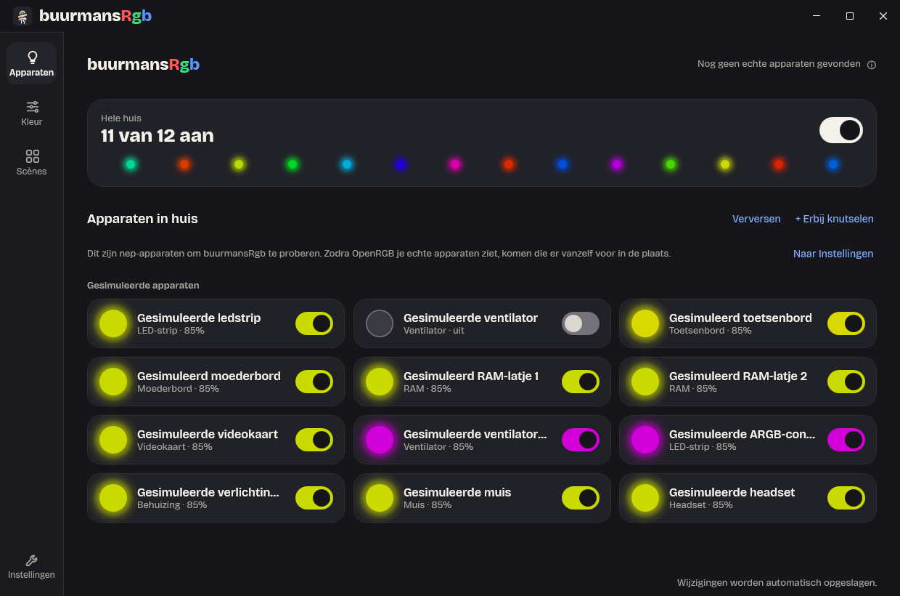
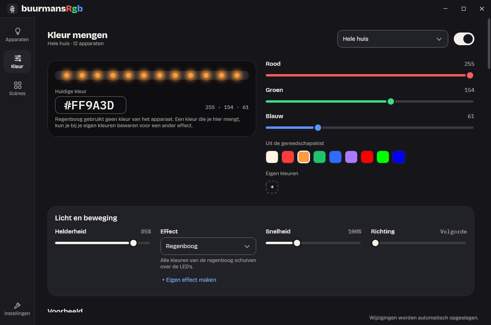
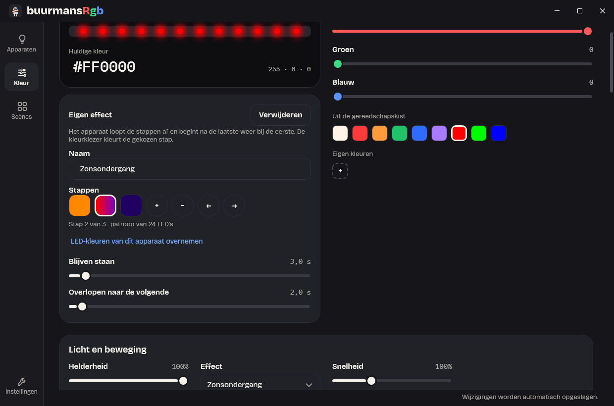
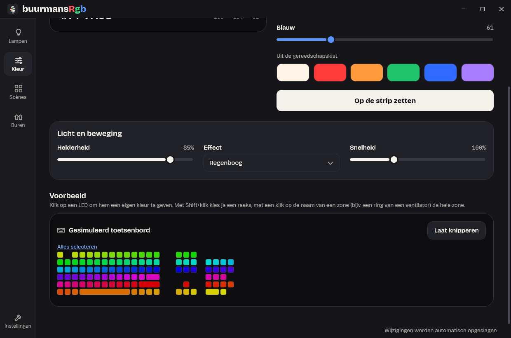
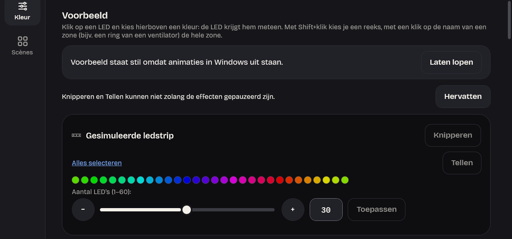
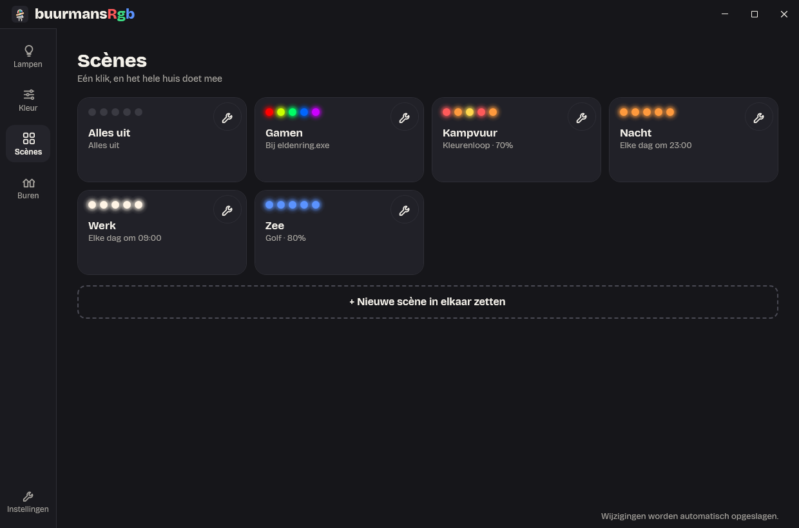

# Handleiding

Hier lees je hoe je met buurmansRgb de verlichting in je pc regelt.

## Snel aan de slag

### De app openen

buurmansRgb draait altijd op de achtergrond. Je ziet het als een klein icoontje rechtsonder, bij
de klok. Zie je het niet, klik dan op het pijltje ^ ernaast. Dubbelklik op het icoontje om de
app te openen. Links staan de pagina's **Apparaten**, **Kleur**, **Scènes** en **Instellingen**.

### Alles aan en uit

- Op **Apparaten** staat bovenaan de kaart **Hele huis**. Met de grote schakelaar daarop zet je
  alles tegelijk aan of uit.
- Elk apparaat heeft op zijn eigen kaart ook een schakelaar.
- Naast elke schakelaar staat of hij **Aan** of **Uit** staat.
- Het kan ook zonder de app: klik met de rechtermuisknop op het icoontje bij de klok en kies
  **Alles aan** of **Alles uit**.

Een apparaat dat uit staat, onthoudt zijn kleur voor als het weer aan gaat.

### Elke avond vanzelf uit

1. Ga naar **Apparaten**. In de kaart **Hele huis** staat onderaan **Uit en aan op tijd**.
2. Zet de schakelaar achter **Uit om** aan. Er staat 23:00, elke dag.
3. Wil je een andere tijd? Klik op de tijd, typ bijvoorbeeld 22:30 en druk op Enter.
4. Niet elke dag? Klik de dagen weg die niet hoeven, bijvoorbeeld **za** en **zo**.
5. Wil je dat ze 's ochtends weer aangaan? Zet dan ook **Aan om** aan (07:00).

Het geldt meteen; opslaan hoeft niet. Bij **Aan om** komen je kleuren van de avond ervoor terug.
Staat de pc om die tijd uit of in slaapstand, dan gebeurt er niets, tenzij **Gemiste tijden
inhalen** op **Instellingen** aan staat.

### Een kleur kiezen

1. Ga naar **Kleur**.
2. Klik rechtsboven op de lijst met apparaten en kies **Hele huis** voor alles, of één
   apparaat.
3. Klik onder **Kleuren** op een kleur, bijvoorbeeld **Warm wit** of **Fel rood**.

De kleur gaat meteen naar je apparaten; bevestigen hoeft niet. Een apparaat dat uit stond, gaat
vanzelf aan. Bij **Huidige kleur** staat hoe de kleur heet. Zie je geen verschil, kies dan bij
**Effect** eerst **Statisch**.

### Hoe fel

Op **Kleur** staat in het blok **Licht en beweging** de schuif **Helderheid**. Naar links is
zachter, naar rechts feller. Net als de kleur geldt dit meteen voor wat je rechtsboven koos.

### Scènes uitproberen

Op **Scènes** staan al vijf scènes klaar: **Alles uit**, **Rustig wit**, **Regenboog**,
**Pastel** en **Gamen**. Klik op een kaart en al je apparaten doen mee. Heb je liever je eigen
scènes, verwijder ze dan gerust: ze komen niet terug.

### Opslaan hoeft niet

Alles wordt vanzelf bewaard. Rechtsonder in de app staat daarna **Opgeslagen ✓** met de tijd.

### Uit bij slaapstand

Ga naar **Instellingen**. Kies in het eerste blok, **Als de pc slaapt of vergrendeld is**, wat
je apparaten dan doen:

- **Uitzetten**: ze gaan uit.
- **Dimmen**: ze branden zacht.
- **Laten branden**: ze blijven aan.

Is de keuze grijs? Zet dan de schakelaar **Pauzeren bij vergrendelen, slaapstand en scherm uit**
erboven aan. Gebruik je de pc weer, dan komen je kleuren vanzelf terug.

### Na een herstart

buurmansRgb onthoudt je kleuren en effecten (of de scène die aan staat), welke apparaten aan of
uit staan, hoe fel ze zijn en je keuze bij slaapstand. Het blok **Na een herstart** op
**Instellingen** zegt precies wat er terugkomt.

Dat gaat alleen vanzelf als **Starten met Windows** aan staat. Staat het uit, dan zie je in dat
blok de knop **Starten met Windows aanzetten**.

### Hulp nodig?

- **Mist er een apparaat?** Klik op **Apparaten** op **Hoe komt een apparaat erbij?**. Of klik
  ernaast op **Verversen** om opnieuw te zoeken.
- **Doen je apparaten niets meer?** Staat er bovenaan een melding, klik dan op de knop die
  erbij staat, zoals **Opnieuw verbinden** of **Herstarten**. Vraagt Windows of het mag, kies
  dan **Ja**.
- **Lukt het nog steeds niet?** Vraag het aan wie buurmansRgb voor je heeft geïnstalleerd. Klik
  op **Instellingen** op **Logbestand openen**: daarin staat wat buurmansRgb deed. Stuur dat mee
  als je om hulp vraagt.
- **Meer weten?** Elke pagina van de app heeft hieronder een eigen kop. Hulp bij het
  toetsenbord, een schermlezer of grotere tekst staat bij [Toegankelijkheid](#toegankelijkheid).

## Over deze handleiding

Hieronder staat alles over het gebruik van BuurmansRgb: de instellingen-app, het tray-icoon,
pauzeren, de instellingenbestanden en hoe OpenRGB en de verschillende apparaten werken.
Installeren staat in [installatie.md](installatie.md); bouwen, testen en hoe het van binnen werkt
in [ontwikkelaars.md](ontwikkelaars.md).

## De instellingen-app

De app volgt het ontwerp "Werkplaats bij nacht" uit [design/DESIGN.md](../design/DESIGN.md):
altijd donker, zodat de kleuren van de apparaten gloeien (behalve met een contrastthema van
Windows, zie "Toegankelijkheid"), met een eigen titelbalk en links een navigatiebalk met **Apparaten**,
**Kleur**, **Scènes** en onderaan **Instellingen**.

Hoe de app werkt met het toetsenbord, een schermlezer, een contrastthema, grotere tekst of minder
beweging, staat verderop bij [Toegankelijkheid](#toegankelijkheid).

- **Venster:** donkere titelbalk met het kleine icoon en het woordmerk. Slepen, dubbelklikken
  om te maximaliseren, Aero Snap en Alt+Spatie werken zoals altijd. Minimaal 960 × 640.
- **Onderaan** staat wat er net gebeurde (bijv. "Scène 'Nacht' staat aan.") en rechts
  "Opgeslagen ✓" met de tijd zodra de engine je wijziging heeft weggeschreven, een seconde na
  de laatste wijziging. Houdt een ander programma `settings.json` net even open, zoals een
  editor, een virusscanner of OneDrive, dan probeert de engine het een paar seconden opnieuw.
  "Opslaan mislukt" betekent: ook dat lukte niet. De verlichting werkt, maar na een herstart is
  de wijziging weg. "De engine kon de wijziging niet verwerken." verdwijnt bij de volgende
  wijziging die wel lukt. Bestaat een scène die je aanzet, verwijdert of een tijd geeft niet
  meer (bijv. verwijderd in een tweede venster), dan staat er "Scène '…' bestaat niet meer." en
  toont de lijst de scènes zoals ze nu zijn.
- **Engine weg:** draait de engine niet, dan meldt het venster dat, met "Opnieuw proberen".
  Stopt de engine terwijl het venster open is, dan staat er dat de verbinding is verbroken.

### Apparaten



- Bovenaan het woordmerk en rechts de status van je apparaten in gewone taal: "5 apparaten
  verbonden" (of "1 apparaat verbonden", "Verbonden, geen apparaten gevonden"), "Verbinden met je
  apparaten…", "Geen verbinding met je apparaten" of "Verbinden met je apparaten lukt niet". Op
  een pc die nog nooit een echt apparaat had, staat er zonder OpenRGB "Nog geen echte apparaten
  gevonden": dan is er niets kapot, je probeert de app met de gesimuleerde apparaten. De
  technische kant (OpenRGB en de SDK-server op `127.0.0.1:6742`) en een tip staan in de tooltip
  van de status en achter de ⓘ (bij aanwijzen of met Tab), en uitgeschreven bij Instellingen.
  Zonder verbinding (op een pc die echte apparaten had, of als OpenRGB geen goed antwoord geeft)
  staat ernaast de knop **Herstarten**: die doet wat "Herstarten" in het
  tray-menu doet (zie "Tray-icoon"): OpenRGB, de driver PawnIO en buurmansRgb opnieuw starten,
  met één UAC-vraag. De app gaat zolang dicht en komt vanzelf terug; tot dan staat onderaan
  "buurmansRgb herstart: de app gaat zo dicht en komt vanzelf terug.". Een schermlezer leest een
  nieuwe status voor.
- **Statusregel:** daaronder staat hooguit één melding, in een gewone kaart, de belangrijkste
  eerst: de verbinding met je apparaten is weg (alleen op een pc die echte apparaten had; met
  **Opnieuw verbinden**, dezelfde zoektocht als Verversen, die zolang "Zoeken…" zegt) > andere
  RGB-software draait mee ("SignalRGB draait ook en kan je kleuren overschrijven.", één melding
  per programma, zie [Andere RGB-software](#andere-rgb-software)) > de effecten zijn gepauzeerd
  (met de reden, en **Hervatten** bij de pauze uit het tray-menu, zie
  "Pauzeren") > het voorbeeld staat stil (met **Laten lopen**, zie "Minder beweging" bij "Toegankelijkheid"). Gelden er
  meer meldingen tegelijk, dan staat rechts de knop **Details** (voor een schermlezer "Details:
  nog 1 melding"): die klapt de andere meldingen uit onder de regel, elk met zijn eigen knop,
  zonder animatie, en blijft ingedrukt zolang ze open staan. Een melding die door een
  belangrijkere uit de regel wordt gedrukt, verdwijnt dus nooit stil: hij staat onder Details tot
  hij niet meer geldt, en komt terug in de regel zodra de belangrijkere weg is; staat er niets
  meer onder, dan gaat Details vanzelf dicht en weg. Is er niets te melden, dan is er geen kaart.
  Een schermlezer leest de melding in de regel als hij komt of verandert; de knoppen en Details
  bereik je met Tab. Verdwijnt de knop waar je op staat omdat de melding weggaat (de verbinding
  is terug, er staat niets meer onder Details), dan springt de focus naar de knop die in de regel
  overblijft of naar de volgende knop op de pagina, niet naar het begin van het venster.
  Dezelfde statusregel staat bovenaan Kleur.

  
- De kaart **Hele huis** zegt hoeveel apparaten aan zijn ("11 van 12 aan"), heeft een grote
  schakelaar voor alles en een strip van 14 bolletjes die laat zien wat de apparaten nu echt doen:
  elk bolletje is een LED uit alle apparaten achter elkaar, dus bij een regenboog loopt hij mee.
  Een LED die uit staat of zwart is, is een donker bolletje met een grijze ring en zonder gloed:
  zo zie je waar hij zit, en dat hij geen licht geeft. Zo staat een apparaat dat uit staat ook
  op zijn kaart, en een scène met de apparaten uit (of in het zwart) op zijn scènekaart.
- **Uit en aan op tijd** (onderaan de kaart Hele huis): elke avond alles uit, en desgewenst 's
  ochtends weer aan, zonder eerst een scène te maken. Twee regels, **Uit om** en **Aan om**, elk
  met een tijd, de dagen (**ma** t/m **zo**) en rechts een schakelaar. Zet je de schakelaar aan,
  dan staat er 23:00 (Uit om) of 07:00 (Aan om) op elke dag, en dat geldt meteen. Een dag aan of
  uit klikken geldt ook meteen; een andere tijd geldt zodra je met Tab verder gaat of op Enter
  drukt. Zolang de schakelaar uit staat, zijn de tijd en de dagen grijs. Een tijd die niet te
  lezen is of geen enkele dag geeft een melding onder het blok ("Vul bij Uit om een tijd in
  zoals 23:00.") en verandert niets.
  - **Uit om** zet de startscène **Alles uit** aan: het zijn de tijden van die scène, dus bij
    Scènes zie je bij "Alles uit" dezelfde tijd, en verander je hem daar, dan verandert hij hier
    ook. Onder de regels staat dat ("Uit om zet de scène 'Alles uit' aan."). buurmansRgb herkent
    die scène niet aan zijn naam maar aan een vaste markering, dus ook na het hernoemen (met de
    hand in `profiles.json`) hoort hij erbij. Heeft de scène bij Scènes meer tijden gekregen,
    dan toont deze regel de eerste en zegt hij hoeveel er nog zijn; de rest blijft staan. Is
    "Alles uit" er niet (verwijderd, of je installatie is van vóór de startscènes), dan bewaart
    buurmansRgb de tijd apart, buiten je scènes: dan gaan om die tijd alle apparaten uit met hun
    eigen kleur, zoals **Alles uit** in het tray-menu. Verwijder je "Alles uit" terwijl hij een
    tijd heeft, dan blijft Uit om gewoon staan.
  - **Aan om** doet alleen iets als dan alles uit staat. Ging alles uit door **Uit om** (of door
    de scène "Alles uit"), dan komen de kleuren en effecten van daarvóór terug, met alle apparaten
    aan. Zette je ze op een andere manier uit, zoals met de grote schakelaar of het tray-menu, dan
    gaat alles aan met de kleur die het had, zoals **Alles aan**. Brandt er al iets, dan blijft
    alles zoals het is: wat je zelf aanzette, gaat voor.
  - Staat de pc om die tijd uit of in slaapstand, dan slaat buurmansRgb die keer over, net als bij
    een scène met een tijd. Met **Gemiste tijden inhalen** (bij Instellingen) gebeurt het bij het
    starten of na het ontwaken alsnog. Draait er een programma met een eigen scène (een spel), dan
    wacht Uit om tot het programma stopt.
  - Voor een schermlezer heeft het blok een kop, is elke schakelaar een schakelaar met de naam
    "Uit om" of "Aan om" die zegt of hij aan of uit staat, heten de tijdvelden "Tijd voor Uit om"
    en "Tijd voor Aan om", en zijn de dagen knoppen met de hele naam ("maandag") die zeggen of ze
    ingedrukt zijn. Alles is met Tab te bereiken. Een melding wordt voorgelezen als hij komt.
- **Apparaten in huis:** elk apparaat als kaart, de echte onder "Echte apparaten
  (OpenRGB)" en de gesimuleerde onder "Gesimuleerde apparaten", twee of drie naast elkaar. Op de
  kaart: een bolletje in de kleur van zijn felste LED, de naam, het type met de kleur en de
  helderheid ("LED-strip · Warm wit · 100%") of "uit", zo nodig de plek (bijv. "Adres 0x52", zie "Welk apparaat is wat?") en
  "⚠ Volgt de kleur misschien niet", en een schakelaar in de kleur van het apparaat. Bij een
  donkere of diepblauwe kleur is het spoor van de schakelaar lichter (zwart wordt grijs), zodat
  je de knop blijft zien. De kleur heet zoals bij "Huidige kleur" op Kleur (zie "Kleurnamen" bij "Toegankelijkheid") en
  loopt mee als je hem verandert, ook terwijl je schuift. Toont het apparaat niet één kleur, dan
  staat er de naam van het effect: Regenboog, Kleurenloop, Vuur, Per LED, een eigen effect onder
  zijn naam, of Komeet, Scanner of Fonkelen met meer dan één eigen kleur ("Muis · Regenboog ·
  80%"). Komeet, Scanner, Fonkelen en Vuur met één eigen kleur noemen die kleur. Past een lange naam niet op de kaart, dan eindigt hij op "…"; de tooltip van de
  kaart heeft de hele naam, met daaronder de hele locatie als OpenRGB die geeft.
- **Alleen gesimuleerde apparaten:** zolang er bij "Gesimuleerde apparaten tonen" "Automatisch"
  staat (zie "Instellingen") en OpenRGB geen echte apparaten geeft, staat onder "Apparaten in huis"
  dat dit nep-apparaten zijn om BuurmansRgb te proberen, en dat je echte apparaten er vanzelf voor
  in de plaats komen zodra OpenRGB ze ziet. Hoe dat gaat, lees je via **Hoe komt een apparaat
  erbij?** naast de kop. De regel is weg zodra er een echt apparaat is, en bij "Altijd" en "Nooit":
  dan koos je zelf of de nep-apparaten er staan. Een schermlezer leest de regel mee.
- **Geen verbinding met je apparaten:** heeft deze pc ooit echte apparaten gehad en staat er nu
  geen enkel apparaat (OpenRGB is gestopt of geeft niets meer door), dan zegt de statusregel
  bovenaan dat de verbinding weg is, met **Opnieuw verbinden** (zie "Statusregel"), en komen er
  geen nep-apparaten voor in de plaats (zie "Gesimuleerde apparaten" bij "Instellingen"). Onder
  "Apparaten in huis" staat dan een kaart als lege staat van de lijst (zie de afbeelding bij
  "Statusregel"): "Hier komen je apparaten zodra de verbinding terug is; opnieuw verbinden kan
  bovenaan.", en dat "Herstarten" bij de status rechtsboven of in het menu van het tray-icoon
  OpenRGB en buurmansRgb opnieuw start (zie "Tray-icoon") als opnieuw verbinden niet helpt. De
  kaart heeft geen eigen knop en wordt niet apart voorgelezen: de melding bovenaan zegt het al,
  zodat een schermlezer het één keer hoort.
  "Opnieuw verbinden" doet wat Verversen doet: OpenRGB zoekt opnieuw, en antwoordt het niet, dan
  verbindt buurmansRgb opnieuw; zolang dat duurt, zeggen beide knoppen "Zoeken…". Op een pc die
  nog nooit een echt apparaat had, staat er zonder apparaten "Nog geen apparaten gevonden" met de
  verwijzing naar Instellingen, zoals eerst.
- Een klik op een kaart opent het apparaat bij Kleur en laat het op de hardware knipperen.
- **Hoe komt een apparaat erbij?** naast de kop "Apparaten in huis" gaat naar Instellingen, waar
  bij OpenRGB de uitleg staat. Een apparaat toevoegen doe je niet in BuurmansRgb maar in
  OpenRGB: ziet OpenRGB een nieuw apparaat, dan komt het er vanzelf bij, en Verversen laat het
  opnieuw zoeken. Dat zegt ook de tooltip van de link, met erbij dat je op Instellingen ook de
  gesimuleerde apparaten aan of uit zet. Het is de enige link naar Instellingen op
  deze pagina; de regel over de gesimuleerde apparaten heeft geen eigen link meer.
- **Verversen** (naast "Hoe komt een apparaat erbij?") laat OpenRGB opnieuw naar apparaten zoeken. Gebruik
  het als een apparaat niet terugkomt, bijvoorbeeld een koptelefoon die je uit en weer aan zette.
  Zolang er gezocht wordt, staat er "Zoeken…"; nog een klik doet dan niets. Een apparaat dat
  terugkomt, krijgt zijn eigen kleur en effect weer. De lijst kan zich in stappen vullen: OpenRGB
  meldt elk apparaat dat het vindt. Is OpenRGB niet bereikbaar, dan zegt een melding onder de kop
  dat er niet gezocht is; die melding verdwijnt zodra OpenRGB weer verbonden is. Duurt het zoeken
  langer dan 15 seconden, dan zegt de melding dat apparaten die OpenRGB nog vindt vanzelf
  verschijnen. Kent OpenRGB de vraag om opnieuw te zoeken
  niet (versies voor 1.0) of antwoordt het niet binnen 5 seconden, dan verbindt BuurmansRgb
  opnieuw met OpenRGB en haalt het de apparatenlijst opnieuw op. De knop is met Tab te bereiken
  en een schermlezer leest de melding voor.

### Kleur



Bovenaan kies je een apparaat of "Hele huis" (een schermlezer noemt de keuze "Welk apparaat?"), met de
schakelaar ernaast.

- **Kleur mengen:** links een groot voorbeeld met een strip in de gemengde kleur, de naam van de
  kleur met de hex-code erachter ("Warm wit · #FFF4E5"; je kunt ook een code typen) en de
  R · G · B-waarden. De naam loopt mee terwijl je schuift; een vaste kleur heet zoals onder
  "Kleuren", een andere kleur krijgt een benaderende naam (zie "Kleurnamen" bij "Toegankelijkheid"). Is het venster
  smal of de tekst groot, dan staat de hex-code met de punt ervoor onder de naam; rechts de schuiven Rood, Groen en Blauw
  (0–255, ook met de pijltjes), "Kleuren" met veertien vaste kleuren (Warm wit,
  Rood, Oranje, Groen, Blauw, Paars, Fel rood, Fel groen en Fel blauw, en Roze, Lichtroze,
  Lila, Mint en Babyblauw) met daaronder je
  eigen kleuren (zie "Eigen kleuren"). De kleur gaat meteen op het apparaat (bij "Hele huis" op
  alle apparaten) terwijl je schuift, een hex-code typt of een vaste of eigen kleur kiest; een
  knop is er niet. Een seconde na je laatste wijziging staat rechtsonder "Opgeslagen ✓" (zie
  "Onderaan"). Sleep je een schuif,
  dan stuurt de app alleen de laatste kleur die nog wacht, zodat de engine niet achterloopt; met
  de pijltjes gaat elke stap meteen op het apparaat. Heb je een kleur van de kleurenloop, een
  kleur van Fonkelen, Komeet, Scanner of Vuur, een stap van een eigen effect of LED's in het
  voorbeeld gekozen, dan verandert die kleur of die LED's op dezelfde manier mee (zie
  "Kleurenloop", "Kleuren van een effect", "Eigen effecten" en "Per-LED-editor"). Wat de kiezer
  kleurt, gaat in deze volgorde: gekozen LED's, dan de kleur van de loop of van het effect, dan de
  gekozen stap van een eigen effect, en anders het apparaat. Staat er een scène aan, dan staat hij
  na een nieuwe kleur niet meer aan, zoals na elke andere wijziging met de hand (zie "Scènes").
- **Hex-code typen:** de code onder "Huidige kleur" staat in een veld met een rand, zoals de andere
  velden; klik erin of ga er met Tab heen. Zes tekens, met of zonder `#` (`#00FF00` of
  `00ff00`); de kleur verandert zodra de code klopt. Een code die geen kleur is (`zzz`, `#12`) doet niets terwijl je typt,
  want `#12` kan nog `#123456` worden. Verlaat je het veld (Tab of een klik ergens anders), dan
  staat de code van de kleur er weer en zegt een melding eronder bijv. "'zzz' is geen kleurcode
  (zes tekens, zoals #FF9A3D); de kleur blijft #FFFFFF."; een schermlezer leest hem voor. Een kleur die klopt,
  een andere kleur of een ander apparaat haalt de melding weg. Een leeg veld krijgt de code
  terug zonder melding. Verandert de kleur terwijl je in het veld een halve code typt (bijv. een
  scène uit het systeemvak), dan blijft je tekst staan tot je het veld verlaat; een hele code
  wordt meteen de code van de nieuwe kleur, ook als je op een LED klikt terwijl de cursor in het
  veld staat. Ga je naar een ander venster (bijv. met Alt+Tab), dan is je tekst niet meer
  beschermd: verandert de kleur intussen, dan staat bij terugkomst de code van die kleur erin.
- **Regenboog gebruikt geen kleur:** met Regenboog gekozen (voor één apparaat of bij "Hele huis")
  staat onder de hex-code "Regenboog gebruikt geen kleur van het apparaat. Een kleur die je hier
  mengt, kun je bij je eigen kleuren bewaren voor een ander effect.": de regenboog heeft zijn
  eigen tinten, dus de kleur die je mengt gaat niet naar het apparaat. De schuiven, de hex-code
  en de vaste kleuren werken wel, en met **+** zet je de gemengde kleur bij je eigen kleuren.
  Kies je daarna bijv. Statisch, of zet een scène (bijv. uit het tray-menu) Statisch aan, dan
  staat de kleur van het apparaat weer in de kiezer en gaat een nieuwe kleur weer meteen op het
  apparaat; de kleur die je bij Regenboog mengde, klik je dan aan bij je eigen kleuren.
- **Een apparaat dat uit staat, gaat aan** bij de eerste kleur die je mengt, één keer, zoals bij
  de meeste lamp-apps: het komt meteen in de nieuwe kleur aan en de schakelaar (hier en op
  Apparaten) gaat mee. Dat geldt ook voor een kleur van de kleurenloop, van een effect of van een
  stap van een eigen effect en voor de per-LED-editor. Alleen mengen bij Regenboog, of + en − bij
  de kleuren, laat het uit. Bij "Hele huis"
  gaan alle apparaten aan als er één uit staat, want de kleur gaat naar allemaal. Kies je één
  apparaat, dan blijven de andere apparaten zoals ze zijn.
- **Licht en beweging:** de helderheid (0–100 %), het effect, de snelheid en bij Regenboog, Golf
  en een verspreide Kleurenloop de richting. De helderheid werkt op elk effect. Onder de
  effectkeuze zegt één korte zin wat het gekozen effect doet, bijv. "Een lichtpunt gaat heen en
  weer, zoals bij Knight Rider." bij Scanner, en bij een eigen effect hoeveel stappen het heeft
  ("Jouw effect: 3 stappen."). Een schermlezer leest die zin als de hulptekst van de keuze. Hij
  verandert mee met het effect, ook als een scène of het tray-menu het effect wijzigt.
- **Hele huis of één apparaat:** een wijziging bij "Hele huis" geldt voor alle apparaten, maar
  alleen voor wat je wijzigt: zet je de helderheid, dan houdt een apparaat met een eigen kleur die
  kleur. Een wijziging bij één apparaat geldt alleen voor dat apparaat. Is een apparaat weer
  gelijk aan "Hele huis", dan volgt het "Hele huis" weer.
- **Eigen kleuren:** onder de vaste kleuren bij "Kleuren". Het vakje **+** zet de
  huidige kleur van de kiezer erbij, achteraan de rij; hooguit 12, en elke kleur één keer (staat
  de kleur er al, of zijn het er 12, dan is + grijs). Een klik op een eigen kleur mengt hem, net
  als een vaste kleur. Weghalen doe je met rechts klikken en **Weghalen**, of met de toets
  **Delete** op het vakje dat de focus heeft; de focus gaat dan naar het vakje dat ervoor in de
  plaats komt, of naar +. De eigen kleuren gelden voor alle apparaten en blijven bewaard, ook
  als je de app sluit: de engine bewaart ze als `customColors` in `settings.json`. Een andere
  instellingen-app die tegelijk open is, ziet ze meteen. Ze zijn iets anders dan de kleuren van
  een effect (zie "Kleuren van een effect"): die horen bij een effect op een apparaat.
- **Loopt mee:** verandert de verlichting buiten de pagina (een scène uit het tray-menu, een
  scène die op tijd of bij een programma aangaat), dan tonen de schuiven, het effect, de
  snelheid, de richting, de kleurenloop en de kleuren van het effect meteen de nieuwe verlichting.
  Een kleur die je net koos, staat al op het apparaat, en een schuif die je net verschoof,
  springt niet terug, ook niet als je nog sleept terwijl de nieuwe verlichting binnenkomt. Een
  getypte code blijft staan zoals je hem typte ("ff00ff"). Komt er zo de kleurenloop, Fonkelen,
  Komeet, Scanner of Vuur op, dan toont het mengpaneel de gekozen kleur daarvan. Alleen bij een
  effect dat geen kleur van het apparaat gebruikt, zoals Regenboog, kan het mengpaneel een kleur
  tonen die niet op het apparaat staat: die blijft staan zolang het effect geen kleur gebruikt,
  ook als de apparaten opnieuw binnenkomen (een zone met een nieuwe lengte, apparaten die OpenRGB
  opnieuw meldt, de schakelaar **Zones gelijk**) en hetzelfde apparaat gekozen blijft; komt er
  een effect met een kleur op, dan toont het mengpaneel de kleur van het apparaat. Verdwijnt het
  gekozen apparaat, dan toont de pagina "Hele huis" met zijn kleur.
- Bovenaan staat dezelfde statusregel als op Apparaten (zie "Statusregel" daar): de verbinding
  met je apparaten weg, een pauze met de reden (bij de pauze uit het tray-menu met "Hervatten",
  zie "Pauzeren") of het voorbeeld dat stilstaat; de belangrijkste in de regel, de rest onder
  "Details". Zijn de effecten gepauzeerd, dan staat boven de kaarten van het voorbeeld ook één
  regel waarom "Knipperen" en "Tellen" grijs zijn (zie "Voorbeeld").

#### Effecten

Onder de effectkeuze staat van elk effect een korte zin; hier staat precies wat het doet.

| Effect | In `settings.json` | Wat het doet |
| --- | --- | --- |
| Statisch | `static` | Eén kleur op alle LED's |
| Ademen | `breathing` | De kleur fadet in 4 seconden in en uit |
| Regenboog | `rainbow` | Alle tinten verdeeld over de LED's, schuift met 0,2 rondes per seconde |
| Golf | `wave` | Een band van de kleur die over de LED's loopt, 0,5 golf per seconde |
| Kleurenloop | `color-loop` | Je eigen 2–12 kleuren die in elkaar overlopen, 0,2 loop per seconde; over de LED's verdeeld of alle LED's tegelijk |
| Fonkelen | `twinkle` | LED's lichten willekeurig op en doven langzaam uit, elke fonkeling in een willekeurige kleur uit de kleuren van het effect (zonder eigen kleuren: de kleur van het apparaat). Elke LED krijgt ongeveer elke 1,7 seconde een kans, en op een lange strip grijpt een vijfde die, zodat losse LED's fonkelen (op een toetsenbord gloeit zo'n 13 % tegelijk); bij een apparaat van een paar LED's lichten er per keer toch ongeveer twee op, bij een muis van één of twee LED's elke LED elke keer. Elk apparaat fonkelt op zijn eigen manier, ook twee even lange |
| Komeet | `comet` | Een punt met een staart die achter hem uitdooft, 0,5 ronde per seconde naar de laatste LED en weer rond, zoals op een fan-ring; elke ronde in de volgende kleur van het effect (zonder eigen kleuren: de kleur van het apparaat), en de staart van de vorige ronde dooft uit in zijn eigen kleur; de staart is 30 % van de lengte. Bij een apparaat van minder dan vier LED's (een muis) staan de LED's verdeeld over een ring van vier: één LED pulseert, fel als de kop voorbijkomt en dan uitdovend, twee LED's om de beurt |
| Scanner | `scanner` | Een punt dat naar de laatste LED en terug gaat, zoals bij Knight Rider, 0,5 keer heen en terug per seconde, elke keer heen of terug in de volgende kleur van het effect (zonder eigen kleuren: de kleur van het apparaat); de kleur wisselt aan het eind, waar het punt omkeert; het remt af bij de uiteinden en trekt een staart die met zijn vaart meegroeit (tot een kwart van de lengte). Eén LED (een muis) licht op telkens als het punt voorbijkomt |
| Vuur | `fire` | Vuur dat onrustig flakkert, met vlammen van een paar LED's breed: een rustige laag die twee keer per seconde verandert en een snelle die er overheen flakkert. De hitte loopt van de eerste kleur van het effect (de gloed) via de andere naar de laatste (de felste vlam); zonder eigen kleuren is dat donkerrood, rood, oranje en geel. De kleur van het apparaat doet niet mee (zoals bij Regenboog). Elk apparaat brandt op zijn eigen manier; één LED (een muis) flakkert als een kaars |
| Per LED | `per-led` | Een eigen kleur per LED (zie "Per-LED-editor") |
| Een eigen effect, onder zijn eigen naam | `custom:` met een code, bijv. `custom:1a2b3c4d` | Je eigen stappen, elk met één kleur of een patroon over de LED's, die in elkaar overlopen (zie "Eigen effecten") |

- **Snelheid** (10–300 %, standaard 100 %) werkt alleen bij een bewegend effect; bij Statisch
  en Per LED staat de schuif grijs. Bij een eigen effect gaan alle tijden van de stappen mee: op
  200 % duurt een stap van 2 seconden er 1. Een nieuwe snelheid gaat verder waar de animatie
  was, en apparaten die samen een nieuwe snelheid krijgen, blijven gelijk lopen.
- **Richting** (0–359°) staat naast de snelheid, alleen bij Regenboog, Golf en een Kleurenloop
  die over de LED's verdeeld is. Zonder richting ("Volgorde" naast de schuif) lopen die effecten
  over de LED's in hun volgorde, zoals altijd. Verschuif je de schuif, dan lopen ze over de plek
  van de LED's: 0° naar rechts, 90° naar beneden, 180° naar links en 270° naar boven, met een
  pijltje naast de graden. Precies 0° kies je met Home op de schuif of een klik op het schuifje
  zelf. Op een toetsenbord loopt de regenboog zo bijv. schuin over de toetsen
  (45°: van linksboven naar rechtsonder), op een fan-ring van links naar rechts of van boven naar
  beneden. Een **strip** (of een andere zone zonder vorm) kan alleen vooruit of achteruit: tussen
  271° en 89° loopt hij zoals zonder richting, tussen 91° en 269° andersom, en op precies 90° of
  270° krijgen al zijn LED's dezelfde kleur. **Volgorde van de LED's** onder de schuif zet de
  richting weer uit. De richting geldt per apparaat, of bij "Hele huis" voor alle apparaten, elk
  over zijn eigen LED's: een effect loopt niet van het ene apparaat naar het andere. Heeft een
  apparaat meer zones, dan houdt elke zone zijn deel van het effect, zoals in de volgorde, en
  loopt het binnen elke zone in de richting; met **Zones gelijk** loopt het over de langste zone
  en krijgen de andere dat beeld. De plekken zijn die van het voorbeeld: de toetsen uit de
  matrix-map van OpenRGB (een brede toets als de spatiebalk in het midden van zijn vakjes), een
  fan-ring als cirkel met LED 1 bovenaan en met de klok mee, en verder een rij. OpenRGB weet niet
  waar LED 1 van een echte fan zit en welke kant hij op telt; loopt de kleur op de fan zelf een
  andere kant op dan in het voorbeeld, draai dan de hoek bij. Een apparaat onthoudt zijn richting
  ook bij een ander effect, en een scène neemt hem mee.
- **Kleurenloop:** kies het effect, dan verschijnen onder het kleurvoorbeeld de kleuren van de
  loop. Klik op een kleur (hij krijgt een dikke witte rand) en meng een nieuwe, met de hex-code
  erboven of met de schuiven en vaste kleuren rechts: het vakje
  en het apparaat veranderen meteen mee, en de loop wordt bewaard. Klik je daarna een andere kleur,
  dan houdt de vorige wat je mengde. + voegt een kleur toe na de gekozen, − haalt de gekozen
  weg. Een loop heeft 2 tot 12 kleuren; de vakjes staan in rijen van hooguit zes, met + en −
  rechts naast de eerste rij (in een smal venster eronder). Zonder vinkje bij "Kleuren over de
  LED's verdelen" krijgen alle LED's tegelijk dezelfde kleur. Een apparaat onthoudt zijn loop, ook als je
  tussendoor een ander effect kiest. Standaard: geel, groen, blauw.
- **Kleuren van een effect:** bij Fonkelen, Komeet, Scanner en Vuur verschijnen onder het
  kleurvoorbeeld "Kleuren van het effect", met dezelfde vakjes, + en − als bij de kleurenloop,
  en een regel die zegt wat de kleuren doen. Klik op een vakje en meng een nieuwe kleur: het
  vakje en het apparaat veranderen meteen mee. Een effect heeft 1 tot 12 kleuren. Wat ze doen:
  - **Komeet:** elke ronde de volgende kleur, en na de laatste weer de eerste.
  - **Scanner:** elke keer heen of terug de volgende kleur.
  - **Fonkelen:** elke fonkeling een willekeurige kleur uit de lijst; een fonkeling houdt zijn
    kleur tot hij uit is.
  - **Vuur:** de vlammen lopen van de eerste kleur (de gloed, het koudst) via de andere naar de
    laatste (de felste vlam). Zet ze dus van donker naar licht, bijv. donkerblauw, blauw,
    lichtblauw en wit voor blauw vuur, of donkergroen, groen en geelgroen voor "gif". Met één
    kleur flakkert die tussen een donkere versie van zichzelf en zichzelf.

  Elk effect heeft zijn eigen kleuren per apparaat: kies je Komeet en daarna Vuur, dan houdt de
  komeet zijn kleuren voor als je hem weer kiest. Ze gaan mee in een scène. Zolang je de kleuren
  van Komeet, Scanner of Fonkelen niet aanpast, is dat één kleur: de kleur van het apparaat (de
  kleur van Statisch, Ademen en Golf). Een bestaand apparaat of een bestaande scène met zo'n
  effect ziet er dus hetzelfde uit als vóór er kleuren per effect waren, en Vuur zonder eigen
  kleuren brandt warm, zoals altijd: donkerrood, rood, oranje en geel. Pas je de kleuren aan, dan
  doet de kleur van het apparaat bij dat effect niet meer mee; hij blijft bewaard voor de
  effecten met één kleur. De schuiven kleuren bij deze effecten het gekozen vakje. Golf en Ademen
  hebben nog één kleur.

  **Standaardkleuren** onder de vakjes haalt de eigen kleuren van het gekozen effect weg: Komeet,
  Scanner en Fonkelen volgen weer de kleur van het apparaat (ook als je die later verandert), Vuur
  brandt weer in zijn vier warme kleuren. De andere effecten houden hun kleuren. Met "Hele huis"
  gekozen geldt dat voor alle apparaten, ook voor een apparaat met eigen kleuren. De knop is alleen te
  gebruiken als het effect eigen kleuren heeft; bij "Hele huis" telt daarvoor wat "Hele huis"
  zelf heeft.

#### Eigen effecten



Een eigen effect maak je van **stappen**. Elke stap is één kleur voor het hele apparaat, of een
patroon over de LED's, en heeft twee tijden: hoe lang hij **blijft staan** en hoe lang hij
**overloopt** naar de volgende stap. Na de laatste stap begint het weer bij de eerste. Zo maak je
bijv. een zwaailicht (rood en blauw, elk 0,3 s, zonder overlopen) of een zonsondergang (oranje,
een verloop van rood naar paars, donkerblauw, met een paar seconden overlopen).

- **Maken:** kies bij "Licht en beweging" **+ Eigen effect maken** onder het effect. Er komt een
  effect "Eigen effect 1" (of 2, 3, …) met twee stappen, de kleur van het apparaat en zwart, elk
  1 seconde met 1 seconde overlopen, en het apparaat (of bij "Hele huis" alles) toont het meteen.
  Je kunt tot 32 eigen effecten maken; daarna is de link grijs.
- **Kiezen:** de eigen effecten staan in de effectkeuze onder hun naam, na de gewone effecten en
  op alfabet. Ze gelden voor alle apparaten: hetzelfde effect kan op meer apparaten tegelijk
  staan, elk met zijn eigen helderheid en snelheid.
- **Aanpassen:** met een eigen effect gekozen staat onder het kleurvoorbeeld het paneel **Eigen
  effect**. Elke wijziging gaat meteen naar de engine, die hem in `effects.json` bewaart, en de
  apparaten met dit effect (en het voorbeeld onderaan) laten hem meteen zien; een tweede
  instellingen-app die open is, ook:
  - **Naam:** typ een nieuwe naam en druk Enter of Tab. Een naam is 1 tot 40 tekens, en een
    eigen effect kan niet heten als een ander effect: een ander eigen effect of een ingebouwd
    effect zoals Statisch of Regenboog (hoofdletters en spaties eromheen tellen niet). Dan staat
    er onder het vak "Deze naam heeft al een effect.", bij een lege naam "Geef het effect een
    naam."; een schermlezer leest de melding voor. Na Enter kun je de naam nog verbeteren; zodra
    je het vak verlaat, staat de echte naam van het effect er weer in, zoals in de effectkeuze,
    en zegt de melding welke naam niet kon en dat de oude blijft, bijv. "Er is al een effect dat
    'Regenboog' heet; de naam blijft 'Disco'.". Die melding staat tot je een goede naam geeft of
    een ander effect kiest. Met Escape staat de naam van het effect weer in het vak, zonder
    melding, en blijf je in het vak. Had een eigen effect uit een eerdere versie al de naam van
    een ingebouwd effect, dan heet het nu bijv. "Regenboog (eigen)".
  - **Stappen:** de vakjes, in rijen van hooguit zes; een patroon staat als verloop in het vakje.
    Klik op een stap (hij krijgt een dikke witte rand) en meng een kleur met de schuiven, de
    hex-code of de vaste kleuren: de stap verandert meteen mee. Een patroon wordt dan één
    kleur. **+** voegt een stap toe na de gekozen, als kopie ervan; **−** haalt de gekozen weg
    (een effect houdt minstens één stap, en heeft er hooguit 32); **←** en **→** zetten de stap
    een plek naar voren of naar achteren. Met de toets **Delete** op een stap haal je hem ook
    weg; de focus gaat naar de stap die ervoor in de plaats komt.
  - **LED-kleuren van dit apparaat overnemen:** maakt van de gekozen stap een patroon met de
    kleuren die je bij **Per LED** aan de LED's van het gekozen apparaat gaf (zie
    "Per-LED-editor"; een LED zonder eigen kleur telt met de kleur van het apparaat). Werkwijze:
    kies het apparaat, kies Per LED en kleur de LED's, kies dan je eigen effect, kies de stap en
    neem de kleuren over. Bij "Hele huis" is de link grijs: kies eerst een apparaat.
  - **Blijven staan** en **Overlopen naar de volgende:** de tijden van de gekozen stap, van 0 tot
    60 seconden in stappen van 0,1 s (de pijltjes 0,1 s, Page Up en Page Down 1 s). Een stap
    met 0 en 0 slaat het effect over. Overlopen gaat per LED van zijn kleur in deze stap naar
    zijn kleur in de volgende.
  - **Verwijderen** vraagt eerst "Eigen effect '…' verwijderen?", met erbij dat apparaten en
    scènes met dit effect dan Statisch worden. Kies je "Verwijderen", dan gaat het effect weg:
    apparaten die het tonen, krijgen Statisch in hun eigen kleur, en de focus gaat naar de
    effectkeuze. "Annuleren" (of Escape) laat alles staan, met de focus weer op Verwijderen.
    Hoe de vraag werkt, staat bij Scènes.
- **Patroon op een ander apparaat:** een patroon wordt over de LED's van het apparaat **uitgerekt**
  (of samengedrukt), net als bij "Zones gelijk": elke LED krijgt de kleur op dezelfde plek in
  het patroon. Een patroon van een toetsenbord loopt op een fan dus ook van begin tot eind, en
  een patroon van 24 LED's op een strip van 48 geeft elke kleur twee LED's. Het patroon volgt de
  volgorde van de LED's, niet de richting (die schuif is er bij een eigen effect niet).
- **Scènes:** een scène neemt het gekozen eigen effect mee, maar als verwijzing: pas je het effect
  later aan, dan ziet de scène er ook anders uit. Verwijder je het effect, dan toont een scène met
  dit effect Statisch in de kleur van het apparaat. De scènekaart zegt bij een eigen effect
  "Eigen effect", niet zijn naam, met bolletjes in de kleur van het apparaat.
- Een eigen effect met één stap staat stil, net als Statisch: er draait dan geen animatie.

#### Voorbeeld



Onder "Licht en beweging" staat per apparaat een kaart met het icoon van zijn type, de naam en
**Knipperen**, en per zone een bolletje per LED. Het toont wat de engine echt rendert,
ook als de effecten gepauzeerd zijn, met hooguit 20 beelden per seconde. Op een pagina zonder
voorbeeld (Scènes, Instellingen) of met het venster geminimaliseerd stuurt de engine
geen beelden; terug op Apparaten of Kleur staat meteen het nieuwste beeld er.

- **Animaties uit:** staan in Windows de animaties uit (zie "Minder beweging" bij "Toegankelijkheid"), dan
  staat het voorbeeld stil en stuurt de engine geen beelden. Na elke wijziging, van jou of van
  een scène, een pauze of een andere pagina komt er één nieuw beeld. **Knipperen** flitst dan
  niet wit aan en uit in het voorbeeld: de kaart van het apparaat krijgt zolang de markering
  "Knippert nu op het apparaat" (bij een zone met de naam van de zone), en het voorbeeld houdt
  zijn beeld tot het knipperen voorbij is. Tijdens een pauze knippert er niets, en dan komt er
  ook geen markering. Bij **Tellen** komt er per stap één beeld: één LED
  meer, er gaat niets aan en uit. Met "Laten lopen" in de statusregel bovenaan beweegt het weer
  zoals altijd.
- **Knipperen en Tellen grijs:** zolang de effecten gepauzeerd zijn, knippert en telt er niets,
  en zijn "Knipperen" en "Tellen" op alle kaarten grijs (hun tooltip blijft). Boven de kaarten
  staat dan één regel die zegt waarom, ook bij "Hele huis": "Knipperen en Tellen kunnen niet
  zolang de effecten gepauzeerd zijn.", bij de pauze uit het tray-menu met de knop **Hervatten**
  ernaast (dezelfde als in de melding bovenaan, met Tab te bereiken), en anders met de reden
  erachter: omdat Windows vergrendeld is, de pc in de slaapstand is, de schermbeveiliging loopt
  of het scherm uit is. Een schermlezer leest de regel als hij komt. Eindigt de pauze, dan gaat de
  regel weg en doen de knoppen het weer.

  

- **Zwarte LED's** (bijv. in Per LED, een stap van een eigen effect, of een apparaat dat uit
  staat) krijgen een grijze ring binnen hun rand, zodat je ziet waar ze zitten en erop kunt
  klikken; een LED in een kleur heeft die ring niet. De ring van een gekozen LED staat er net
  buiten, in de markeerkleur van Windows.
- **Zones** staan er met naam en aantal LED's zoals OpenRGB ze geeft; een apparaat met één zone
  toont geen zonenaam. Naast de naam van een zone met LED's staat **Knipperen** (zie "Welk
  apparaat is wat?"), behalve bij "Overige LED's": de LED's die OpenRGB bij geen zone indeelt.
- **Zones gelijk:** een apparaat met twee of meer zones met LED's heeft onder zijn naam de
  schakelaar **Zones gelijk**, met in één regel wat hij doet (meer in de tooltip). Aan rendert
  het effect één keer, over de langste zone, en krijgt elke andere zone hetzelfde beeld,
  uitgerekt over zijn eigen lengte. Zo hebben bijv. de twee
  zones van één LED van een Logitech-muis ("Primary Zone" en "Logo Zone") in een regenboog
  dezelfde kleur, en lopen de binnen- en buitenring van een fan gelijk op. "Overige LED's" doen
  mee als een zone. Het voorbeeld laat zien wat de apparaten dan krijgen. Bij Statisch, Ademen en
  de kleurenloop met alle LED's tegelijk maakt het geen verschil; bij Per LED houdt elke LED
  zijn eigen kleur, ook met de schakelaar aan. De keuze geldt per apparaat, blijft bewaard (zie
  `zonesAlike` bij "settings.json") en hoort niet bij een scène: een scène laat hem zoals hij
  is. Knipperen werkt zoals altijd: een zone knippert alleen. Een kleur die je aan het mengen
  bent, blijft staan als je de schakelaar omzet (zie "Loopt mee").
- **Fans** (in OpenRGB het type "cooler", dus ook een AIO-pomp) tekent het voorbeeld per zone
  als ring, met LED 1 bovenaan en dan met de klok mee. OpenRGB zegt niet waar LED 1 echt zit;
  de wijzerplaat is dus een keuze. Een zone waarvan je de lengte instelt, of een zone van meer
  dan 48 LED's, blijft een rij: dat is meestal een kanaal van een hub met een strip of meer
  fans erop.
- **Toetsenborden** met een matrix-map van OpenRGB tonen elke LED als toets op zijn plek, en
  maken de toetsen kleiner in een smal venster. LED's buiten de map (bijv. een logo) staan in
  een rij eronder. Met toetsnamen tekent het voorbeeld Tab, Caps Lock, Shift, Ctrl, Backspace,
  Enter, de spatiebalk en de 0 van het numerieke blok breder over de lege vakjes ernaast.
- **Namen:** wijs een LED aan voor zijn naam en nummer, bijv. "Escape (LED 1)", of "LED 5"
  zonder naam. Een schermlezer noemt de LED's zo ook, met de kleur die de LED op dat moment toont
  erachter ("LED 5, rood", "Escape (LED 1), warm wit"; zie "Kleurnamen" bij "Toegankelijkheid"), en kan ze selecteren
  zoals een klik; de apparaten en zones in het voorbeeld noemt hij bij hun naam. Bij een effect dat
  beweegt hoor je de kleur van het moment dat je met de pijltjes bij de LED komt. Die naam blijft
  daarna staan tot de LED opnieuw de focus krijgt, ook als de kleur intussen verandert: zo begint
  de schermlezer niet uit zichzelf te praten bij elk beeld van het effect. Loop je met de
  schermlezer langs LED's die de focus niet hebben gehad, dan hoor je de kleur van het moment dat
  de focus het laatst in het voorbeeld kwam (of dat de schermlezer ze voor het eerst opvroeg, als
  de focus er nog niet is geweest). Ook als het aantal LED's verandert, krijgen ze allemaal de
  kleur van dat moment.
- **Lengte van een zone:** bij een zone die OpenRGB in lengte laat instellen (een ARGB-header
  of -kanaal) staat "Aantal LED's (0–120):" met het bereik, en −, +, een schuif, een vak en
  "Toepassen". − en + doen één LED per klik en blijven herhalen zolang je ze ingedrukt houdt.
  Met −, + en de schuif groeit het voorbeeld meteen; de zone zelf krijgt de lengte
  pas als je 0,6 seconde niets verandert of de schuif loslaat, want OpenRGB laadt bij elke
  nieuwe lengte zijn apparaten opnieuw. Typen en "Toepassen" (of Enter) gaat meteen. Typ je
  iets wat de zone niet kan hebben (`abc`, `-3` of meer dan het grootste aantal), dan blijft
  "Toepassen" grijs en zegt een melding onder het vak welk bereik wel kan ("Kies 0 tot 120
  LED's."); een schermlezer leest hem voor. Een leeg vak geeft nog geen melding. Een zone
  met 0 LED's zegt "Nog geen LED's ingesteld", met uitleg. De lengte wordt bewaard (zie
  `zoneLengths` bij "settings.json").
- **LED's tellen:** weet je niet hoeveel LED's de fan of strip op een header heeft, kies dan
  **Tellen**, naast "Knipperen" (bij een apparaat met één zone staat het rechts boven de LED's).
  De zone gaat even naar zijn grootste aantal LED's en er gaat elke seconde één LED meer aan: de
  nieuwste groen, die ervoor wit, de rest van de zone uit; de rest van het apparaat houdt zijn
  effect. In het voorbeeld staat, op de plek van de lengte, een grote teller ("LED 37") met:
  - **Pauze** en **Doorgaan**: zet het tellen stil op de LED die de teller dan zegt;
  - **−** en **+**: één LED terug of verder (dat pauzeert het tellen ook);
  - **LED's per seconde** 1, 2 of 5;
  - **Dit is de laatste**: de zone krijgt zoveel LED's als de teller zegt, net als met
    "Toepassen", en het tellen stopt;
  - **Stoppen**: het tellen stopt en de zone krijgt zijn eigen aantal LED's terug.

  Zo werkt het: kijk naar de fan of strip; gaat de groene LED niet meer aan, kies dan Pauze, ga
  met − terug tot de laatste LED groen is en kies "Dit is de laatste". Na de laatste LED die de
  zone kan hebben, stopt het tellen vanzelf; Doorgaan begint dan weer bij LED 1. Nog eens
  Tellen begint ook opnieuw bij LED 1. Er telt steeds één zone. Het tellen stopt ook, en de zone
  krijgt zijn eigen aantal LED's terug, als je een andere zone laat tellen, een ander apparaat
  kiest, van Kleur weggaat, de app sluit, op Verversen klikt, of als de effecten pauzeren (via
  het tray-menu, of omdat Windows vergrendelt, slaapt, het scherm uitgaat of de
  schermbeveiliging start); bij een pauze is Tellen grijs. Verdwijnt het apparaat, of krijgt de
  zone ergens anders een ander aantal LED's (bijv. in de app van OpenRGB), dan stopt het tellen
  zonder iets terug te zetten. Een telling die je in een tweede venster van de app startte, telt
  daar door als je hier een ander apparaat kiest of van Kleur weggaat; hier zie je hem ook, en
  Stoppen werkt in beide. Tellen verandert de verlichting niet, en de grootste lengte wordt
  nooit bewaard; "Dit is de laatste" bewaart de lengte die je koos. Had de zone nog geen
  bewaarde lengte, dan bewaart Tellen wel zijn eigen aantal LED's (niet 0) in `zoneLengths`,
  zodat de zone dat terugkrijgt als de engine halverwege het tellen stopt. Een schermlezer noemt
  de teller bijv. "Teller van Moederbord – ARGB 1: LED 37 van 60" en leest de regel eronder voor
  als het tellen pauzeert, doorgaat of een ander tempo krijgt, niet bij elke LED. Met Tab bereik
  je alle knoppen; de tempo's zijn keuzerondjes.

#### Per-LED-editor

Klik in het voorbeeld op een LED om hem te kiezen; Shift+klik kiest een reeks vanaf de vorige
klik, en een klik op de naam van een zone kiest die hele zone (bijv. één ring van een fan).
Een apparaat met maar één zone heeft daar "Alles selecteren", dat al zijn LED's kiest. Zolang er
LED's gekozen zijn, staat boven het mengpaneel welke dat zijn en gaat de kleur alleen naar die
LED's, meteen terwijl je schuift, een hex-code typt of een vaste kleur kiest. Staat het apparaat
uit, dan gaat het aan bij de eerste kleur, ook bij "Verloop vullen". Kies je een andere LED, dan
toont het mengpaneel diens kleur; de LED's ervoor houden wat je mengde.

- **Naast een LED klikken mag:** een klik tot 12 px van het midden van een LED kiest die LED,
  ook als het bolletje kleiner is, ook net boven of naast het voorbeeld en ook met Shift. Zo is
  elke LED een doel van minstens 24 px, ook bij een verkleind toetsenbord. Tussen twee LED's kies
  je de dichtstbijzijnde; klik je op een LED zelf, dan altijd die. Een brede toets, zoals de
  spatiebalk, telt over zijn hele breedte, met 12 px rond de lijn door zijn midden. Verder van
  elke LED, bijv. in het midden van een ring, kiest een klik niets. De naam van de LED onder de
  muis (de tooltip) is die van de LED die een klik daar kiest. De naam van een zone, "Alles
  selecteren" en Knipperen erboven houden hun eigen plek: daarop klik je nog steeds die.
- **Met het toetsenbord:** ga met Tab naar de LED's van een apparaat; de actieve LED krijgt een
  witte ring van 2 px en zijn naam als tooltip, die terugkomt als de muis van de LED's af gaat.
  Tab stopt één keer per apparaat, bij de zone met de actieve LED; die begint bij LED 1 en is
  daarna de laatste die je koos of aanklikte. Krijgt een zone een andere lengte, dan blijft hij
  op zijn plek in zijn zone, of op de laatste LED die die zone nog heeft. Staat de focus al in
  de LED's en klik je bij "Hele huis" op een LED van een ander apparaat, dan gaat de focus mee
  naar die LED; werk je alleen met de muis, dan blijft de focus waar hij was.

  | Toets | Wat het doet |
  | --- | --- |
  | ← en → | Naar de vorige of volgende LED, ook door naar de zone ervoor of erna |
  | ↑ en ↓ | Naar de LED in de rij erboven of eronder (op een toetsenbord de toets erboven of eronder); vanaf de bovenste of onderste rij naar de laatste LED van de zone erboven of de eerste van de zone eronder. Een ring heeft geen rijen: daar gaan ↑ en ↓ meteen naar de zone ervoor of erna |
  | Home en End | Naar de eerste of laatste LED van het apparaat |
  | Spatie of Enter | Kiest de actieve LED, zoals een klik |
  | Shift+pijltje, Shift+Home of Shift+End | Breidt de reeks uit tot de LED waar je heen gaat, zoals Shift+klik; zonder keuze begint de reeks bij de LED waar je vandaan kwam |
  | Ctrl+A | Kiest alle LED's van het apparaat, zoals "Alles selecteren" |
  | Escape | Heft de selectie op, zoals "Selectie opheffen" |

  Daarna ga je met Shift+Tab terug naar boven, naar de schuiven en de vaste kleuren: elke
  stap kleurt de gekozen LED's meteen.
  Een schermlezer noemt de actieve LED bij zijn naam en kleur en zegt of hij gekozen is.
- **Verloop vullen** vult de reeks met een verloop van de kleur van de eerste naar die van de
  laatste LED (geef die dus eerst een kleur).
- **Selectie opheffen**, een ander apparaat kiezen of een ander effect dan Per LED kiezen, geeft
  het mengpaneel weer aan het apparaat (bij Kleurenloop aan de kleur van de loop); een kleur zet
  het apparaat dan niet terug op Per LED.
- Het apparaat krijgt bij de eerste wijziging het effect "Per LED". LED's die je niet kleurt,
  volgen de kleur van het apparaat. De kleuren blijven bewaard, ook als je tussendoor een ander
  effect kiest of een zone van lengte verandert.

### Scènes



Een scène bewaart de verlichting van alle apparaten onder een naam (in de code en in
`profiles.json` heet dat een profiel). De scènes staan als kaarten, drie of vier naast elkaar:
vijf bolletjes met de kleuren van de scène (bij Komeet, Scanner en Fonkelen de kleuren van het
effect om de beurt; bij Vuur zijn kleuren heen en terug, met drie of meer kleuren zonder de
eerste, de gloed: zonder eigen kleuren rood, oranje, geel, oranje en rood; van meer dan vijf
kleuren zie je de eerste vijf), de naam en wanneer
hij vanzelf aangaat ("Elke dag om 23:00", "Bij eldenring.exe"), of anders wat hij laat zien
("Regenboog · 80%", "Alles uit").

Een nieuwe installatie begint met vijf **startscènes**, die op alle apparaten slaan, ook op een
apparaat dat er later bij komt:

| Scène | Wat hij doet |
|---|---|
| Alles uit | Alle apparaten uit, en hun kleur en effect worden die van Rustig wit: met "Alles aan" daarna branden ze rustig wit, je eigen kleur komt niet terug. Wil je alleen uit en daarna je eigen kleur terug, gebruik dan "Alles uit" in het tray-menu (of `--all-off`), of "Aan om" bij Hele huis. Zijn tijden zijn "Uit om" bij Hele huis op Apparaten (zie "Uit en aan op tijd"). |
| Rustig wit | Warm wit, statisch, op 40 %. |
| Regenboog | Het effect Regenboog. |
| Pastel | Een kleurenloop van Lichtroze, Lila, Mint en Babyblauw. |
| Gamen | Komeet, de ene ronde fel rood en de volgende fel blauw. |

Het zijn gewone scènes: je kunt ze aanzetten, overschrijven, vanzelf laten aanzetten en
verwijderen. Een verwijderde
startscène komt niet terug, ook niet als je ze allemaal verwijdert of `profiles.json` weghaalt.
Alleen een pc zonder `profiles.json` krijgt ze, bij de eerste start van de engine; wie al
scènes had (of ze allemaal verwijderde) vóór er startscènes waren, krijgt ze niet ongevraagd. De
namen zijn Nederlands, zoals de rest van de app. Zijn er geen scènes, dan zegt de pagina wat een
scène is en dat je er een maakt met "Nieuwe scène" eronder.

- **Een klik op een kaart** zet de scène aan: kleur, helderheid, aan/uit, effect, snelheid,
  richting, kleurenloop, kleuren van de effecten en per-LED-kleuren van alle apparaten worden die
  van de scène, en ook de opgeslagen verlichting.
- **"+ Nieuwe scène"** vraagt een naam en bewaart de verlichting zoals die nu
  is.
- **De moersleutel** op een kaart kiest de scène (lichtere rand) en toont eronder "Aanzetten",
  "Overschrijven met wat nu brandt", "Verwijderen" en "Vanzelf aanzetten".
- **Verwijderen** vraagt eerst "Scène '…' verwijderen?" in een klein venster boven de app, met
  de knoppen "Annuleren" en "Verwijderen". De focus begint op Annuleren, dus een Enter te veel
  laat de scène staan; Tab gaat naar Verwijderen, Enter of Spatie doet de knop met de focus, en
  Escape of het kruisje is Annuleren. Zolang de vraag open is, doet het hoofdvenster niets. Een
  schermlezer leest de vraag voor. Een verwijderde scène komt niet terug.
- **Vanzelf aanzetten:** vul bij "Aanzetten om" een tijd in (`23:00`, `23.00` of zonder iets
  ertussen `2300`; `930` en `0930` worden 09:30) en/of bij
  "Aanzetten als dit programma start" de naam van een .exe (`eldenring.exe`; `eldenring` of een
  heel pad mag ook), en kies "Toepassen". Leeg en "Toepassen" zet het uit. Achter elke tijd
  staan zijn dagen, ma t/m zo; standaard alle zeven. Klik een dag aan of uit, bijv. alleen
  ma t/m vr voor "Werk"; zonder tijd zijn ze grijs. De kaart zegt dan "Werkdagen om 09:00",
  "In het weekend om 10:00" of "ma, wo, vr om 19:00".
  Een snelkoppeling of script (`.lnk`, `.url`, `.bat`, `.cmd`) weigert de app: vul het doel
  in (Eigenschappen van de snelkoppeling). Weet je de naam niet, kies dan onder het veld bij
  "Kies uit wat nu draait" een programma dat nu een venster heeft (start het spel eerst), of
  kies "Bladeren…" en zoek het .exe-bestand op; alleen de naam komt in het veld. De lijst
  noemt elk programma bij de naam die het zelf in zijn .exe-bestand heeft, met de exe-naam
  erachter, bijv. "Microsoft Outlook (olk.exe)", op alfabet van die naam; heeft het geen naam,
  of alleen zijn exe-naam nog eens ("game"), dan de titel van zijn venster, en anders alleen
  de exe-naam ("notepad++.exe"). Die namen staan er zoals het programma ze meegeeft, vaak in
  het Engels ("Settings" voor de Instellingen van Windows). In het veld komt alleen de
  exe-naam (`olk.exe`). Een programma dat als administrator draait, of van een andere
  gebruiker is, staat er soms met alleen zijn venstertitel of exe-naam bij. Onderdelen van
  Windows zonder eigen app staan er niet bij: het aanraaktoetsenbord en emojivenster
  (`TextInputHost.exe`), het startmenu, zoeken, de meldingen en snelle instellingen, het
  vergrendelscherm en `ApplicationFrameHost.exe`, het kader om apps uit de Microsoft Store
  (zie "Alleen op de voorgrond" hieronder). Typ je zo'n naam zelf in het veld, dan werkt hij
  wel. De lijst wordt gelezen zodra je een scène opent, en bij elke keer openklappen opnieuw;
  een programma dat je net startte, komt er na een ogenblik bij. Met een vinkje
  bij "Alleen als het op de voorgrond staat" (daaronder, grijs zonder programma) telt het
  programma alleen zolang je het voor je hebt, zie "Alleen op de voorgrond" hieronder.
- **Meer tijden:** "+ Nog een tijd" zet onder de tijden een lege rij erbij, met eigen dagen;
  zo gaat "Ochtend" om 07:00 op werkdagen en om 09:00 in het weekend aan. Een scène kan tot acht
  tijden hebben. "−" achter een rij haalt die tijd weg (de enige tijd wordt leeg), en een lege
  rij telt niet mee. Klopt een tijd niet, dan zegt de melding welke ("Tijd 2: kies minstens één
  dag."). Na "Toepassen" staan de tijden van vroeg naar laat, en wordt twee keer dezelfde tijd
  één tijd op de dagen van allebei; het veld waarin je typte houdt de focus. De kaart noemt de
  eerste tijd en hoeveel er nog zijn: "Werkdagen om 07:00 en nog 1". Een andere geopende
  instellingen-app ziet de nieuwe tijden meteen op de kaart.
- **De scène die aan staat** heeft een witte rand van 2 px, zoals in het ontwerp, en in het
  tray-menu een vinkje; een schermlezer zegt "Staat aan". Dat is de scène die het laatst aanging
  (met een klik, uit het tray-menu, op tijd of bij een programma) of die je net opsloeg of
  overschreef. Verandert de verlichting daarna op een andere manier (een kleur, de helderheid,
  een apparaat uit), dan staat er geen scène meer aan. Stopt een spel met een eigen scène, dan staat
  de scène van daarvoor weer aan. Ook na een herstart van de engine (of de pc) staat dezelfde
  scène nog aan, zolang hij nog bestaat.
- Zonelengtes en "Zones gelijk" horen niet bij een scène.

Hoe het vanzelf aanzetten werkt:

- **Op tijd:** elke dag om die tijd zet de engine de scène aan, net alsof je op de kaart klikte.
  Het is de klok van Windows: bij zomer- en wintertijd blijft 23:00 gewoon 23:00; een tijd in
  het uur dat wegvalt komt na dat uur, een tijd in het dubbele uur alleen de eerste keer.
  Slaapt de pc, staat hij uit of zet je de klok erover heen, dan slaat de engine die keer over
  (ook als de timer meer dan een minuut te laat afgaat): na een nacht slaapstand komt "Nacht"
  's ochtends niet alsnog, tenzij "Gemiste tijden inhalen" aan staat (hieronder). Hebben twee
  scènes dezelfde tijd, dan wint de eerste op alfabet. Met meer tijden gaat de scène op elk van
  die tijden aan, elke tijd op zijn eigen dagen.
- **Gemiste tijden inhalen** (bij Instellingen, standaard uit): dan gaat na het ontwaken en bij
  het starten de scène aan van de tijd die het laatst voorbij is, op de gekozen dagen en
  hooguit een week terug. Bij scènes met meer tijden telt elke tijd mee: met "Ochtend" om 07:00
  en 13:00 en "Middag" om 10:00 geeft starten om 14:00 "Ochtend".
  - *Na het ontwaken* alleen als er in de slaap een tijd voorbij kwam, en pas als de apparaten terug
    zijn (na zo'n 2 seconden, zie "Na slaapstand" onder "Per apparaattype"). Kwam er geen tijd
    voorbij, dan blijft de verlichting zoals hij was, ook als je na de laatste tijd zelf iets
    koos. Voorbeeld met "Avond" om 20:00 en "Nacht" om 23:00: slaap van 21:00 tot 08:00 geeft
    "Nacht"; slaap van 20:30 tot 22:00 laat alles zoals het was. Ook een tijd vlak voor het
    ontwaken telt: wakker om 23:00:30 geeft "Nacht".
  - *Bij het starten* van de engine (of de pc) wint de tijd altijd, ook van de scène die voor de
    herstart aan stond: wat er gebeurde terwijl de engine niet draaide, weet hij niet. Is de
    scène van de tijd al de scène die aan staat, dan gebeurt er niets. Dat geldt bij elke
    herstart: kies je om 21:00 zelf "Gamen", sluit je de engine af ("Afsluiten") en start je hem
    weer, dan staat "Avond" weer aan.
  - Draait er een programma met een eigen scène, dan komt de scène van de tijd pas als het
    programma stopt, zoals bij "Tijd tijdens een spel". Ook bij het starten gaat dan alleen de
    scène van het programma naar de apparaten.
  - De klok verzetten haalt niets in; dat doet alleen ontwaken of starten, en na het ontwaken
    alleen een tijd die in de slaap viel. Aanzetten zet nog niets aan: het geldt vanaf het
    volgende ontwaken of de volgende start.
- **Bij een programma:** start het programma, dan staat de scène binnen 2 seconden aan. Stopt
  het, dan komt de verlichting van daarvoor terug, tenzij je die intussen veranderde. Bij twee
  programma's met een scène toont het laatst gestarte de zijne; stopt dat, dan komt die van
  het eerste terug. Een programma dat al draait als je het instelt, telt pas bij zijn volgende
  start; draait het al als de engine start, dan gaat de scène meteen aan. Sluit je de engine
  af terwijl het programma draait, dan zet hij eerst de verlichting van daarvoor terug en
  bewaart die. Zolang Windows vergrendeld is of slaapt, kijkt de engine niet naar programma's,
  ook als "Pauzeren bij vergrendelen, slaapstand en scherm uit" uit staat; de scène van een spel
  blijft dan staan. Gaat alleen het scherm uit of loopt de schermbeveiliging, dan kijkt hij wel.
  Meteen na het ontgrendelen of ontwaken kijkt hij één keer: een programma dat intussen
  startte, zet dan zijn scène aan, en een dat intussen stopte, zet de verlichting van daarvoor
  terug. Alleen een tijd die intussen komt, laat hem één keer eerder kijken (zie hieronder).
- **Alleen op de voorgrond** (standaard uit): met het vinkje gaat de scène aan zodra een venster
  van het programma op de voorgrond komt (je klikt erop of wisselt er met Alt+Tab naartoe),
  meteen en niet pas binnen 2 seconden, en komt de verlichting van daarvoor terug zodra je naar
  iets anders wisselt of het programma stopt. Draait het alleen op de achtergrond, dan telt het
  niet. De kaart zegt dan "Bij vlc.exe op de voorgrond". Handig voor bijv. een filmspeler of een
  tekenprogramma dat je de hele dag open laat staan.
  - *Twee van zulke programma's:* wissel je van het ene naar het andere, dan gaat de ene scène
    rechtstreeks over in de andere, zonder de verlichting van daarvoor ertussen. Wissel je daarna
    naar een derde programma, dan komt de verlichting van vóór het eerste terug.
  - *Wat niet als wegwisselen telt:* de taakbalk en het pijltje met de verborgen icoontjes naast
    de klok, het venster van Alt+Tab en Win+Tab, het startmenu en zoeken, meldingen en snelle
    instellingen, het vergrendelscherm, de schermbeveiliging en het tray-menu van BuurmansRgb
    zelf. Dan blijft het zoals het was. Het bureaublad, Verkenner en de
    instellingen-app van BuurmansRgb tellen wel als een ander programma: open je de app om de
    scène bij te stellen, dan brandt daar de verlichting van daarvoor.
  - *Samen met "zolang het draait":* de scène die het laatst aanging wint, zoals bij twee
    spellen. Start er een spel met een eigen scène terwijl de filmspeler vooraan staat, dan toont
    het spel de zijne, ook als je daarna van de film wegwisselt; stopt het spel, dan komt de
    verlichting van daarvoor terug. Wissel je tijdens een spel naar de filmspeler en weer terug,
    dan komt de scène van het spel terug.
  - *Zelf iets veranderd* terwijl het programma vooraan stond: dat blijft bij het wegwisselen.
    Elke keer dat het programma weer op de voorgrond komt, telt als een nieuwe start.
  - *Tijden* wachten zoals bij een spel (hieronder): komt een tijd terwijl het programma vooraan
    staat, dan komt de scène van die tijd zodra je wegwisselt.
  - *Vergrendeld of slaapstand:* dan telt de voorgrond niet en blijft de scène staan; meteen na
    het ontgrendelen of ontwaken telt wat dan vooraan staat.
  - *Apps uit de Microsoft Store* met een eigen Store-venster (zoals Films en tv of Foto's)
    herkent hij nog niet op de voorgrond: Windows geeft hun venster aan `ApplicationFrameHost.exe`
    in plaats van aan de app zelf. Gewone programma's, ook als je ze uit de Store haalde, tellen
    wel.
  - Zet je het vinkje aan of uit terwijl het programma draait, dan blijft de verlichting zoals
    hij is; het programma telt weer vanaf de volgende keer dat het op de voorgrond komt (of
    start). Sluit het programma zonder dat er een ander venster vooraan komt, dan ziet de engine
    dat binnen 2 seconden: zolang zo'n scène aan staat, kijkt hij ook in de proceslijst.
- **Tijd tijdens een spel:** komt een tijd terwijl een programma zijn scène toont, dan blijft
  die staan en komt de scène van de tijd zodra het programma stopt; heb je tijdens het spel
  zelf iets veranderd, dan komt hij meteen. Komt de tijd terwijl Windows vergrendeld is of
  slaapt, dan kijkt de engine eerst één keer of het programma nog draait: stopte het intussen,
  dan komt de scène van de tijd meteen, en niet pas na het ontgrendelen.

### Instellingen

- **Als de pc slaapt of vergrendeld is:** het eerste blok. Hier kies je wat de apparaten doen
  zolang Windows vergrendeld is of slaapt, het scherm uit is of de schermbeveiliging loopt:
  "Uitzetten", "Dimmen" (op een vijfde van hun helderheid) of "Laten branden" (het laatste
  beeld blijft staan). Een nieuwe installatie begint met "Uitzetten"; had je buurmansRgb al, dan
  blijft je keuze zoals hij was (zie "Als de pc slaapt of vergrendeld is" bij "Pauzeren"). Boven de
  keuze staat de schakelaar "Pauzeren bij vergrendelen, slaapstand en scherm uit": alleen als die
  aan staat, telt de keuze. Staat hij uit, dan is de keuze grijs en zegt een regel eronder waarom.
  Voor een schermlezer is de titel van het blok een kop en de naam van de keuze, en hoort hij die
  reden ook bij de keuze zelf. Beide gelden meteen, zonder herstart, de engine bewaart ze, en een
  tweede instellingen-app toont de wijziging meteen.
- **Na een herstart:** het tweede blok zegt wat buurmansRgb bewaart en terugzet zodra het weer
  start: de kleur en het effect van elk apparaat en of het aan of uit staat (staat er een scène
  aan, dan "de scène 'Gamen', die nu aan staat"), de helderheid, en wat de apparaten doen als de
  pc slaapt of vergrendeld is (de keuze van het blok erboven). Staat "Uit om" of "Aan om" bij Hele
  huis aan, dan noemt een regel ook die tijden ("de tijden van Hele huis op Apparaten: uit om 23:00
  (elke dag) en aan om 07:00 (werkdagen)"). Staat "Gemiste tijden inhalen" aan
  en heeft een scène een tijd, dan staat eronder dat bij het starten de scène aankomt waarvan de
  tijd het laatst voorbij is, ook als je daarna met de hand een kleur of andere scène koos (zie
  "Gemiste tijden inhalen" bij Scènes); met Uit om of Aan om staat er dat buurmansRgb die bij het
  starten alsnog doet als ze voorbij gingen terwijl de pc uit stond. Daaronder staat of dat vanzelf gebeurt: "Starten met
  Windows" staat aan, of staat uit, en dan komt je verlichting na een herstart van de pc niet
  vanzelf terug, pas als je buurmansRgb zelf opent. Dan staat er ook de knop **Starten met Windows
  aanzetten**, die hetzelfde doet als de schakelaar bij "Opstarten" (en dus ook telt als je eigen
  keuze, zie `autoStartChosen` bij "Instellingenbestanden"). Daarna verdwijnt de knop en staat de
  toetsenbordfocus op die schakelaar, zodat een schermlezer zegt dat hij aan staat. Het blok loopt
  mee als je iets verandert: een scène aan of uit, een andere keuze bij slaapstand, "Gemiste
  tijden inhalen" of een tijd bij een scène, of "Starten met Windows" hier of in het tray-menu. Een
  schermlezer leest het als hij er komt; de titel is een kop.
- **OpenRGB:** de status van je apparaten in gewone taal, met daaronder de technische status
  (OpenRGB en de SDK-server op `127.0.0.1:6742`, dezelfde zin als in de tooltip van het
  tray-icoon) en de tip uitgeschreven, de uitleg hoe een apparaat erbij komt ("Zodra OpenRGB een
  apparaat ziet, komt het vanzelf bij Apparaten; zelf toevoegen hoeft niet. Mist er een, kies dan
  Verversen bij Apparaten", waar **Hoe komt een apparaat erbij?** op Apparaten naartoe gaat), en
  zonder verbinding de knop **Herstarten** (zie "Apparaten").

  | Wat je ziet | Technisch | Wat er aan de hand is |
  | --- | --- | --- |
  | Verbinden met je apparaten… | OpenRGB: verbinden… | De engine is net gestart, of de verbinding viel weg en de volgende poging komt zo |
  | 5 apparaten verbonden (of "1 apparaat verbonden") | OpenRGB: verbonden, 5 apparaten | Verbonden; OpenRGB gaf zoveel apparaten |
  | Verbonden, geen apparaten gevonden | OpenRGB: verbonden, geen apparaten gevonden | Verbonden, maar OpenRGB gaf geen apparaten |
  | Geen verbinding met je apparaten | OpenRGB: niet bereikbaar | Niets nam de verbinding aan op `127.0.0.1:6742`: OpenRGB draait niet of de SDK-server staat uit. Tip: kies Herstarten; helpt dat niet, herstart dan de pc of draai de installer opnieuw |
  | Nog geen echte apparaten gevonden | OpenRGB: niet bereikbaar | Hetzelfde, op een pc die nog nooit een echt apparaat had (`hadRealDevices`, zie "Gesimuleerde apparaten"): niets is kapot, de gesimuleerde apparaten spelen mee, en Herstarten staat er niet. Tip: zet OpenRGB aan (de installer regelt dat) |
  | Verbinden met je apparaten lukt niet | OpenRGB: geen goed antwoord | Er antwoordde wel iets, maar verbinden of de apparaten ophalen mislukte; buurmansRgb blijft het proberen, Herstarten start OpenRGB opnieuw |

- **Licht op de achtergrond:** wat de engine nu gebruikt, bijv. "Geheugen 26 MB · CPU 0,3 %".
  Het geheugen is het werkgeheugen van de engine (working set, de maat van het budget in het
  bouwplan; Taakbeheer toont bij Details een kleiner getal, alleen het privé-deel). De CPU is een
  deel van de hele pc, zoals Taakbeheer het toont: de tijd die de engine rekende in de laatste 2
  seconden, gedeeld door het aantal kernen. Bij het openen van de pagina staat er eerst alleen
  het geheugen ("CPU meten…"); 2 seconden later ook de CPU. De app meet het zelf, elke 2 seconden
  en alleen zolang Instellingen open is en het venster niet geminimaliseerd: op een andere pagina,
  geminimaliseerd of met de app dicht meet niemand iets, en de engine doet er nooit iets voor.
  Zonder verbinding met de engine staat er "Nu niet te meten.". Een schermlezer leest de regel
  als je erop komt, niet bij elke meting.
- **Gesimuleerde apparaten:** bij "Gesimuleerde apparaten tonen"
  kies je "Automatisch" (standaard: alleen zolang er op deze pc nog nooit een echt apparaat was),
  "Altijd" of "Nooit". De engine wisselt meteen en bewaart de keuze. Bij "Automatisch" wacht de
  engine bij het starten op de eerste verbindpoging met OpenRGB, zodat de gesimuleerde apparaten
  op een pc met echte apparaten niet even verschijnen; zonder OpenRGB komen ze er na die poging
  bij. Zodra OpenRGB één keer een echt apparaat gaf, onthoudt de engine dat (`hadRealDevices` in
  `settings.json`), ook over een herstart heen: valt OpenRGB daarna weg of draait het bij het
  starten nog niet, dan komen de gesimuleerde apparaten niet terug en zegt Apparaten dat de
  verbinding met je apparaten weg is. Wil je de gesimuleerde apparaten toch weer zien, kies dan
  "Altijd", of zet `hadRealDevices` in `settings.json` op `false` of haal de regel weg (dat geldt
  tot OpenRGB weer een echt apparaat geeft; dan staat hij er weer).
  Gesimuleerd zijn er een strip
  (30 LED's), een fan (12), een toetsenbord (104, met de plek en naam van elke toets), een
  moederbord (7, in drie zones, met een lege ARGB-header), twee RAM-sticks (8), een videokaart
  (13, in twee zones), een fan met twee ringen (20), een ARGB-controller (20, in twee
  kanalen), verlichting in de behuizing (10), een muis (12, in vier zones) en een headset (2,
  in twee zones). Ze heten "Gesimuleerde ledstrip", "Gesimuleerde ventilator" enzovoort, en hun
  zones hebben Nederlandse namen, zoals "Binnenring", "ARGB-aansluiting" en "Linkeroorschelp". De
  namen van de toetsen zijn Engels, zoals OpenRGB ze bij echte toetsenborden geeft. Ook de zones
  van echte apparaten heten zoals OpenRGB ze noemt. In `settings.json` (`zoneLengths`) staat de
  lengte van een gesimuleerde zone onder de Engelse naam die de zone eerder had ("ARGB header",
  "ARGB 2"), zodat een bestand van vóór de Nederlandse namen blijft werken.
- **Effecten:** bij "Vloeiendheid" kies je hoe vaak per seconde een bewegend effect de apparaten
  bijwerkt: "Zuinig" (15), "Normaal" (30, standaard) of "Vloeiend" (60). Het effect loopt even
  snel, alleen minder of meer vloeiend; zuinig kost de minste CPU. Staat er in `settings.json`
  een ander getal, dan staat dat er als vierde keuze bij. Het geldt meteen, zonder herstart, de
  engine bewaart het, en een tweede instellingen-app toont de wijziging meteen. Het pauzeren
  van "Pauzeren" (bij vergrendelen, slaapstand, scherm uit en de schermbeveiliging) staat in het
  eerste blok, "Als de pc slaapt of vergrendeld is".
- **Scènes op tijd:** "Gemiste tijden inhalen" (standaard uit), zie "Gemiste tijden inhalen" bij
  Scènes. Het geldt zonder herstart, de engine bewaart het, en een tweede instellingen-app toont
  de wijziging meteen.
- **Sneltoetsen:** "Sneltoetsen voor alles aan en uit" zet de sneltoetsen van "Alles aan" en
  "Alles uit" aan of uit (standaard aan); zie "Sneltoetsen" bij het tray-icoon. Uit geeft de
  engine de toetsen meteen terug aan Windows, zodat een andere app ze kan gebruiken. Het geldt
  zonder herstart, de engine bewaart het, en een tweede instellingen-app toont de wijziging
  meteen.
- **Opstarten:** "Starten met Windows" doet hetzelfde als het item in het tray-menu (zie "Starten
  met Windows" bij het tray-icoon): aan start buurmansRgb als je je aanmeldt bij Windows. Het
  geldt meteen; het staat in Windows zelf en niet bij de instellingen die de engine bewaart, dus
  er komt geen "Opgeslagen ✓" onderaan (dat je koos, onthoudt de engine wel, zodat een update het
  laat zoals jij het zette). De schakelaar en het vinkje in het tray-menu
  staan altijd hetzelfde: zet je het in het menu om, dan gaat de schakelaar meteen mee, en het
  menu toont wat je hier koos. Laat Windows het niet toe (het register is niet te schrijven),
  dan springt de schakelaar terug en staat onderaan "Starten met Windows kon niet
  worden aangepast."; het logbestand zegt waarom. Wat het betekent voor een herstart, staat bij
  het blok "Na een herstart" bovenaan Instellingen.
- **Bewaren en terugzetten:** "Instellingen bewaren…" zet `settings.json`, `profiles.json` en
  `effects.json` (zie "Instellingenbestanden") samen in één zip-bestand dat je zelf kiest; de
  naam die de app voorstelt is `buurmansRgb-instellingen-<datum>.zip`. Een bestand dat er nog
  niet is (nog geen scènes of eigen effecten), zit er niet in. De engine maakt de zip, met je
  laatste wijziging erin, ook als die nog niet bewaard was. Zo neem je alles mee naar een
  nieuwe pc, of bewaar je het voordat je iets uitprobeert. Lukt bewaren niet (een map waar je
  niet mag schrijven, een volle schijf, of de verbinding met de engine viel weg), dan staat
  onderaan "De instellingen konden niet worden bewaard.".
  "Instellingen terugzetten…" kiest zo'n zip en vraagt eerst "Instellingen terugzetten?" met de
  naam van het bestand: je huidige instellingen, scènes en eigen effecten worden vervangen
  (Annuleren of **Terugzetten**; Escape is Annuleren). Daarna gelden ze meteen, zonder herstart,
  ook in een tweede instellingen-app, en staat onderaan "Instellingen teruggezet.". Een bestand
  dat de zip niet heeft, blijft zoals het was. Wat er nu is, zet de engine eerst in een kopie in
  de map met instellingen, in `backups\before-restore-<datum>-<tijd>-<ms>.zip` (de tijd tot op de milliseconde en in UTC, dus
  in de winter een uur vroeger dan op de klok en in de zomer twee; de laatste vijf blijven);
  daarmee zet je het zo nodig weer terug. Drie dingen horen bij deze pc en komen niet uit de zip:
  "Starten met Windows" blijft zoals het hier staat, en ook of je dat zelf koos (`autoStartChosen`), zodat een update het laat zoals jij het zette; of deze pc ooit echte
  apparaten had (`hadRealDevices`); en of hij zijn startscènes al kreeg (`startScenesCreated`),
  zodat een zip van vóór de startscènes ze niet nog eens oplevert. Welke meldingen over andere RGB-software je wegklikte
  (`dismissedOtherRgbSoftware`) komt wel mee, net als wat de apparaten doen als de pc slaapt of
  vergrendeld is (`pausedLights`): een zip zonder die regel, van een versie van vóór die keuze,
  zet "Laten branden" terug, wat die pc toen deed, ook op een nieuwe installatie die met
  "Uitzetten" begon.
  Is de zip niet goed, dan verandert er niets en staat onderaan waarom: "Dit bestand bevat geen
  bewaarde instellingen van buurmansRgb." (geen zip, of er staat iets anders in dan die drie
  bestanden, zoals een map), "Dit bestand is te groot …" (een zip groter dan 4 MB, of een bestand
  dat uitgepakt groter wordt dan 16 MB) of "profiles.json in dit bestand is niet te lezen." (geen
  geldige JSON, of geen object). Kan de app het gekozen bestand zelf niet lezen (bijvoorbeeld
  omdat een ander programma het openhoudt), dan staat er "Het bestand kon niet worden gelezen.
  Er is niets veranderd.". Weigert de engine het terugzetten (bijvoorbeeld een oudere engine die
  het nog niet kent), dan staat er "Terugzetten is niet gelukt. Er is niets veranderd.". Lukt
  het schrijven van een bestand niet, dan zet de engine terug wat er was, ook de verlichting en de scène die aan stond, en staat er "Terugzetten is niet gelukt." met waar de kopie staat. Valt de
  verbinding met de engine weg tijdens het terugzetten, dan weet de app niet hoe ver de engine
  kwam: er staat dan "De verbinding met de engine viel weg tijdens het terugzetten." en waar de
  kopie staat; kijk dan of je instellingen kloppen. Beide knoppen werken alleen als de app
  verbonden is met de engine.
- **Logbestand en map:** "Logbestand openen" opent `engine.log` (zie "Logbestanden") in Kladblok of het
  programma dat bij `.log` hoort, net als het item in het tray-menu. Dat werkt ook als de engine
  niet draait of de app hem niet bereikt; je ziet dan het log van de laatste keer. Is er nog geen
  logbestand, of kan Windows het niet openen, dan staat onderaan "Het logbestand kon
  niet worden geopend.". "Map met instellingen en logs openen" opent `%AppData%\BuurmansRgb` in
  Verkenner, met de instellingenbestanden, `logs` en `backups`. Is die map er nog niet (de
  engine draaide nooit), dan staat onderaan "De map met instellingen en logs kon niet worden
  geopend.".
- **Versie:** onderaan staat het versienummer van buurmansRgb (bijv. "buurmansRgb 1.2.0"). Een
  link naar deze handleiding staat er nog niet: die komt zodra de handleiding een plek heeft die
  iedereen kan openen.

Wijzigingen worden automatisch opgeslagen; of dat gelukt is, staat rechtsonder ("Opgeslagen ✓"
met de tijd, zie "Onderaan"), zoals op elke pagina. "Starten met Windows" is de
uitzondering (zie "Opstarten").

### Aan en uit

Elk apparaat, en met "Hele huis" alles tegelijk, kan aan en uit (de schakelaars op Apparaten
en naast de apparaatkeuze bij Kleur). Een apparaat dat uit is, wordt zwart en houdt zijn kleur,
effect en helderheid voor als het weer aan gaat. De grote schakelaar staat aan zolang er
minstens één apparaat aan is. Met alles uit loopt er geen timer in de engine, ook niet als het
effect een regenboog is. "Knipperen" naast de naam van een apparaat werkt ook als het uit
staat; daarna is het weer zwart.
Een kleur op een apparaat zetten bij Kleur zet het ook aan (zie "Kleur").

### Toegankelijkheid

Wat de app doet voor wie met het toetsenbord, een schermlezer, een contrastthema, grotere tekst
of minder beweging werkt.

- **Toetsenbord:** met Tab kom je in de navigatiebalk, met de pijltjes kies je een pagina. Elke
  knop, kaart en schuif krijgt bij toetsenbordfocus een ring van 2 px, en in het voorbeeld de
  actieve LED (zie "Per-LED-editor").
- **Schermlezer:** een schermlezer zoals Verteller noemt de lijstitems bij hun naam in plaats
  van een technische naam: een apparaatkaart naar het apparaat, een vaste kleur naar de kleur
  ("Warm wit"), een scènekaart naar de scène, het tempo van Tellen ("2 LED's per seconde") en
  een tijd bij "Vanzelf aanzetten" ("Tijd 1"). De bolletjes op een scènekaart zijn samen één
  afbeelding met de namen van hun kleuren, elke naam één keer ("Aan: oranje, fel blauw" of
  "Uit"), en zolang de app nog niet weet hoe de scène eruitziet slaat hij ze over; de strip van "Hele huis" en die in het kleurvoorbeeld slaat hij ook over,
  want de tekst ernaast zegt al wat ze tonen.
- **Koppen:** elke pagina heeft koppen voor de schermlezer, zodat je in Verteller met H van kop
  naar kop springt (met 1, 2 of 3 naar een kop van dat niveau). De titel van de pagina is niveau 1
  (op Apparaten het woordmerk "buurmansRgb"), elk blok niveau 2 (zoals "Hele huis", "Kleuren",
  "Licht en beweging", "Voorbeeld", een scènekaart en elk blok op Instellingen) en een
  apparaatkaart niveau 3, op Apparaten en in het voorbeeld op Kleur. De lijsten hebben een naam,
  zodat je hoort in welke lijst je komt: "Kleuren", "Eigen kleuren", "Voorbeeld", "Apparaten in
  huis", "Kleuren van de loop", "Kleuren van het effect" en "Stappen".
- **Schakelaars** zeggen voor een schermlezer "aan" of "uit" (bijv. "Sneltoetsen, schakelaar,
  aan") in plaats van "ingedrukt", en naast elke schakelaar staat ook in woorden **Aan** of
  **Uit**. Dat woord groeit mee met de tekstgrootte van Windows, neemt de kleuren van een
  contrastthema over en wordt niet nog eens voorgelezen. Een klik op het woord zet de schakelaar
  ook om.
- **"Alles selecteren"** bij een apparaat met één zone heet voor een schermlezer "Alles
  selecteren, alle LED's van …": het begint met wat je ziet, zodat je het met Spraaktoegang van
  Windows ook bij die woorden noemt.
- **Kleurnamen:** een vakje van de kleurenloop, van de kleuren van een effect en van je eigen
  kleuren, en een stap van een eigen effect noemt een schermlezer (en de tooltip) naar een
  benaderende kleurnaam met de hex-code erachter: "Kleur 1: geel, #FFFF00", "Eigen kleur:
  oranje, #FF8800", "Stap 2: donkerblauw, #000080, 1,0 s blijven staan, 0,5 s overlopen". Een
  vaste kleur onder "Kleuren" houdt zijn eigen naam, ook in een vakje of een stap, met een
  kleine beginletter omdat hij midden in de zin staat ("Kleur 2: fel groen, #00FF00", "Eigen
  kleur: warm wit, #FFF4E5"). De naam is een ruwe benadering op tint, verzadiging en helderheid:
  zwart (wat zo goed als uit is), donkergrijs, grijs, lichtgrijs, wit, en verder rood, roze,
  oranje, bruin, geel, olijfgroen, groen, turquoise, blauw en paars, zo nodig met licht- of
  donker- ervoor; de hex-code zegt precies welke kleur het is. Een kleur met maar een vleugje tint
  heet grijs of wit. De regel onder de stappen ("Stap 1 van 3 · #FF3B3B") blijft de hex-code
  tonen, want daar zie je de kleur. Dezelfde namen staan, met een hoofdletter, bij "Huidige kleur"
  op Kleur en op de apparaatkaarten ("Warm wit", "Lichtblauw"), en een schermlezer hoort ze bij
  elke LED van het voorbeeld ("LED 5, rood") en bij de bolletjes van een scènekaart.
- **Contrastthema:** zet je in Windows een contrastthema aan (Instellingen → Toegankelijkheid →
  Contrastthema's, bijv. "Woestijn" of "Nachthemel"), dan neemt de app de kleuren van dat thema
  over: tekst, achtergrond, kaarten, randen, links en de focusring. Knoppen en kaarten waarop je
  klikt, krijgen de knopkleuren van het thema. De pagina die je open hebt in de navigatiebalk, het
  gekozen item van een keuzelijst en een knop in de titelbalk onder de muis (ook het kruisje,
  dat zonder contrastthema rood wordt) krijgen de markeerkleur van het thema, net als wat aan
  staat of de hoofdactie is: een aangevinkt vakje, een dag die aan staat, de grote knop (bijv.
  "Terugzetten" in de vraag of je instellingen terug mogen) en een schakelaar die aan staat, in
  plaats van de kleur van het apparaat. Een schakelaar die uit staat is een rand in de
  tekstkleur met de knop in de tekstkleur, en het spoor van een schuif een rand in de
  tekstkleur. Onder de muis krijgt alles de markeerkleur: de rand van een knop, kaart of veld, de streepjesrand van "+ nieuw", de
  rand om een schakelaar, de schuifbalk en een link, die dan ook een streep eronder krijgt; de
  grote knop draait zijn kleuren om en krijgt een rand. Dat gaat terwijl de app open is, en zet
  je het thema weer uit, dan is de app weer donker. De LED's in het voorbeeld met hun gloed, de
  bolletjes op een scènekaart, de vakjes met kleuren, de schuiven R, G en B en het woordmerk
  houden hun eigen kleuren: dat zijn de kleuren die je instelt. Alleen de ring van een LED die
  uit staat of zwart is, krijgt de tekstkleur, net als een schakelaar die uit staat; op de strip
  van Kleur, die donker blijft, blijft hij grijs.
- **Tekstgrootte:** maak je in Windows de tekst groter (Instellingen → Toegankelijkheid →
  Tekstgrootte, tot 225 %), dan groeit de tekst van de app mee, ook terwijl hij open is: zodra je
  op "Toepassen" klikt. Zodat alles blijft passen, wordt de navigatiebalk breder als de namen
  van de pagina's dat nodig hebben, loopt tekst om naar een volgende regel in plaats van
  afgekapt te worden, worden velden en keuzelijsten breder (het veld van de hex-code past altijd
  een hele code) en gaan kolommen onder elkaar als ze naast elkaar niet meer passen: op Kleur
  het voorbeeld boven de schuiven en de keuze van het apparaat onder de titel, en bij "Licht en
  beweging" twee of drie in plaats van vier naast elkaar. De dagen bij een scènetijd worden
  pillen in plaats van rondjes. Iconen, LED's, de bolletjes, de vakjes met kleuren, de
  klikmaten en het woordmerk in de titelbalk blijven even groot: het woordmerk is het logo, in
  een titelbalk die even hoog blijft. Een lange naam van een apparaat of scène op een kaart eindigt
  met "…", zoals bij 100 %, en ook een naam die niet meer in de keuze op Kleur past. Bij een
  lange naam van een apparaat staat die keuze ook bij 100 % onder de titel, zodat de titel
  leesbaar blijft.
- **Minder beweging:** zet je in Windows de animaties uit (Instellingen → Toegankelijkheid →
  Visuele effecten → Animatie-effecten), dan staat het voorbeeld op Apparaten en Kleur stil: je
  ziet één beeld van wat de apparaten doen, ook bij een bewegend effect zoals Regenboog of Vuur,
  en een nieuw beeld zodra je iets verandert. De statusregel bovenaan Apparaten en Kleur zegt
  "Voorbeeld staat stil omdat animaties in Windows uit staan.", met de knop **Laten lopen**: dan
  beweegt het voorbeeld toch, tot je de app sluit; **Stilzetten** zet het weer stil. Geldt er
  tegelijk een belangrijkere melding, zoals een pauze, dan staat deze onder "Details" van die
  regel, met dezelfde knop (zie "Statusregel" bij Apparaten). De knop bereik je met Tab, en een
  schermlezer leest de melding voor als hij komt of verandert. Je apparaten zelf veranderen
  niet: die doen wat je koos. Zet je de animaties weer aan, dan gaat de melding weg en beweegt
  het voorbeeld, ook terwijl de app open is (zie "Voorbeeld" bij Kleur).

### Ontwerp en bewuste afwijkingen

De app volgt `design/DESIGN.md`. Bewust anders, of (nog) niet gebouwd:

- **Apparaten in plaats van Lampen:** het ontwerp zegt "Lampen" (de pagina, "Lampen in huis",
  de lampenlijst en de keuze van de lamp bij Kleur); de app zegt "Apparaten", "Apparaten in huis" en
  "Welk apparaat?", omdat er ook een toetsenbord, muis, headset of moederbord tussen staat. In de
  code heten ze nog zo (`LampsPage`, `LampItem`), en de schermafbeelding `lampen.png` ook.
- **Hele huis:** de strip toont de echte kleuren van de apparaten, niet de vaste regenboog van het
  ontwerp; zo zegt hij iets over het huis.
- **Knoppen** hebben ronde hoeken (12 px) in plaats van pilvormen.
- **Gewone woorden op knoppen:** het ontwerp (§ 8) kiest overal een knipoog naar klussen ("Erbij
  knutselen", "Uit de gereedschapskist", "In elkaar zetten"). Het testpanel vond dat onduidelijk,
  dus een knop of link zegt in gewone woorden wat hij doet, en alleen een kop mag de knipoog
  houden ("Alles achter de schermen van de werkplaats"). Zo heet "Uit de gereedschapskist" nu
  "Kleuren", wordt "+ Nieuwe scène in elkaar zetten" "+ Nieuwe scène", en werd "+ Erbij
  knutselen" "Hoe komt een apparaat erbij?" (zie "Kop van Apparaten"). Echt rood, groen en
  blauw heten Fel rood, Fel groen en Fel blauw, en Klus-wit heet Warm wit (dezelfde kleur,
  `#FFF4E5`): een kleurnaam hoort geen knipoog te zijn. In de code heten de vaste kleuren nog de toolbox
  (`ToolboxHeader`).
- **Scènes = profielen:** wat in de app een scène heet, is in de code en in `profiles.json`
  een profiel. Elke kaart heeft een moersleutel om hem aan te passen; de gekozen kaart krijgt
  dan een lichtere rand, en de witte rand van het ontwerp blijft voor de scène die aan staat.
- **Startscènes:** het ontwerp toont als voorbeeld Klusmodus, Filmavond, Feestje en Even
  bijkomen; een nieuwe installatie krijgt Alles uit, Rustig wit, Regenboog, Pastel en Gamen (de
  keuze van de gebruiker na het testpanel), gemaakt van effecten en kleuren die de app al heeft.
  De lege staat van Scènes zegt wat een scène is en noemt "Nieuwe scène".
- **Uit en aan op tijd:** de kaart Hele huis heeft in het ontwerp alleen de telling, de grote
  schakelaar en de strip. Onderaan staat nu ook "Uit om" en "Aan om" (testpanel, Truus en Henk:
  "elke avond om … uit" zonder eerst een scène te bouwen), in de stijl van de rest: een
  schakelaar rechts zoals op de apparaatkaarten, en dezelfde tijd en dagknoppen als bij "Vanzelf
  aanzetten" op Scènes.
- **Buren** zit er niet in: de pagina (§ 5.4), de buren-kaart op Apparaten en "Samen aan de slag"
  op Scènes zijn weggelaten, omdat samen met de buren je apparaten kleuren geen doel van de app is.
  Daarmee vervallen ook de `buren-*`-kleuren.
- **Kleur** heeft, zoals het ontwerp, de schuiven R, G en B, maar zonder de knop "Op de strip
  zetten" (§ 4 en § 5.2): de kleur gaat meteen op het apparaat terwijl je schuift, typt of een
  kleur kiest, zoals al bij de kleurenloop en gekozen LED's. De app slaat elke wijziging meteen
  op, dus een knop die de kleur pas op het apparaat zet, sprak "Wijzigingen worden automatisch
  opgeslagen" tegen (testpanel, Henk). Extra ten opzichte van het ontwerp: "Licht en beweging"
  (helderheid, effect, snelheid, richting) en het LED-voorbeeld met de per-LED-editor. Bij
  Regenboog, dat geen kleur van het apparaat gebruikt, zegt een regel onder de hex-code dat de
  kleur die je mengt nergens heen gaat.
- **Kleuren** (de gereedschapskist van het ontwerp): de vakjes zijn 32 px in plaats van de 44 px
  van het ontwerp (§ 4, "Preset tile"), zodat de negen eerste vaste kleuren in een breed venster op één rij passen en de
  eigen kleuren eronder ruimte hebben; de rest loopt door op een volgende rij. Ze zijn met de Tab-toets te bereiken, krijgen de
  focusring en hebben hun naam voor een schermlezer. Naast de zes kleuren van het ontwerp staan
  Fel rood, Fel groen en Fel blauw (255,0,0 · 0,255,0 · 0,0,255): de rood, groen en blauw van
  het ontwerp zijn getint. Daarna komen Roze, Lichtroze, Lila, Mint en Babyblauw
  (255,105,180 · 255,182,193 · 204,153,255 · 152,255,204 · 137,207,240): het ontwerp heeft geen
  roze of pastel, en de gebruiker wilde die bij de hand hebben. De vakjes van de kleurenloop en de kleuren van een effect blijven
  44 px.
- **LED's tellen** staat niet in het ontwerp: "Tellen" naast "Knipperen" en de teller op de plek
  van de lengte van een zone gebruiken dezelfde knoppen en kaarten; de tempo's zijn ronde knopjes
  zoals de dagen bij een scène, en de teller staat in het monolettertype.
- **Richting** staat niet in het ontwerp: een vierde schuif in "Licht en beweging", naast en in
  de stijl van de snelheid, met de graden in het monolettertype en een pijltje dat de kant op
  wijst. "Volgorde van de LED's" eronder is een link, zoals Verversen. Bij een effect zonder
  richting blijft de plek van de schuif leeg, zodat de andere drie niet verspringen.
- **Uitleg bij het effect** staat niet in het ontwerp: de zin onder de effectkeuze is subtekst,
  zoals "Alleen voor bewegende effecten." onder de snelheid. Hij houdt de ruimte van de langste
  zin vrij, zodat de schuiven ernaast, "+ Eigen effect maken" eronder en de kaart niet
  verspringen als je een ander effect kiest.
- **Eigen effect** staat niet in het ontwerp: het paneel onder het kleurvoorbeeld gebruikt de
  kaart, de vakjes (44 px) met + en − van de kleurenloop, met ← en → in dezelfde ronde knopjes,
  en de schuiven en het monolettertype van "Licht en beweging". "+ Eigen effect maken" onder de
  effectkeuze is een link, zoals Verversen. Een eigen pagina met een lijst van alle eigen effecten
  is er niet: je kiest ze in de effectkeuze, en het paneel past het gekozen effect aan.
- **De vraag voor het verwijderen** van een scène of een eigen effect staat niet in het ontwerp:
  een klein venster met dezelfde eigen titelbalk (icoon, woordmerk en kruisje) als het
  hoofdvenster, in `bg` met een rand in `border`, de vraag als sectiekop en de uitleg als
  subtekst. "Verwijderen" is de primaire knop, maar 44 px hoog en in de tekstgrootte van
  "Annuleren" ernaast, die een gewone knop is. Zo zijn de knoppen Nederlands, ook op een Windows in
  een andere taal, wat een `MessageBox` van Windows niet is. Dezelfde vraag staat voor
  "Instellingen terugzetten…", met **Terugzetten** als primaire knop: de knop zegt wat er gebeurt.
  Het kiezen van een bestand gaat wel met de dialogen van Windows (Opslaan als en Openen), in de
  taal van Windows.
- **Instellingen** staat niet in het ontwerp; de pagina volgt de kaarten van de andere pagina's,
  met sectiekoppen en gewone knoppen. De kop "Licht op de achtergrond" is een knipoog zoals de
  koppen van het ontwerp; de getallen erin staan in de lettersoort van de tekst en niet in IBM
  Plex Mono, omdat het één zin is.
- **Apparaatkaarten** tonen het type met de kleur en de helderheid in plaats van "Ruimte ·
  helderheid": een ruimte kent BuurmansRgb niet.
- **Kop van Apparaten:** rechts staat de status van je apparaten (in gewone taal, met
  "Herstarten" als gewone knop zodra de verbinding weg is) in plaats van de ronde
  instellingenknop (§ 5.1); Instellingen staat onderaan in de navigatiebalk. Bij "Apparaten in
  huis" staat de link "Hoe komt een apparaat erbij?" in plaats van "+ Erbij knutselen" (§ 5.1),
  en ernaast de knop **Verversen**, die het ontwerp niet heeft, in dezelfde linkstijl. Hij blijft
  tijdens het zoeken bruikbaar (er staat "Zoeken…") in plaats van grijs te worden,
  zodat de toetsenbordfocus erop blijft.
- **Uitleg bij de gesimuleerde apparaten** staat niet in het ontwerp (dat kent geen nep-apparaten):
  de regel onder "Apparaten in huis" is subtekst, zoals de melding van Verversen, zonder eigen
  kaart, zodat hij niet op een apparaat lijkt, en zonder eigen link: "Hoe komt een apparaat
  erbij?" bij de kop gaat al naar Instellingen.
- **De lege staat zonder verbinding** staat niet in het ontwerp (dat kent geen OpenRGB): een
  gewone kaart onder "Apparaten in huis" met twee regels subtekst, waar de apparaten komen en de
  verwijzing naar "Herstarten", zonder eigen knop en zonder voorlezen: de melding en "Opnieuw
  verbinden" staan in de statusregel bovenaan, zodat er per pagina één melding is.
- **Schakelaars** van een apparaat met een donkere of diepblauwe kleur krijgen een lichter spoor
  (zwart wordt grijs, `#0000FF` een lichter blauw), zodat de knop (`bg`) er minstens 3:1 op
  haalt: in dezelfde tint, en maar zo veel lichter als nodig. Naast het spoor staat "Aan" of
  "Uit" in de tekstkleur en de grootte van gewone tekst, wat het ontwerp (§ 4, "Switch") niet
  heeft: of een schakelaar aan staat, zie je zo ook zonder op de kleur of de plek van de knop te
  letten (testpanel, Truus). Het woord houdt de breedte van het langste, zodat de schakelaar niet
  verspringt als je hem omzet, en de focusring gaat om de schakelaar en het woord samen, zoals
  bij de schakelaars van Windows. Een apparaatkaart houdt rechts ruimte vrij voor beide.
- **Velden** (een tekstvak, een keuzelijst en een vinkje) hebben een lichtere rand dan het ontwerp:
  `#74727A` in plaats van `border` (`#2E2E36`, 1,2:1 op een kaart) of `border-strong` (`#4A4A54`,
  1,8:1), zodat je een veld ook zonder focus herkent: minstens 3:1 op `surface`, `bg` en
  `preview-bg` (WCAG 1.4.11). Onder de muis wordt de rand `text-muted` in plaats van de
  `#4A4A54` van § 6, want die is donkerder dan de rand in rust; met de focus blijft het de ring van
  2 px in `text`. Kaarten en knoppen houden de randen van het ontwerp.
- **Een LED die uit staat** (of zwart is) heeft een grijze ring van 1,5 px binnen zijn rand
  (`#7A7880`): het ontwerp (§ 4, "LED-bolletje") geeft hem alleen `led-off` zonder gloed, en dat is
  1,4–1,7:1 op een kaart en in het voorbeeld, en zwart nog minder. De ring is minstens 3:1 op
  `bg`, `surface`, `preview-bg` en de strip, zonder gloed, zodat hij niet op een LED lijkt die aan
  is. In het voorbeeld krijgt een zwarte LED die ring in plaats van de vage omtrek van de andere.
  Een LED die bijna zwart is (elk kanaal onder 8) telt als zwart: daar zie je ook geen licht van.
  Bij een effect dat door het zwart gaat, komt de ring dus even op: bij Ademen op het donkerste
  moment (een paar tienden van een seconde per ademhaling), bij Komeet op de LED's achter de
  staart. Dat is bewust: zo lang geeft de LED geen licht, en de ring zegt dat net als bij een LED
  die stil op zwart staat. Een drempel met speling (hysterese) zou dat moment alleen verschuiven,
  en de ring alleen bij een stilstaand beeld tonen maakt de LED's van een bewegend effect juist
  onvindbaar als ze donker zijn.
  De rail van een schuif houdt `led-off`: daar tonen de knop en het gevulde deel de waarde (zie
  "Contrast" in `docs/ontwikkelaars.md`).
- **Een schakelaar die uit staat** heeft een grijs spoor (`SwitchOffTrackColor`, `#74727A`,
  dezelfde kleur als de rand van een veld) met een lichte knop (`KnobOffColor`, `#DAD7D1`), niet
  het spoor in `led-off` (`#3A3A42`) met de knop in `knob-off` (`#8C8A85`) die § 4 voorschrijft:
  `led-off` is 1,4:1 op een kaart, zodat je de schakelaar zelf nauwelijks ziet. Het spoor haalt
  3,2–4,1:1 op `surface`, `surface-raised`, `bg` en `preview-bg` (WCAG 1.4.11), en de knop 3,3:1 op
  het spoor; aan staat de schakelaar zoals in het ontwerp, in de kleur van het apparaat met de
  knop in `bg`. `design/DESIGN.md` houdt zijn waarden; de nieuwe staan alleen in `Tokens.xaml`,
  zoals de rand van een veld.
- **Een knop die niets doet** (bijv. "Knipperen" en "Tellen" tijdens een pauze, of "Toepassen" bij
  een lengte die al staat) is niet de hele knop op 40 % doorzichtig, wat de tekst op 3,4:1 liet:
  de tekst staat in een eigen grijs (`DisabledTextColor`, `#93918C`, dat niet in het ontwerp
  staat: 4,9–6,1:1 op `bg`, `surface`, `surface-raised` en `preview-bg`, WCAG 1.4.3) op een vlak
  dat de kaart laat zien, met de rand van een kaart, zodat de knop nog duidelijk "uit" oogt; de
  muisaanwijzer is er een pijl. Het ontwerp zegt niets over knoppen die uit staan. Dat geldt voor
  de gewone knoppen, de ronde knopjes en de dagen van een scène zonder tijd; een aangevinkte dag
  laat daarbij zien dat hij aan staat: het vlak in dat grijs (5,1:1 op een kaart) met de tekst in
  `bg` (5,7:1), grijzer dan een dag die aan staat en anders dan een dag die uit staat. De primaire
  knop, een schuif, een vinkje en een keuzelijst die uit staan, worden nog doorzichtiger (zie
  `docs/ideas.md`). In een contrastthema krijgen de tekst en de rand van zo'n knop de grijze tekst
  van dat thema (`GrayText`), zoals een knop van Windows die uit staat; een aangevinkte dag krijgt
  die als vlak met de tekst in de vensterkleur.
- **De hex-code op Kleur** is een veld met die rand, zonder vulling, zodat het voorbeeld donker
  blijft. In het ontwerp (§ 5.2) is het losse tekst, waaraan je niet ziet dat je erin kunt typen.
  Het veld is net breed genoeg voor een code en staat 4 px onder "Huidige kleur".
- **Contrastthema's van Windows** noemt het ontwerp niet: daar is de app altijd donker. Met een
  contrastthema aan volgen tekst, vlakken, randen, links, focus en selectie de kleuren van Windows
  (zie "Contrastthema" bij "Toegankelijkheid"). Gedempte tekst (`text-muted`) wordt dan gewone tekst, want de
  grijze tekst van een contrastthema betekent "uitgeschakeld". De kaart van het voorbeeld
  (`preview-bg`) krijgt de achtergrond van het venster, omdat er tekst en knoppen op staan; de strip
  onder de bolletjes blijft donker, zodat de LED's erop gloeien. Een schakelaar die aan staat,
  toont de markeerkleur in plaats van de kleur van het apparaat, zoals de schakelaars van Windows;
  de kleur zie je in het voorbeeld en op de kaart. Het waarschuwingsteken ⚠ krijgt de tekstkleur
  in plaats van geel, dat op een licht thema wegvalt. Een link krijgt onder de muis alleen in een
  contrastthema een streep eronder, waar de kleur alleen niet genoeg zegt; de links van het
  ontwerp hebben geen streep, en zonder contrastthema blijft dat zo.
- **De tekstgrootte van Windows** noemt het ontwerp niet: daar hebben de letters vaste maten (§ 2).
  De app vermenigvuldigt ze met de tekstgrootte (zie "Tekstgrootte" bij "Toegankelijkheid"), en maakt dan plaats:
  de navigatiebalk is minstens 88 px en breder als de labels dat vragen (het ontwerp zegt
  ~72–88 px), en op Kleur gaan het voorbeeld en de schuiven en de vier kolommen van "Licht en
  beweging" onder elkaar zodra ze naast elkaar niet passen. Bij 100 % ziet alles eruit als in het
  ontwerp. Het woordmerk blijft 22 px, ook boven Apparaten.
- **Minder beweging** noemt het ontwerp niet: daar gloeit het voorbeeld altijd mee. Met de
  animaties van Windows uit staat het stil (zie "Minder beweging" bij "Toegankelijkheid"). De melding met
  "Laten lopen" staat in de Statusregel (§ 4), en de markering van Knipperen is een pil met een
  rand van 2 px in de tekstkleur (een contrastthema geeft hem de kleur van dat thema).
- **Instellingen** staat niet in het ontwerp; het gebruikt dezelfde kaarten, kleuren en
  lettertypes. Scènes zegt "Eén klik" in plaats van "Eén tik". De Statusregel (de pauze, de
  verbinding weg en het voorbeeld dat stilstaat, sinds `een-melding` in één kaart) staat in § 4
  van het ontwerp, ook de melding over andere RGB-software (`conflict-melding`) en waar die in de
  volgorde staat. Die melding heeft als enige twee knoppen, **Uitleg** en **Niet meer melden**;
  het voorstel noemde de eerste "Details", maar zo heet al de knop die de andere meldingen
  uitklapt, en twee knoppen met dezelfde naam en een ander doel naast elkaar zijn verwarrend.
  Uitleg klapt de uitleg in de app zelf open, omdat de handleiding (nog) niet met de app
  meekomt; een link naar de handleiding staat er pas onder als die er is.
  De regel boven het voorbeeld die zegt waarom Knipperen en Tellen grijs zijn,
  is subtekst in de tekstkleur zonder eigen kaart, dicht bij de knoppen, met "Hervatten" als
  gewone knop zoals in de Statusregel.
- **Onderaan Instellingen** staan "Opstarten" en "Logbestand" als gewone kaarten, met de
  schakelaar en de knop zoals de andere opties. "Logbestand openen" is een gewone knop, geen
  primaire: hij zet niets op een apparaat. Het versienummer staat onder de laatste kaart,
  zonder eigen kaart, als subtekst; zodra de handleiding een plek heeft, komt "Handleiding"
  ernaast als link in dezelfde stijl als Verversen.
- WPF kent geen letterafstand, dus de −0,02em van de koppen ontbreekt; de navigatiebalk is
  niet uitklapbaar.

## Tray-icoon

De engine draait zonder venster, met een tray-icoon rechtsonder bij de klok.

- **Menu:** "Instellingen openen", "Scène aanzetten", "Alles aan", "Alles uit", "Effecten
  pauzeren", "Starten met Windows", "Logbestand openen", "Herstarten" en "Afsluiten". Dubbelklik
  op het icoon opent ook de instellingen.
- **Alles aan** en **Alles uit** doen hetzelfde als de grote schakelaar bij "Hele huis" op Apparaten.
  Alleen wat iets verandert, is te klikken: staat alles al aan, dan is "Alles aan" grijs. Elk
  apparaat houdt zijn eigen verlichting voor als het weer aangaat.
- **Sneltoetsen:** **Ctrl+Alt+Shift+A** doet hetzelfde als "Alles aan" en **Ctrl+Alt+Shift+U**
  hetzelfde als "Alles uit" (A van aan, U van uit). Ze werken overal in Windows, ook als de
  instellingen-app dicht is of een andere app de focus heeft, vanaf het moment dat de engine de
  opgeslagen verlichting heeft gezet. In het menu staan ze naast de twee items. De toetsen zijn
  vast; uitzetten kan bij Instellingen ("Sneltoetsen") of met `"hotkeys": false` in
  `settings.json`. Gebruikt een andere app een van de toetsen al, dan meldt het icoon dat
  ("De sneltoets Ctrl+Alt+Shift+A werkt niet: een andere app gebruikt hem al."), staat die toets
  niet in het menu en noemt het logbestand hem; de andere toets werkt gewoon. Zijn ze allebei
  bezet, dan staat er "De sneltoetsen Ctrl+Alt+Shift+A en Ctrl+Alt+Shift+U werken niet: een
  andere app gebruikt ze al.". Zet de sneltoetsen
  uit en weer aan om het opnieuw te proberen nadat die app dicht is. Typ je met het toetsenbord
  "Verenigde Staten (internationaal)" een Á of Ú met AltGr+Shift, zet de sneltoetsen dan uit:
  AltGr telt in Windows als Ctrl+Alt.
- **Logbestand openen** opent `engine.log` (zie "Logbestanden") in Kladblok of het programma dat
  bij `.log` hoort. Bij Instellingen in de app staat dezelfde knop.
- **Herstarten** helpt als een apparaat of de verbinding met OpenRGB hapert: het herstart
  buurmansRgb zelf en de services OpenRGB en PawnIO (de driver voor moederbord, RAM en
  videokaart). Dezelfde knop staat in de instellingen-app naast de status van je apparaten en
  bij Instellingen, zodra die geen verbinding heeft (zie "Apparaten"). Services herstarten mag
  alleen met adminrechten, dus Windows vraagt één keer om toestemming (UAC). Daarna gaat het zo:
  - OpenRGB stopt, PawnIO stopt, PawnIO start weer en OpenRGB start weer. Dat duurt meestal een
    paar seconden, hooguit zo'n anderhalve minuut; zolang staat er in de tooltip
    "buurmansRgb – herstarten…" en is "Herstarten" in het menu grijs.
  - PawnIO gaat alleen mee als het kan. Gebruikt een ander programma de driver (bijv. FanControl
    of LibreHardwareMonitor) of is hij niet te stoppen, dan blijft hij zoals hij was; staat
    PawnIO niet op de pc, dan wordt hij overgeslagen. Stopt OpenRGB niet, dan blijft PawnIO ook
    staan ("PawnIO is overgeslagen omdat OpenRGB niet stopte."): OpenRGB houdt de driver vast.
    OpenRGB start altijd weer.
  - Daarna sluit buurmansRgb af zoals bij "Afsluiten" en start meteen opnieuw. Was de
    instellingen-app open, dan gaat die dicht en weer open. Is de oude buurmansRgb na een
    minuut nog niet weg, dan wacht de nieuwe nog een minuut; is hij er dan nog, dan blijft de
    oude draaien en stopt de nieuwe. Neemt de nieuwe het alsnog over, dan staat dat in
    `engine.log`; stopt hij, dan staat alles in `engine.restart.log` ernaast (`engine.log` is dan
    nog van de oude). Hangt de oude, sluit hem dan via Taakbeheer en start buurmansRgb opnieuw.
  - Een melding bij het icoon zegt wat er herstart is, bijv. "buurmansRgb is herstart.",
    "OpenRGB is herstart." en "PawnIO is overgeslagen: de driver stopte niet, misschien gebruikt
    een ander programma hem.". Lukte iets niet, dan staat in `engine.log` wat als eerste misging,
    bijv. "The restart of the services went wrong first at stopping OpenRGB: TimedOut.".
  - Geef je geen toestemming, dan herstart alleen buurmansRgb ("buurmansRgb is herstart, OpenRGB
    en PawnIO niet: je gaf geen toestemming."). Staan OpenRGB en PawnIO niet als service op de
    pc (bijv. als je OpenRGB zelf start), dan komt er geen UAC-vraag en herstart ook alleen
    buurmansRgb.
  - Lukt het starten van de nieuwe engine niet, dan blijft de oude gewoon draaien en meldt het
    icoon dat.
- **Scène aanzetten** toont de opgeslagen scènes, met een vinkje bij de scène die aan staat;
  klik er een aan. Zonder scènes staat er
  "Nog geen scènes – maak ze in de instellingen". De lijst is altijd actueel. Kan
  `profiles.json` niet gelezen worden, dan is het grijs en meldt het icoon dat; ook de eerste
  seconden na het starten is het grijs, tot de engine de opgeslagen verlichting heeft gezet.
- **Tooltip:** "buurmansRgb" (of "buurmansRgb – effecten gepauzeerd", of tijdens Herstarten
  "buurmansRgb – herstarten…") en daaronder de OpenRGB-status, bijv. "OpenRGB: verbonden, 5
  apparaten".
- **Starten met Windows** zet `BuurmansRgb` in
  `HKCU\Software\Microsoft\Windows\CurrentVersion\Run`; nogmaals klikken haalt hem weg. Staat
  de engine die daar stond er niet meer (verplaatst of ergens anders geïnstalleerd), dan zet de
  engine bij het starten zijn eigen pad erin; een andere engine die er nog wel staat, houdt hem.
  Bij Instellingen in de app staat dezelfde schakelaar ("Opstarten"); het vinkje en de schakelaar
  lopen gelijk, en lukt het niet, dan meldt het icoon (of de app) "Starten met Windows kon niet
  worden aangepast.". Zet je het hier of bij Instellingen aan of uit, dan onthoudt de engine dat
  je gekozen hebt (`autoStartChosen` in `settings.json`), en laat een update het zoals jij het
  zette. Alleen een eerste installatie, of een update zolang je nog nooit gekozen hebt, zet het
  aan. Kwam je van 1.5.0 of eerder (nog zonder dat veld) en stond het uit, dan telt dat ook als
  je keuze: die installer had het aangezet, dus jij hebt het uitgezet.
- **Eén instantie:** start je de engine nog een keer, dan stopt die meteen en vraagt de
  draaiende engine om de instellingen-app (`BuurmansRgb.UI.exe` naast de engine) te openen.
  Lukt dat niet (bijv. geblokkeerd door SmartScreen), dan meldt het icoon dat. Elke ingelogde
  Windows-gebruiker heeft zijn eigen engine. Met `--scene`, `--all-on` of `--all-off` opent hij
  de app niet, maar doet hij dat (zie "Van buitenaf bedienen" hieronder).
- **Afsluiten vanaf de commandline:** `BuurmansRgb.Engine.exe --exit` sluit de draaiende engine
  af zoals "Afsluiten" in het menu, dus met het bewaren van de laatste wijziging en zonder een
  icoon dat in de tray blijft hangen. Draait er geen engine, dan doet het niets.
  `--restart-services`, `--restarted` en `--open-settings` gebruikt Herstarten zelf; start ze
  niet met de hand.
- **Eén venster:** is de instellingen-app al open, dan komt dat venster naar voren (ook als het
  geminimaliseerd was) in plaats van een tweede, bij "Instellingen openen", een dubbelklik op het
  icoon of een tweede start van `BuurmansRgb.UI.exe`.

### Van buitenaf bedienen

Een scène aanzetten of alles aan en uit kan ook zonder het tray-menu, met een opdracht. Zo zet je
het onder een knop van een Stream Deck, in Home Assistant of in een eigen script.

| Opdracht | Doet hetzelfde als |
|---|---|
| `BuurmansRgb.Engine.exe --scene "Gamen"` | "Scène aanzetten" → "Gamen" in het tray-menu |
| `BuurmansRgb.Engine.exe --all-on` | "Alles aan" |
| `BuurmansRgb.Engine.exe --all-off` | "Alles uit" |

`BuurmansRgb.Engine.exe` staat in de map waar je buurmansRgb installeerde, standaard
`C:\Program Files\BuurmansRgb`.

- **Naam van de scène:** zoals op de pagina Scènes, met aanhalingstekens als er een spatie in
  staat (`--scene "Film kijken"`). Hoofdletters maken niet uit: `--scene gamen` zet "Gamen" aan.
- **Draait buurmansRgb al**, dan geeft de opdracht het door en stopt meteen; buurmansRgb zelf
  blijft draaien. Er gaat niets over het netwerk en er staat geen poort open: de opdracht bereikt
  alleen buurmansRgb van jouw eigen Windows-sessie.
- **Draait buurmansRgb nog niet**, dan start het en zet het de scène aan (of alles aan of uit)
  zodra de opgeslagen verlichting staat. Het blijft daarna draaien, met het icoon bij de klok.
- **Een scène die niet bestaat** verandert niets. In `engine.log` (zie "Logbestanden") staat dan
  bijv. "Command line: there is no scene 'Gamen2'.". Draaide buurmansRgb nog niet, dan start het
  in dat geval ook niet.
- **Elke opdracht** staat in `engine.log`, bijv. "Command line: --scene 'gamen' done.". Lukt het
  niet omdat een apparaat een fout geeft, dan meldt het icoon dat, net als bij het tray-menu.
- **De eerste seconden na het starten** van buurmansRgb, tot de opgeslagen verlichting staat,
  doet een opdracht nog niets (zoals het tray-menu dan grijs is); probeer het dan opnieuw.

Een script kan aan de **exitcode** zien hoe het ging:

| Exitcode | Betekenis |
|---|---|
| 0 | Gelukt |
| 1 | Mislukt: een apparaat of `profiles.json` gaf een fout (zie `engine.log`) |
| 2 | Deze scène bestaat niet |
| 3 | buurmansRgb is net gestart en heeft de opgeslagen verlichting nog niet gezet |
| 4 | Geen antwoord van buurmansRgb: een oudere versie die deze opdrachten niet kent (dan meteen), of een die binnen 10 seconden niet antwoordt omdat hij hangt of net stopt |

In PowerShell wacht je zo op de exitcode (buurmansRgb heeft geen consolevenster, dus zonder
`| Out-Null` wacht PowerShell niet):

```powershell
& "C:\Program Files\BuurmansRgb\BuurmansRgb.Engine.exe" --scene "Gamen" | Out-Null
$LASTEXITCODE
```

Draaide buurmansRgb nog niet, dan wordt deze opdracht zelf buurmansRgb en wacht PowerShell tot je
het afsluit; start buurmansRgb dus eerst (of zet "Starten met Windows" aan) als een script op de
exitcode wacht.

#### Stream Deck

1. Sleep in de Stream Deck-app de actie **Openen** (onder **Systeem**) op een knop.
2. Vul bij **App / Bestand** de opdracht in, met het pad tussen aanhalingstekens:
   `"C:\Program Files\BuurmansRgb\BuurmansRgb.Engine.exe" --scene "Gamen"`.
3. Maak zo een knop per scène, en desgewenst een voor `--all-on` en een voor `--all-off`.

Neemt jouw versie van de Stream Deck-app geen opdracht met een extra stuk erachter, maak dan een
snelkoppeling: klik met de rechtermuisknop op het bureaublad, kies **Nieuw** → **Snelkoppeling**,
vul dezelfde opdracht in en geef hem een naam als "buurmansRgb Gamen". Kies bij **App / Bestand**
die snelkoppeling.

#### Home Assistant

Home Assistant draait meestal op een ander apparaat (een Raspberry Pi of een server), en een
`shell_command` draait op dat apparaat, niet op je pc. De opdracht moet op de pc terechtkomen in
jouw Windows-sessie, waar het icoon van buurmansRgb staat. Een opdracht die rechtstreeks via `ssh`
binnenkomt, draait in een eigen sessie: die vindt jouw buurmansRgb niet en zou er een tweede
starten zonder icoon. Daarom start Home Assistant via `ssh` een **geplande taak**, die wel in
jouw sessie draait:

1. Zet op de pc **OpenSSH-server** aan (Instellingen → Systeem → Optionele onderdelen) en zorg dat
   Home Assistant met een sleutel kan inloggen (zie de documentatie van Home Assistant over
   `shell_command` en `ssh`).
2. Maak op de pc per opdracht een geplande taak die alleen draait als jij bent aangemeld (`/it`),
   in een opdrachtprompt als jijzelf (dus niet als administrator):

   ```bat
   schtasks /create /tn "buurmansRgb Gamen" /sc once /st 00:00 /it /f /tr "\"C:\Program Files\BuurmansRgb\BuurmansRgb.Engine.exe\" --scene \"Gamen\""
   ```

   De waarschuwing dat de begintijd al voorbij is, mag je negeren: de taak hoeft nooit vanzelf
   te starten.

   Zet ook **"Starten met Windows"** aan (tray-menu of Instellingen), zodat buurmansRgb al draait
   als de taak komt: de taak geeft de opdracht dan alleen door en is meteen klaar. Draait
   buurmansRgb nog niet, dan wordt de taak zelf buurmansRgb, en een geplande taak krijgt van
   Windows standaard beperkingen mee: hij stopt na 72 uur, start niet als een laptop op de accu
   werkt en draait met een lage voorrang. Wil je dat toch, haal die beperkingen dan weg in
   **Taakplanner** (zoek in Start op "Taakplanner"): dubbelklik op de taak, zet op het tabblad
   **Voorwaarden** het vinkje bij starten alleen op netstroom uit, en op het tabblad
   **Instellingen** het vinkje bij stoppen als de taak langer loopt dan 3 dagen.
3. Zet in `configuration.yaml` van Home Assistant:

   ```yaml
   shell_command:
     pc_gamen: >-
       ssh -i /config/.ssh/id_ed25519
       -o UserKnownHostsFile=/config/.ssh/known_hosts
       -o StrictHostKeyChecking=accept-new
       jij@mijn-pc 'schtasks /run /tn "buurmansRgb Gamen"'
   ```

   en roep `shell_command.pc_gamen` aan vanuit een automatisering, script of knop.

   De twee regels met `-o` zijn nodig omdat Home Assistant geen venster heeft waarin `ssh` kan
   vragen of je de pc vertrouwt, en de lijst met bekende pc's anders bij een herstart kwijtraakt.
   Zonder die regels mislukt de eerste aanroep met "Host key verification failed". Nu onthoudt
   `ssh` de pc bij de eerste aanroep in `/config/.ssh/known_hosts`, en weigert hij daarna als een
   ander apparaat zich als jouw pc voordoet.

Home Assistant krijgt zo de exitcode van `schtasks` (of de taak startte), niet die van
buurmansRgb; of de scène bestond, staat in `engine.log`. Draait Home Assistant op dezelfde pc
in jouw sessie, of gebruik je een programma op de pc dat opdrachten van Home Assistant in jouw
sessie uitvoert, dan kan de opdracht daar rechtstreeks in.

### Pauzeren

De engine pauzeert de bewegende effecten om vijf redenen, die elk op zichzelf aflopen:

| Reden | Begint | Eindigt | Wat de apparaten doen |
| --- | --- | --- | --- |
| Tray-menu | "Effecten pauzeren" aanvinken | Uitvinken, of "Hervatten" in de instellingen-app | Blijven zoals ze zijn; de engine stuurt niets tot hervatten |
| Vergrendeld | Windows vergrendelen (Windows-toets+L), van gebruiker wisselen, of een verbroken extern bureaublad | Ontgrendelen, of de sessie is weer op een scherm | Uit, gedimd, of het laatste frame blijft staan (zie "Als de pc slaapt of vergrendeld is" hieronder) |
| Slaapstand | De pc gaat slapen of in sluimerstand | Wakker worden (of ontgrendelen) | Als bij vergrendeld; "Uitzetten" gaat naar de apparaten vóórdat de pc slaapt |
| Scherm uit | Het scherm van je eigen sessie gaat uit, ook zonder dat Windows vergrendelt (bijv. na de tijd bij "Scherm uitschakelen na" van Windows) | Het scherm gaat weer aan (of ontgrendelen, of de sessie komt op een ander scherm) | Als bij vergrendeld |
| Schermbeveiliging | De schermbeveiliging van Windows begint na de wachttijd die je daar instelde, ook zonder dat Windows vergrendelt | Je beweegt de muis of drukt een toets in en de schermbeveiliging verdwijnt (of ontgrendelen) | Als bij vergrendeld |

- Bij elke reden stopt de animatie en kost hij geen CPU meer; bij een nieuwe installatie gaan de
  apparaten standaard uit (zie "Als de pc slaapt of vergrendeld is" hieronder).
  Scènes op tijd en het verbinden met OpenRGB lopen gewoon door. Naar programma's kijkt de
  engine tijdens vergrendelen en slaapstand niet (zie "Bij een programma" bij Scènes); als
  alleen het scherm uit is of de schermbeveiliging loopt wel, want misschien zit je er nog, bijv.
  met muziek aan.
- Een gedimd scherm telt niet als uit. Het gaat om de schermen die Windows zelf uitzet; een
  scherm dat je met zijn eigen aan/uit-knop uitzet, ziet Windows niet als uit, en dan lopen de
  effecten door.
- Het gaat om het scherm van je eigen sessie, niet om de monitor aan de pc. Werk je via Extern
  bureaublad, dan is de monitor aan de pc uit terwijl jij naar je sessie kijkt: de effecten
  pauzeren dan niet, en Knipperen en Tellen blijven gewoon te gebruiken. Een spel in een
  volledig scherm pauzeert ook niet. Wissel je van de pc naar Extern bureaublad of terug, dan
  eindigt een pauze van het vorige scherm (zoals bij ontgrendelen) en vraagt de engine Windows
  of het nieuwe scherm aan of uit is: staat het uit, dan pauzeert hij opnieuw. Elke pauze en
  elke hervatting staat met de reden in het logbestand (zie "Logbestanden").
- De schermbeveiliging telt alleen als Windows hem zelf start, na de wachttijd. "Voorbeeld" in
  de instellingen van de schermbeveiliging pauzeert niet, en het kleine voorbeeld in dat venster
  ook niet; in het logboek staat dan dat er een schermbeveiliging vooraan kwam die Windows niet
  startte. Zegt Windows het pas iets later, dan pauzeren de effecten een seconde na het begin
  van de schermbeveiliging. Staat bij de schermbeveiliging het vinkje om bij hervatten het
  aanmeldingsscherm te tonen, dan vergrendelt Windows erbij: verdwijnt de schermbeveiliging, dan
  blijven de effecten gepauzeerd tot je ontgrendelt, en gedimde of uitgezette apparaten worden
  tussendoor niet even fel. Een schermbeveiliging van een ander programma telt mee als het een
  gewoon `.scr`-bestand is dat Windows start.
- De redenen staan los van elkaar: ontgrendelen heft een pauze uit het tray-menu niet op, en
  gaat het scherm aan op het vergrendelscherm, dan lopen de effecten pas na het ontgrendelen.
  Eindigt een reden, dan stuurt de engine alle kleuren nog een keer.
- Tijdens vergrendelen, slaapstand, scherm uit en de schermbeveiliging gaat een wijziging wel
  naar de apparaten, bijv. een scène op tijd of het herstellen na het ontwaken. Alleen de pauze uit
  het tray-menu houdt alles tegen. Knipperen gebeurt bij geen enkele pauze.
- In de instellingen-app staat de pauze met de reden in de statusregel bovenaan Apparaten en
  Kleur, bij de pauze uit het tray-menu met de knop "Hervatten"; is de verbinding met je
  apparaten weg, dan gaat die melding voor en staat de pauze onder "Details" (zie "Statusregel"
  bij "Apparaten"). Eindigt de pauze, dan staat er 5 seconden "Effecten lopen weer.". Het vinkje
  in het tray-menu hoort alleen bij de pauze uit het menu.
  Boven het voorbeeld op Kleur zegt een regel dat Knipperen en Tellen zolang niet kunnen, met
  dezelfde reden en bij de pauze uit het menu ook "Hervatten" (zie "Voorbeeld" bij "Kleur").
- Uitzetten: de schakelaar "Pauzeren bij vergrendelen, slaapstand en scherm uit" bovenaan
  Instellingen, bij "Als de pc slaapt of vergrendeld is" (of `"pauseOnLockAndSleep": false` in
  `settings.json`); die geldt ook voor de schermbeveiliging. Uitzetten tijdens zo'n pauze laat
  de effecten meteen weer lopen.
- **Als de pc slaapt of vergrendeld is:** in dat blok bovenaan Instellingen (of met
  `pausedLights` in `settings.json`) kies je wat de apparaten doen bij vergrendelen,
  slaapstand, scherm uit en de schermbeveiliging: "Uitzetten" (zwart), "Dimmen" (het laatste
  beeld op een vijfde van zijn helderheid) of "Laten branden" (het laatste beeld blijft staan);
  bij de slaapstand al vóór de pc slaapt.
  **Standaard:** een nieuwe installatie, een pc zonder `settings.json`, begint met "Uitzetten".
  Had je buurmansRgb al, dan blijft het zoals het was: een `settings.json` met `pausedLights`
  houdt die keuze, en een `settings.json` zonder (van een versie van vóór deze keuze) houdt
  "Laten branden", wat de apparaten toen deden. Ook een `settings.json` die niet te lezen is,
  telt als bestaand: de engine zet hem opzij als `settings.json.broken` en schrijft meteen een
  nieuwe met "Laten branden", dus ook na een herstart blijft het zo. Haal je `settings.json` zelf
  weg, dan begint de engine bij de volgende start als een nieuwe installatie, dus met
  "Uitzetten". Eindigt de laatste van die redenen, dan komen de echte kleuren en effecten
  terug; is de pc wakker maar nog vergrendeld, dan blijven de apparaten gedimd of uit tot het
  ontgrendelen. Een scène op tijd tijdens de pauze gaat ook gedimd of uit naar de apparaten; na
  het ontgrendelen zie je hem echt. De pauze uit het tray-menu doet hier niet aan mee: dan
  blijven de apparaten zoals ze zijn, ook als je daarna vergrendelt. Het voorbeeld in de instellingen-app toont de echte kleuren. Wijzigen
  tijdens zo'n pauze geldt meteen.
- **Van gebruiker wisselen met "Dimmen" of "Uitzetten":** de engine van de eerste gebruiker dimt of
  zet de apparaten uit op het moment van wisselen; de engine van de tweede gebruiker stuurt daarna
  zijn eigen kleuren.

## Instellingenbestanden

De bestanden staan in `%AppData%\BuurmansRgb\`. Bij de eerste start schrijft de engine de
standaardwaarden in `settings.json`; `profiles.json` komt er bij de eerste scène en
`effects.json` bij het eerste eigen effect. Wijzigingen uit de app, ook aan eigen effecten, slaat
de engine een seconde na de laatste wijziging op, en bij afsluiten; scènes meteen. Met de hand
aanpassen kan ook: `settings.json` terwijl de engine draait (zie hieronder), `profiles.json` en
`effects.json` terwijl hij niet draait. Alle drie samen bewaren en terugzetten, ook terwijl de
engine draait, doe je bij Instellingen ("Bewaren en terugzetten"); de map open je daar met "Map
met instellingen en logs openen". In `backups` staan de kopieën die de engine maakt voordat hij
een bewaarde zip terugzet.

Elke gebruiker op de pc heeft zijn eigen map. BuurmansRgb verwijderen stopt eerst je engine zoals
**Afsluiten** in het tray-menu, zodat je laatste wijziging bewaard is, en vraagt dan of jouw
instellingen weg moeten; die van andere gebruikers blijven staan. Hoe die ze zelf weghalen, staat
bij "Verwijderen" in [installatie.md](installatie.md#verwijderen). "Ja" haalt de hele map weg, ook
`logs` en de kopieën in `backups`; wil je je instellingen meenemen, maak dan eerst een zip met
**Instellingen bewaren…** bij Instellingen. Heeft een andere gebruiker BuurmansRgb nog open, meld
die dan eerst af: zijn engine sluit het verwijderen niet, en dan blijven de programmabestanden
staan.

### settings.json

Pas je `settings.json` met de hand aan terwijl de engine draait, dan neemt hij het binnen een
seconde na het opslaan over, zonder herstart: de opties, de verlichting (algemeen, per apparaat
en per LED), de zonelengtes en "Zones gelijk". Een open instellingen-app laat het meteen zien. Het
bestand blijft zoals jij het schreef, met je eigen opmaak en een naam die de engine niet kent
(bijv. een tikfout als `"colour"`); je editor meldt dus niet dat het bestand veranderde. Een
waarde buiten het bereik past de engine aan (bijv. `framesPerSecond` 500 wordt 60); in het
bestand staat die pas verbeterd als de engine zelf iets opslaat, bijvoorbeeld omdat je in de app
iets wijzigt.
Verander je alleen een optie, dan blijft de scène die aan staat aan; een andere verlichting zet
hem uit, zoals elke wijziging. `activeScene` neemt hij niet over: een scène aanzetten doe je in
de app of het tray-menu. Staat er in `activeScene` daardoor iets anders dan de scène die aan
staat, dan schrijft de engine het bestand een seconde later wel weg, in zijn eigen opmaak.

```json
{
  "color": "#FF8800",
  "brightness": 0.8,
  "effect": "rainbow",
  "speed": 1.5,
  "colorLoop": { "colors": ["#FF0000", "#FF00FF", "#0000FF"], "spread": true },
  "effectColors": { "fire": ["#000040", "#0000FF", "#40C0FF", "#FFFFFF"], "comet": ["#FF0000", "#00FF00"] },
  "on": true,
  "devices": {
    "simulated-fan": { "color": "#0000FF", "brightness": 0.5, "effect": "per-led", "speed": 1 },
    "simulated-headset": { "color": "#FF8800", "brightness": 0.8, "effect": "static", "on": false }
  },
  "ledColors": {
    "simulated-fan": ["#FF0000", null, "#0000FF"]
  },
  "ledColorZoneLengths": {
    "simulated-fan": [12]
  },
  "simulatedDevices": "automatic",
  "hadRealDevices": true,
  "startScenesCreated": true,
  "autoStartChosen": true,
  "framesPerSecond": 30,
  "pauseOnLockAndSleep": true,
  "pausedLights": "off",
  "catchUpSceneTimes": false,
  "hotkeys": true,
  "zoneLengths": {
    "simulated-argb": { "ARGB 2": 15 }
  },
  "zonesAlike": ["simulated-headset", "simulated-mouse"],
  "customColors": ["#FF0000", "#40C0FF"],
  "dismissedOtherRgbSoftware": ["signalrgb"]
}
```

| Veld | Betekenis |
| --- | --- |
| `color` | `#RRGGBB`, standaard `#FFFFFF` (wit) |
| `brightness` | 0 tot 1, standaard 1 |
| `effect` | Een van de effecten uit de tabel bij "Effecten", standaard `static`; onbekend wordt `static` |
| `speed` | Snelheid van een bewegend effect: 1 is normaal, van 0,1 tot 3 |
| `direction` | De richting van `rainbow`, `wave` en een verspreide `color-loop` in hele graden, 0–359 (0 naar rechts, 90 naar beneden); zonder (of `null`) lopen ze over de LED's in hun volgorde. Buiten één slag telt dezelfde kant (`-90` is `270`), een breuk wordt afgerond, en iets anders dan een getal laat de engine weg. Een oudere versie leest het veld niet: hij laat de effecten over de volgorde lopen en laat het weg als hij het bestand opnieuw schrijft (`settings.json` bij de eerstvolgende wijziging, een scène als je hem opnieuw bewaart), dus daarna is de richting ook voor een nieuwe versie weg |
| `colorLoop` | De 2–12 kleuren van de Kleurenloop; `spread` op `false` voor alle LED's tegelijk. Zonder (of met te weinig of te veel kleuren): geel, groen, blauw |
| `effectColors` | Per effect de 1–12 eigen kleuren van `twinkle`, `comet`, `scanner` en `fire`, in volgorde (bij `fire` van koud naar heet). Een effect zonder lijst (of met een lege of te lange lijst) heeft zijn standaard: de kleur van het apparaat, bij `fire` donkerrood, rood, oranje en geel. Een lijst voor een ander effect slaat de engine over |
| `on` | `false` als het apparaat (of alles) uit staat; zonder is het aan |
| `devices` | Per apparaat de velden hierboven, alleen voor apparaten die afwijken van de algemene waarden |
| `ledColors` | Per apparaat een kleur per LED voor het effect `per-led`; `null`, of een LED voorbij het eind van de lijst, volgt de kleur van het apparaat |
| `ledColorZoneLengths` | Per apparaat de lengte van elke zone (in volgorde) waarvoor die kleuren gekozen zijn, zodat ze een zone met een andere lengte volgen |
| `simulatedDevices` | `"automatic"` (standaard), `"always"` of `"never"`. Iets anders leest als `"automatic"`; oud `true` is `"automatic"`, oud `false` is `"never"` |
| `hadRealDevices` | `true` zodra OpenRGB op deze pc ooit een echt apparaat gaf: bij `"automatic"` komen de gesimuleerde apparaten dan niet meer in de plaats van de echte als OpenRGB weg is. De engine zet dit zelf en schrijft het alleen als het `true` is; zonder (of `false`) had de pc nog nooit een echt apparaat. Op `false` zetten of weghalen draait het terug, tot OpenRGB weer een echt apparaat geeft |
| `startScenesCreated` | `true` zodra de engine op deze pc over de startscènes besliste: hij maakte ze (er was geen `profiles.json`), of er was al een `profiles.json`, ook met een lege lijst. Daarna maakt hij ze nooit meer, ook niet zonder `profiles.json`. De engine zet dit zelf bij de eerste start, alleen als het `true` is: maakte hij de startscènes, dan schrijft hij het meteen; was er al een `profiles.json`, dan gaat het mee met de eerstvolgende wijziging. Een teruggezette zip houdt de waarde van deze pc |
| `autoStartChosen` | `true` zodra je "Starten met Windows" zelf aan- of uitzette (in het tray-menu of bij Instellingen): de installer zet het dan bij een update niet meer aan. Een nieuw bestand zegt `false`. Zonder het veld (een bestand van 1.5.0 of eerder, of weggehaald) kijkt de engine bij het starten of "Starten met Windows" aan staat: uit telt als je keuze (`true`), aan niet (`false`), en dat schrijft hij erbij zodra hij iets anders opslaat (tot dan kijkt hij bij elk starten opnieuw). Kan hij dat niet lezen, dan telt het niet als keuze. Op `false` zetten laat de volgende installatie het weer aanzetten. "Starten met Windows" zelf staat niet in dit bestand maar in Windows |
| `framesPerSecond` | 1–60, standaard 30: de framerate van bewegende effecten ("Vloeiendheid" bij Instellingen) |
| `pauseOnLockAndSleep` | Standaard `true`; `false` laat de effecten doorlopen bij vergrendelen, slaapstand, scherm uit en de schermbeveiliging (ook bij Instellingen) |
| `pausedLights` | `"off"`, `"dim"` of `"keep"`: wat de apparaten doen tijdens die pauze ("Uitzetten", "Dimmen" of "Laten branden" bij "Als de pc slaapt of vergrendeld is" op Instellingen). Een nieuw bestand zegt `"off"`; zonder het veld (een bestand van vóór deze keuze) of met iets anders leest het als `"keep"`, wat de apparaten toen deden |
| `catchUpSceneTimes` | Standaard `false`; `true` zet na het ontwaken en bij het starten de scène van de laatste tijd aan ("Gemiste tijden inhalen" bij Instellingen) |
| `hotkeys` | Standaard `true`; `false` zet de sneltoetsen Ctrl+Alt+Shift+A en Ctrl+Alt+Shift+U van "Alles aan" en "Alles uit" uit (ook bij Instellingen) |
| `zoneLengths` | Per apparaat de lengte die je een instelbare zone gaf, op de naam van de zone (bij de gesimuleerde apparaten de Engelse naam die de zone eerder had, bijv. "ARGB 2" voor "Kanaal 2") |
| `zonesAlike` | De apparaten (op id) met "Zones gelijk" aan: elke zone krijgt het beeld van de langste. Zonder staat het bij elk apparaat uit. Een id die geen tekst is, slaat de engine over |
| `activeScene` | De naam van de scène die aan staat; zonder staat er geen aan. De engine houdt dit zelf bij |
| `customColors` | De eigen kleuren onder "Kleuren" op Kleur, in volgorde; zonder zijn er geen. Een kleur die twee keer staat, telt één keer, en van meer dan 12 tellen de eerste 12 |
| `dismissedOtherRgbSoftware` | De andere RGB-software waarvoor je **Niet meer melden** koos, op id: `signalrgb`, `icue`, `razer`, `armourycrate`, `mysticlight`, `rgbfusion` of `openrgb` (een tweede OpenRGB). Zonder krijg je bij elk programma een melding. Haal een id weg (of de hele regel) en de melding komt weer zodra de engine het programma ziet; dat geldt meteen, de engine leest het bestand opnieuw. Een id die geen tekst is, slaat de engine over |

- Een apparaat van OpenRGB heet bijvoorbeeld `openrgb-corsair-vengeance-pro-rgb-1a2b3c4d`: de naam
  plus een code uit de locatie en het serienummer, zodat die na een herstart dezelfde blijft.
- Een waarde in `zoneLengths` of `ledColorZoneLengths` die geen getal is, slaat de engine over
  (bij `ledColorZoneLengths` de hele lijst van dat apparaat); de rest blijft gelden.
- Een kleur die niet te lezen is (bijv. `"purple"` of een getal), slaat de engine ook over: bij
  `color` wordt het wit, in `ledColors` volgt die LED de kleur van het apparaat, in `effectColors`
  gaat het effect zonder die kleur (zonder kleuren over: zijn standaard), en in `colorLoop`
  loopt de loop zonder die kleur (met minder dan twee kleuren: geel, groen, blauw); in
  `customColors` valt die eigen kleur weg. De rest
  blijft gelden, ook in `profiles.json`. Bij de volgende wijziging schrijft de engine het bestand
  zonder die kleur weg.
- Een versie van vóór 12 kleuren nam er hooguit 8. Ga je terug naar zo'n versie, dan leest die
  een `colorLoop` van 9–12 kleuren als geel, groen, blauw (het vinkje `spread` blijft), en een
  lijst van 9–12 in `effectColors` als de standaard van dat effect; de andere lijsten blijven.
  Dat geldt ook voor de scènes in `profiles.json`. Bij de volgende wijziging schrijft die versie
  het bestand zo weg, en zijn de lange lijsten weg.
- Een versie van vóór de eigen kleuren kent `customColors` niet: die laat het veld liggen en
  schrijft het bij de volgende wijziging niet mee weg, dus dan zijn je eigen kleuren weg.
- Een waarde van het verkeerde soort (bijv. `"brightness": "hoog"`, `"on": "ja"` of een getal
  waar een lijst hoort), slaat de engine ook over: die waarde krijgt de standaardwaarde, alsof
  hij niet in het bestand stond, en de rest blijft gelden, ook in `profiles.json`. In een lijst
  wordt alleen dat ene onderdeel overgeslagen, zoals een scène die geen `{ … }` is. Het
  logbestand noemt elke overgeslagen waarde.
- Is het bestand geen geldige JSON (bijv. een komma te veel), geen `{ … }`, of staat een naam
  twee keer in hetzelfde `{ … }` terwijl er ook een waarde niet klopt, dan zet de engine
  het opzij als `settings.json.broken`, draait hij op de standaardwaarden en schrijft hij die
  meteen als nieuwe `settings.json`. Verbeter de fout en zet het terug als `settings.json` (over
  het nieuwe bestand heen). Dat kan ook terwijl de engine draait: die neemt het dan
  meteen over, net als een andere wijziging met de hand. Kan de engine het bestand niet lezen
  (bijv. omdat een ander programma het open heeft), dan laat hij het ongemoeid.
- Kan de engine het bestand niet opzij zetten (bijv. omdat een editor het open heeft en het
  niet laat verplaatsen), dan laat hij het ook staan en schrijft hij er niets overheen: hij
  draait op de standaardwaarden en probeert het bij de volgende keer opslaan opnieuw opzij te
  zetten. Lukt dat dan nog niet, dan probeert hij het binnen een paar seconden een paar keer
  en geeft hij die wijziging daarna op (het logbestand noemt het); je bestand blijft dan
  zoals het was. Sluit je de editor, dan gaat het bij de volgende wijziging alsnog opzij.
- Sla je terwijl de engine draait een bestand op dat zo niet te lezen is (of nog half
  geschreven), dan verandert er niets: de engine houdt wat hij had, noemt het in het
  logbestand en leest het bij de volgende keer opslaan opnieuw. Verbeter de fout en sla weer op.
  Slaat de engine intussen zelf iets op (omdat je in de app iets wijzigt), dan zet hij jouw
  bestand eerst opzij als `settings.json.broken`. Heeft een ander programma het bestand even
  open, dan probeert de engine het binnen een paar seconden zelf nog eens.
- Wijzig je in de app iets op hetzelfde moment dat je het bestand opslaat, dan gaat jouw
  bestand voor: de engine schrijft er niet overheen, neemt het over en de app laat zien wat
  erin staat. De wijziging in de app vervalt dan; doe die nog eens.

### profiles.json

De scènes, met per scène een naam, de lichtvelden van `settings.json` (`color` t/m
`ledColorZoneLengths`) en, als hij vanzelf aangaat, zijn tijden en/of `program`. Eén tijd staat
als `loadAt` (`"HH:mm"`) met eventueel `loadOn`, zoals vóór er meer tijden waren; meer tijden
staan in `loadTimes`, elk met `at` en eventueel `on`. `"foregroundOnly": true` naast `program`
laat het programma alleen tellen zolang het op de voorgrond staat:

```json
{
  "profiles": [
    { "name": "Film", "color": "#8000FF", "brightness": 0.3, "program": "vlc.exe", "foregroundOnly": true },
    { "name": "Gamen", "color": "#FF0000", "effect": "rainbow", "program": "eldenring.exe" },
    { "name": "Nacht", "color": "#FF8800", "brightness": 0.1, "loadAt": "23:00" },
    { "name": "Ochtend", "color": "#FFFFFF", "loadTimes": [
      { "at": "07:00", "on": "mon,tue,wed,thu,fri" },
      { "at": "09:00", "on": "sat,sun" }
    ] },
    { "name": "Werk", "color": "#FFFFFF", "loadAt": "09:00", "loadOn": "mon,tue,wed,thu,fri" }
  ]
}
```

Zonder tijd en `program` gaat een scène nooit vanzelf aan. Zonder `loadOn` of `on` geldt die
tijd elke dag; de dagen staan als `mon` t/m `sun` (met de hand mag ook `ma` t/m `zo`). Een
bestaand bestand met `loadAt` en `loadOn` blijft gewoon werken, en een scène met één tijd
schrijft de engine nog zo, zodat een oudere versie hem ook leest. Staan `loadAt` en `loadTimes`
er met de hand allebei, dan tellen ze allebei; dezelfde tijd twee keer telt één keer, en na acht
tijden laat de engine de rest weg. Zonder `foregroundOnly` (of met `false`) telt een programma
zolang het draait, zoals in een bestand van vóór deze keuze; de engine schrijft het alleen als
het aan staat. Zonder `program` doet het niets, en een waarde die geen `true` of `false` is,
telt als uit. Een tijd met de hand leest de engine zoals de app hem leest: ook `"7:30"`,
`"21.30"` en `"2130"`, als tekst tussen aanhalingstekens (een getal als `2130` zonder
aanhalingstekens niet). Zelf schrijft de engine hem als `"21:30"`. Een oudere versie leest
`"21.30"` en `"2130"` niet en laat die tijd weg; de rest van de scène blijft gelden. Een tijd, dagen of programma die niet te lezen zijn (bijv. `"25:00"`,
`"someday"` of een getal), laat de engine weg (zonder dagen: elke dag); de rest blijft
gelden. Een `loadTimes` die geen lijst is, of een tijd daarin die geen `{ … }` is, laat hij
ook weg. Voor een kleur of een waarde van het verkeerde soort geldt hetzelfde als in
`settings.json`. Is het
bestand geen geldige JSON, dan zet de engine het opzij als `profiles.json.broken` en begint
hij met een lege lijst. Een scène zonder naam, met een naam van meer dan 40 tekens, of met
dezelfde naam als een eerdere (hoofdletters tellen niet), slaat de engine over.

Is er bij de eerste start van de engine nog geen `profiles.json`, dan schrijft hij er een met de
vijf startscènes (zie "Scènes"), alle vijf zonder `devices`, dus voor alle apparaten. Dat
gebeurt één keer per pc (`startScenesCreated` in `settings.json`): een `profiles.json` met een
lege lijst, of geen `profiles.json` meer nadat je hem weghaalde, blijft zo. Een `profiles.json`
die niet te lezen was en naar `profiles.json.broken` ging, telt ook als een bestand dat er was.
Is `settings.json` er wel maar bij het starten niet te lezen (een virusscanner of OneDrive houdt
hem even vast, of hij is geen geldige JSON), dan beslist de engine nog niets over de startscènes
en schrijft hij ook niets over je instellingen; de volgende start die hem kan lezen beslist.

De startscène "Alles uit" heeft `"role": "allOff"`: daaraan herkent de engine de scène van
**Uit om** bij Hele huis, ook als je hem hier hernoemt. Een bestand zonder `role` (van vóór de
startscènes, of een scène die je zelf maakte) werkt zoals altijd. Wat buurmansRgb voor Uit om
en Aan om bewaart zonder scène, staat apart in `internal`, met een `role` maar zonder naam, zodat
het niet bij Scènes, in het tray-menu of bij `--scene` staat:

```json
{
  "profiles": [
    { "name": "Alles uit", "role": "allOff", "color": "#FFF4E5", "brightness": 0.4, "on": false, "loadAt": "23:00" }
  ],
  "internal": [
    { "role": "backOn", "color": "#FF8800", "effect": "rainbow", "loadAt": "07:00", "loadOn": "mon,tue,wed,thu,fri" }
  ]
}
```

`backOn` is **Aan om**: zijn tijden, en de verlichting van vlak voordat "Alles uit" de laatste
keer aanging. `allOff` in `internal` is **Uit om** zonder de scène "Alles uit". Zonder tijden
haalt de engine ze weg. Een oudere versie van buurmansRgb leest `role` en `internal` niet en laat
ze bij het opslaan weg; Uit om en Aan om moet je dan opnieuw aanzetten.

### effects.json

De eigen effecten (zie "Eigen effecten"), op alfabet. Elk effect heeft een `id` (`custom:` met
een code, die de engine bij het maken kiest), een `name` en zijn `steps`. Een stap heeft
`colors` (één kleur, of meer voor een patroon), `hold` (blijven staan) en `fade` (overlopen),
in seconden. In `settings.json` en in een scène staat bij `effect` de `id`, zodat een nieuwe naam
daar niets verandert:

```json
{
  "effects": [
    {
      "id": "custom:1a2b3c4d",
      "name": "Zwaailicht",
      "steps": [
        { "colors": ["#FF0000"], "hold": 0.3, "fade": 0 },
        { "colors": ["#0000FF"], "hold": 0.3, "fade": 0 }
      ]
    },
    {
      "id": "custom:9f8e7d6c",
      "name": "Zonsondergang",
      "steps": [
        { "colors": ["#FF8800"], "hold": 2, "fade": 1.5 },
        { "colors": ["#FF0000", "#C00040", "#800080"], "hold": 3, "fade": 2 }
      ]
    }
  ]
}
```

De engine leest het bestand bij het starten, vóór de verlichting, en schrijft het een seconde na
de laatste wijziging uit de app, en bij afsluiten. Een wijziging met de hand komt pas na een
herstart binnen, zoals bij `profiles.json`. Soepel lezen, zoals `settings.json`:

- Een kleur die niet te lezen is, valt uit de stap; een stap zonder kleuren valt weg. Een tijd
  die geen getal is of ontbreekt, is 1 seconde; een tijd onder 0 of boven 60 wordt 0 of 60.
- Een effect zonder geldige `id` (`custom:` met kleine letters, cijfers of `-`), zonder naam
  (of met meer dan 40 tekens) of zonder stappen, of met de `id` of de naam van een eerder effect,
  slaat de engine over, net als de effecten na de 32e, de stappen na de 32e en de kleuren na de
  1024e.
- Is het bestand geen geldige JSON, dan zet de engine het opzij als `effects.json.broken` en
  begint hij zonder eigen effecten. Kan hij het bij het starten niet lezen (een ander programma
  heeft het open), dan probeert hij het elke 5 seconden opnieuw tot het lukt, ook als de
  instellingen-app niet open is. Tot dan toont een apparaat met een eigen effect zijn eigen kleur,
  maar houdt het het effect, en toont de app geen eigen effecten; zodra de engine het bestand
  gelezen heeft, verschijnen ze vanzelf in de app en speelt het apparaat zijn effect weer.
- Kan de engine het bestand niet schrijven, dan houdt hij de wijziging en probeert hij het een
  seconde later opnieuw, tot het lukt of tot afsluiten.
- Staat in `settings.json` of in een scène een eigen effect dat er niet (meer) is, dan toont dat
  apparaat Statisch in zijn eigen kleur. Bij `settings.json` schrijft de engine dat bij de
  volgende wijziging weg; een scène houdt de `id`.
- Een **oudere versie** van vóór de eigen effecten kent `effects.json` niet en laat het staan.
  Een `custom:`-effect in `settings.json` of een scène leest hij als een onbekend effect, dus als
  Statisch in de kleur van het apparaat. Bij de volgende wijziging schrijft hij `settings.json`
  zo weg, en een scène die je opnieuw bewaart ook; ga je terug naar deze versie, dan staan de
  eigen effecten er nog, maar staat dat apparaat op Statisch tot je het effect weer kiest.

### Logbestanden

Wat er misgaat of gebeurt (verbinden met OpenRGB, een apparaat zonder "Direct"-modus, een waarde
in een instellingenbestand die niet te lezen is, fouten), schrijven de engine en de
instellingen-app in `%AppData%\BuurmansRgb\logs`: `engine.log` en `ui.log`. Elke regel heeft de
tijd en het niveau (`Information`, `Warning`, `Error`). Handig om mee te sturen als iets op je
eigen hardware niet werkt. Het log van de engine open je ook met "Logbestand openen" in het
tray-menu of bij Instellingen in de app.

- Stopt een engine die "Herstarten" startte omdat de oude niet afsloot, dan schrijft hij dat in
  `engine.restart.log`: `engine.log` is dan nog van de oude.
- Een melding die steeds terugkomt, zoals "OpenRGB is not reachable" elke 5 seconden, staat er
  één keer, met daaronder hoe vaak hij nog kwam.
- Groter dan 1 MB, dan gaat het bestand naar `engine.old.log` (of `ui.old.log`,
  `engine.restart.old.log`) en begint er een nieuw; van elk logbestand zijn er dus hooguit twee.
- Je kunt het bestand openen terwijl de engine draait. De meldingen zijn in het Engels, zoals
  de code.
- Elke pauze van de effecten en elke hervatting staat erin met de reden, bijv. "Effects paused
  (screen off)." en "Pause ended (screen off); effects run again."; houden er meer redenen
  tegelijk aan, dan staan die erbij ("also paused: locked", "still paused: locked"). De redenen
  heten `tray menu`, `locked`, `asleep`, `screen off` en `screen saver` (zie "Pauzeren" bij
  Effecten). Zo zie je achteraf waarom de effecten stilstonden.
- Verwijderen van BuurmansRgb met "instellingen ook weg" haalt ook de logbestanden weg, alleen
  die van jou: andere gebruikers op de pc houden hun `%AppData%\BuurmansRgb` (zie "Verwijderen"
  in [installatie.md](installatie.md#verwijderen)).

## OpenRGB en hardware

### OpenRGB koppelen

De installer regelt dit (OpenRGB als service). Zonder installer:

1. Sluit andere RGB-software af die dezelfde LED's aanstuurt (zie
   [Andere RGB-software](#andere-rgb-software)).
2. Start OpenRGB en zet de SDK-server aan: tabblad **SDK Server** → **Start Server**, of start
   OpenRGB met `--server`. BuurmansRgb verbindt met `127.0.0.1:6742`, de standaardpoort.
   Voor moederbord, RAM en videokaart moet OpenRGB de eerste keer als administrator draaien
   (SMBus); BuurmansRgb zelf heeft geen adminrechten nodig.
3. Start de engine (de volgorde maakt niet uit). Binnen enkele seconden staan de apparaten van
   OpenRGB in de app en verdwijnen de gesimuleerde (bij "Automatisch").

- Bij het verbinden zet BuurmansRgb elk apparaat in de modus "Direct" of "Custom". Een apparaat
  zonder zo'n modus (vaak een videokaart) krijgt "⚠ Volgt de kleur misschien niet": het kan
  zijn eigen effect blijven tonen; stel het dan in OpenRGB zelf in.
- Stopt OpenRGB, dan probeert de engine elke 5 seconden opnieuw te verbinden en stuurt daarna
  de kleuren opnieuw. De eigen kleur van een apparaat blijft bewaard.
- In de clientlijst van OpenRGB staat BuurmansRgb twee keer: `BuurmansRgb` stuurt de kleuren,
  `BuurmansRgb watcher` merkt op wanneer OpenRGB stopt of opnieuw zoekt.
- Details over verbinden, protocolversie en fouten staan in het logbestand van de engine (zie
  "Logbestanden").

### Wat er altijd meedraait

BuurmansRgb zelf is een gewone app. Om bij je apparaten te komen, zet de installer er twee
dingen naast, ook als je BuurmansRgb afsluit:

- **OpenRGB**, als achtergrondprogramma van Windows (een service). Het draait altijd, start mee
  met Windows en praat met je apparaten. BuurmansRgb geeft het de kleuren door via een
  verbinding die alleen binnen je eigen pc loopt (`127.0.0.1`, poort 6742).
- **PawnIO**, een driver: een stukje software diep in Windows waarmee OpenRGB bij oudere
  moederborden en het geheugen (RAM) kan. Het vervangt een oudere driver die Windows Defender
  als gevaarlijk aanmerkt. PawnIO staat er altijd en is waarschijnlijk vanaf het opstarten
  geladen, maar dat is nog niet bevestigd.

Goed om te weten: die verbinding heeft geen wachtwoord. Elk programma op je pc kan dus je
verlichting veranderen. Van buiten je pc kan dat niet, zolang OpenRGB alleen binnen je pc
luistert. De details, ook over bekende lekken en hoe je het controleert, staan in
[installatie.md](installatie.md#wat-er-altijd-draait).

### Andere RGB-software

Twee programma's die dezelfde LED's aansturen, maken ruzie: de kleuren flikkeren of springen
terug. Sluit daarom deze programma's af en zet ze uit bij **Taakbeheer → Opstartapps**.
Sommige, zoals SignalRGB, iCUE en Synapse, draaien ook als achtergrondprogramma (service);
zet die in `services.msc` op **Handmatig**:

- SignalRGB
- Corsair iCUE
- Razer Synapse
- ASUS Armoury Crate
- MSI Mystic Light (in MSI Center)
- Gigabyte RGB Fusion (of Gigabyte Control Center)
- en ook Logitech G Hub, NZXT CAM en SteelSeries GG als die je verlichting regelen

Heb je OpenRGB al eens zelf geïnstalleerd, zet daarin dan **Start Server** niet aan: er kan maar
één OpenRGB de verbinding aanbieden, en dat doet de service. Het OpenRGB-venster openen om
iets te bekijken mag wel. Welke processen en services erbij horen, staat in
[installatie.md](installatie.md#andere-rgb-software-afsluiten).

**De melding in de app.** buurmansRgb kijkt zelf of een van deze programma's draait: als de
engine start, als de pc uit de slaapstand komt en als je **Verversen** kiest (of **Opnieuw
verbinden**). Daartussen kijkt hij niet, dus een programma dat je net startte of afsloot, zie je
pas bij de volgende keer; kies Verversen om meteen opnieuw te kijken. Vindt hij er een, dan staat
in de statusregel bovenaan Apparaten en Kleur bijvoorbeeld "SignalRGB draait ook en kan je
kleuren overschrijven.", één melding per programma. Hij herkent SignalRGB, Corsair iCUE, Razer
Synapse, ASUS Armoury Crate, MSI Mystic Light en Gigabyte RGB Fusion, ook als alleen hun
achtergrondprogramma draait. Logitech G Hub, NZXT CAM en SteelSeries GG herkent hij (nog) niet.
Van RGB Fusion zijn de namen niet bekend; daar is het een gok die misschien niet werkt.

- **Een tweede OpenRGB:** draait er een OpenRGB in je eigen Windows-sessie terwijl de service
  OpenRGB ook draait, dan zegt de app "Er draait nog een OpenRGB naast de service en die kan je
  kleuren overschrijven.". Dat is ook zo als je alleen het OpenRGB-venster open hebt: wat je
  daarin aan kleuren kiest, overschrijft die van buurmansRgb. Sluit het als je klaar bent, of
  kies Niet meer melden. Zonder de service (OpenRGB zelf gestart, zie "OpenRGB koppelen") is dat
  ene OpenRGB juist de server, en komt er geen melding.
- **Uitleg** klapt onder de melding in het kort uit wat je kunt doen, zonder dat je deze
  handleiding nodig hebt: sluit het programma af, zet het uit bij **Taakbeheer → Opstartapps**,
  en zet een achtergrondprogramma (zoals van SignalRGB, iCUE en Synapse) in `services.msc` op
  **Handmatig**. Bij een tweede OpenRGB staat er dat je het venster sluit als je klaar bent en
  daarin Start Server niet aanzet. Kies nog een keer Uitleg en hij gaat weer dicht. Staat de
  melding onder Details, dan heeft hij daar zijn eigen Uitleg. Weet de app waar deze handleiding
  staat (in deze versie nog niet), dan staat onder de uitleg ook "Meer in de handleiding", dat
  deze handleiding hier opent.
- **Niet meer melden** haalt de melding over dat programma weg, en hij komt niet meer terug:
  ook niet als het programma later weer draait of na een herstart. Handig als je het bewust laat
  draaien, bijvoorbeeld voor een apparaat dat OpenRGB niet kent. Wil je de melding toch weer,
  haal het programma dan weg uit `dismissedOtherRgbSoftware` in `settings.json` (zie
  "Instellingenbestanden"); hoofdletters maken daar niet uit.
- Een schermlezer leest de melding voor als hij komt. De knoppen bereik je met Tab en heten naar
  het programma ("Uitleg over SignalRGB", "SignalRGB niet meer melden"); Uitleg zegt, net als
  Details, of hij ingedrukt is, dus of de uitleg open staat, en de uitleg zelf volgt direct na de
  melding. Na Niet meer melden gaat de focus naar de volgende knop. De uitleg volgt het
  contrastthema en de tekstgrootte van Windows.

### Games met anti-cheat

Sommige games hebben anti-cheat die kijkt welke drivers er op je pc staan. BuurmansRgb zelf heeft
geen driver; PawnIO wel. Van FACEIT is bekend dat het een oudere PawnIO blokkeerde; met de
versie die BuurmansRgb meelevert hoort dat opgelost te zijn. Stond PawnIO er al (bijv. van
FanControl), dan laat de installer die versie staan, ook een oudere. Je wilt 2.1.0 of nieuwer;
de versie staat mogelijk bij **Instellingen → Apps → PawnIO**, en anders vind je in
[installatie.md](installatie.md#games-met-anti-cheat) hoe je hem opzoekt. Van Vanguard
(Valorant), Easy Anti-Cheat en BattlEye weten we het niet. Zegt een game dat er iets
geblokkeerd is, kijk dan in [installatie.md](installatie.md#games-met-anti-cheat) wat je kunt doen.

### Per apparaattype

- **Moederbord en RAM** bereikt OpenRGB via SMBus (eerste keer als administrator). OpenRGB
  toont elke RAM-stick als eigen apparaat, vaak met dezelfde naam; BuurmansRgb nummert ze in de
  volgorde van OpenRGB ("ENE DRAM 1", "ENE DRAM 2").
- **ARGB-headers** (op het moederbord, een videokaart of een controller) hebben in OpenRGB vaak
  0 LED's tot je de lengte instelt, in OpenRGB of in het voorbeeld bij Kleur.
- **Videokaarten** kennen in OpenRGB vaak alleen hun eigen effecten (geen "Direct"); zie de
  waarschuwing hierboven. Twee dezelfde kaarten krijgen een nummer, met hun bus eronder.
- **Fans, strips en behuizing** hangen meestal aan een ARGB-header of een controller (bijv.
  een Corsair Commander of een Lian Li-hub) die OpenRGB via USB bereikt. Controllers met
  ARGB-kanalen heten "LED-strip", zo noemt OpenRGB ze.
- **Toetsenbord, muis en headset** gaan via USB. Regenboog en Golf lopen over de LED-volgorde
  van OpenRGB; met een **Richting** (zie "Effecten") lopen ze over de plek van de toetsen. Een
  muis of headset met een paar zones van één LED krijgt daardoor per zone een andere kleur; wil
  je ze gelijk, zet dan "Zones gelijk" aan (zie "Voorbeeld"). OpenRGB ondersteunt maar een deel
  van de headsets (zie "Supported Devices" op [openrgb.org](https://openrgb.org)); een headset die
  OpenRGB niet kent, staat ook niet in BuurmansRgb, en er komt geen eigen driver.
- **Overige types:** muismat, headsetstandaard, speaker, gamepad, microfoon en keypad hebben
  een eigen naam en icoon. Lampen (OpenRGB-type "light"), virtuele apparaten, "accessory" en
  "storage" staan zonder type. OpenRGB.NET 3.1.1 kent "case", "microphone" en "keypad" niet bij
  naam; BuurmansRgb herkent ze aan hun nummer.
- **Na slaapstand** gaan veel apparaten terug naar hun eigen effect. Daarom zet de engine 2 en
  10 seconden na het ontwaken de OpenRGB-apparaten opnieuw klaar en stuurt hij alle kleuren
  opnieuw (bij een pauze uit het tray-menu pas bij hervatten). Een USB-apparaat dat je opnieuw
  aansluit, ziet OpenRGB mogelijk pas nadat het opnieuw naar apparaten heeft gezocht: klik dan
  op **Verversen** bij Apparaten.
- **Zonelengtes:** een lengte die je in BuurmansRgb instelt, zet de engine terug als OpenRGB hem
  vergeten is (bijv. na een herstart van OpenRGB), op de naam van de zone. Neemt OpenRGB hem niet
  over, dan blijft het bij één poging tot het apparaat opnieuw verschijnt. Verander je de lengte
  in OpenRGB zelf, dan neemt BuurmansRgb die over, behalve 0.

### Welk apparaat is wat?

- **Knipperen:** open je een apparaat (een klik op zijn kaart, of de apparaatkeuze bij Kleur),
  dan knippert het op de hardware 1,5 seconde: drie keer fel wit en uit, ook bij een lage
  helderheid. Daarna krijgt het zijn eigen verlichting terug. "Knipperen" naast de naam in het
  voorbeeld doet het nog eens. Loop je met de pijltjes door de apparaatkeuze, dan knippert alleen
  het apparaat waar je 0,3 seconde op blijft staan. Er knippert steeds één apparaat; knipperen
  wordt niet opgeslagen, en bij een pauze knippert er niets: dan is "Knipperen" grijs, en een
  regel boven de kaarten van het voorbeeld zegt waarom (zie "Voorbeeld"). Staat het
  voorbeeld stil omdat de animaties van Windows uit staan, dan knippert het voorbeeld niet mee:
  de kaart zegt dan "Knippert nu op het apparaat" (zie "Animaties uit" bij "Voorbeeld").
- **Eén zone knipperen:** heeft een apparaat meer zones, zoals een moederbord met een paar
  ARGB-headers, dan staat naast elke zonenaam in het voorbeeld **Knipperen**, behalve bij
  "Overige LED's" (de LED's die bij geen zone horen). Dat laat alleen de LED's van die zone
  knipperen, net zo als hierboven; de rest van het apparaat houdt zijn kleuren.
  Zo zie je welke header welke fan of strip is. Een zone zonder LED's knippert niet en heeft
  dus geen knop: stel eerst het aantal LED's in. Ook hier knippert er steeds één ding: een
  nieuwe zone of een nieuw apparaat neemt het over, bij een pauze is "Knipperen" grijs, en verandert de
  apparatenlijst (bijv. een nieuwe lengte of OpenRGB dat opnieuw zoekt), dan stopt het
  knipperen en krijgt het apparaat zijn eigen kleuren terug. Klik je vlak na − of + op
  "Knipperen", dan gaat eerst de nieuwe lengte naar het apparaat. Bij OpenRGB overleeft het
  knipperen die lengte niet: OpenRGB laadt het apparaat daarna opnieuw en dat stopt het knipperen.
  Knippert de zone daardoor maar kort, klik dan nog eens. Een schermlezer noemt de knop bijv.
  "Zone ARGB 1 van Moederbord laten knipperen".
- **Hoeveel LED's?** Bij een zone waarvan je de lengte instelt, laat **Tellen** de LED's één voor
  één aangaan, zodat je ziet hoeveel de fan of strip erop heeft; zie "LED's tellen" bij
  "Voorbeeld".
- **Plek:** staan er twee of meer apparaten van hetzelfde type en met dezelfde naam, zoals de
  RAM-sticks van een kit, dan staat op hun kaart het deel van hun OpenRGB-locatie dat verschilt:
  het adres ("Adres 0x52"), of anders de bus ("Op NVIDIA GPU 1"). De hele locatie staat in de
  tooltip van de kaart. Welke welke is in de pc, zie je met "Knipperen".
- **Echt of gesimuleerd:** elk onder een eigen kop, zie "Apparaten".
